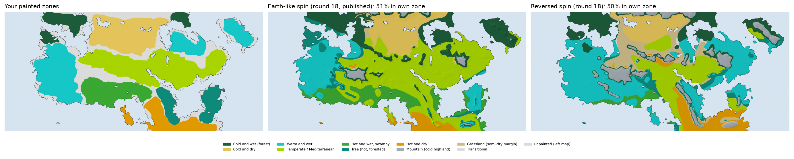
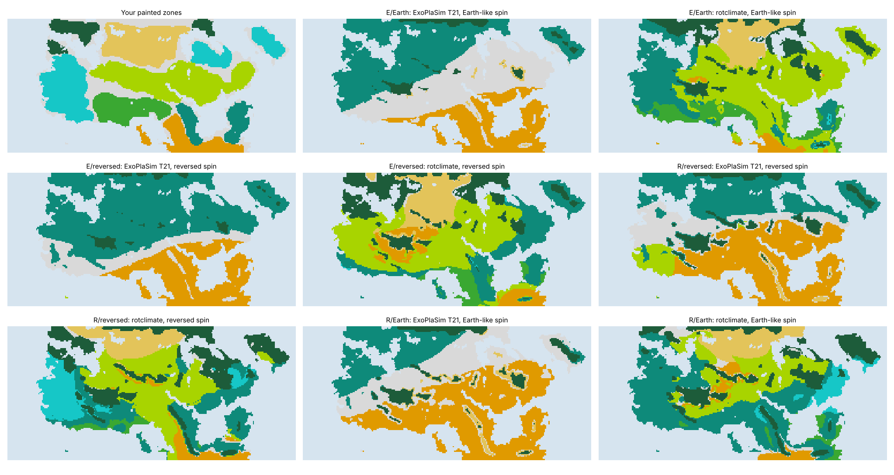

# rotclimate: a climate simulator for a hand-drawn world

**r40 adopted, 30 October 2026:** tracing North India's errors (256 mm of
rain against 761) against reanalysis showed the model's circulation is the
main gap: with observed surface winds North India gets 933 mm. Three new
physical rules, all using only what an invented map has, follow from that
diagnosis. Monsoon westerlies turn cross-equatorial trades where the model's
own pressure falls poleward. Warm currents stay off shallow shelves (East
Asia's seas were 3–5 °C too warm in spring). The sea's column cannot hold
more water than the cold air above it (winter columns were up to 1.85× the
reanalysis). After two frozen refits that each failed one region group, the
third passes every check: 31-region S **0.9932** (rain loss −2.1 %,
temperature +0.8 %, inside the 1 % allowance, every group better), 28 km
0.9953, and the sealed six, run once, **0.9671**. It is adopted as
[`r40`](calibration/local_accuracy_20261023/r40_params.json). North India's
rain rises to 373 mm, but its temperature and the winter-rain coasts
(California, Iberia) get slightly worse. Summer rain, still 0.5–0.8×
observed almost everywhere, is now the largest systematic gap. The invented
world and atlases are unchanged until a world refit on r40. See the
[physics-gap report](reports/PHYSICS_GAPS_20261030.md). A follow-up
[summer-rain diagnosis](reports/SUMMER_RAIN_20261030.md) traces the humid
summers' deficit to columns 10–22 % short of water, beginning over the sea;
adding sea water (e59, a frozen refit) or slowing the sea does not beat r40.
Capping the eddies' humidity (e38b) with more land water passes the
development gate and the 28 km check (S 0.9946) but makes the six sealed
regions 1.35 % worse, and a cold-air-only version (e60) 4 % worse (it
removes the north-east US's winter snow), so neither is adopted. Both Earth
correction stages are retrained on r40 (31 regions held out: temperature
1.81 → 1.55 °C, rain loss 0.433 → 0.420; see the
[correction report](reports/EARTH_CORRECTION_20261030.md)). Since a release that is better on the Earth
test updates the atlas, the Earth-fit atlas now runs r40 physics on the
published world's geometry, with FORGE foraging, politics, trade and its
Fit-check diagnostics rebuilt; it fits the painted zones slightly less well
than r38 did (zone objective 0.180 against 0.183). The hosted claude.ai
copies of all three atlases and the hub are republished with every current
feature ([atlas report](reports/ATLAS_R40_20261031.md)).

**Earth corrections, 30 October 2026:** two new output stages learn r39's
repeatable errors from the 31 Earth regions, using only inputs every map has.
Scored with whole geographic clusters held out (the Earth stand-in for an
unseen invented continent), monthly temperature error falls 1.79 → 1.54 °C
(14 km, the atlas scale: 1.91 → 1.29 °C; sealed regions 2.62 → 2.14 °C), mainly
fixing a month-late season on maritime westerly coasts. A local rain pattern
driven by the simulated wind over the terrain (windward slopes, rain shadows)
lowers the rain loss 0.442 → 0.428, every group improving; regional rain
amounts are left to the physics because no correction of them transferred.
Some regions, the seasonal range and fine-grid Köppen main groups get worse.
r39 physics and the published atlases are unchanged. See the
[correction report](reports/EARTH_CORRECTION_20261030.md) and [handoff](HANDOFF.md).

**Terrain side project:** a [source audit and constrained-generation plan](reports/CONSTRAINED_TERRAIN_FEASIBILITY_20261026.md)
shows the existing ramps/rivers and explains how tier-respecting ridges, valleys
and drainage could be generated without conditioning on painted climates.
The baseline illustration is an audit, not a newly generated/adopted DEM.

**Two-branch and terrain-tracer development,26 October2026:** three completed
fixed pilots add133 passing regional integrations. Separate moist inflow and
upper return restore monsoon supply; a common-mass correction preserves uniform
mixing ratio over terrain. North India local monthly error reaches43.7mm versus
r39’s50.0mm, but coastal regressions still reject all profiles. Higher rain
thresholds also fail. Seven new figures/maps and all safeguards are on the
launcher accuracy page. See [mass-aware transport](reports/MASS_TRACER_20261026.md)
and [rain thresholds](reports/HUMIDITY_GATE_20261026.md). A separate bounded
shared-wind design keeps the planet Earth-like and every accuracy gate intact.

**Mass-consistent column experiment,26 October2026:**49 strict solves test
whether divergent surface-like transport causes wet coasts. The new closure
substantially improves several regional rainfall errors, but loses the Indian
monsoon; no profile passes all safeguards. A reference-only comparison confirms
that pressure-mass and humidity-weighted winds are different targets. Three new
plots/maps and all results are on the launcher accuracy page; see the
[column mass report](reports/COLUMN_MASS_20261026.md) for the next two-layer design.

**Thermal-wind development,26 October2026:** a fixed42-run experiment tests
physical vertical shear with unchanged Earth planetary settings. Native-grid
wind errors improve in India/Australia, but rain remains misplaced and wet-coast
errors persist. No candidate qualifies; r39 physics and the r38 world Earth
atlas stay adopted. See the [thermal-wind report](reports/THERMAL_WIND_20261026.md)
and three new plots in the launcher’s accuracy page.

**Outside circulation check,26 October2026:** four exact r39 controls now compare
wind vectors against native-grid NCEP reanalysis. Direction and vertical-level
differences remain substantial, especially over subtropical lowlands; this is
an external diagnostic, not an adopted rainfall gain. New seasonal charts and
winter maps are in the launcher accuracy page and [circulation report](reports/CIRCULATION_20261026.md).

**Observation-calendar audit, 26 October 2026:** an optional evaluation helper
aligns unchanged Earth step series with non-leap calendar months, including the
southern mirror. Four exact controls pass; rainfall MAE changes only0.02–0.12mm
and temperature MAE slightly worsens. Annual rain is preserved. This audit
changes no physical fit, benchmark default or headline score. See the
[calendar report](reports/EARTH_CALENDAR_20261026.md) and launcher accuracy page.

**Conservative vapor transport, 26 October 2026:** the opt-in flux equation
has shared-face accounting and a checked regional water ledger. In a frozen
35-attempt pilot it raises North India rain from256 to482mm/year, closer to761
observed, but over-wets several other regions and fails four nonlinear solves.
It is rejected; defaults, qualified r39 physics and all atlas climate fields
remain unchanged. The launcher's accuracy page shows successful and failed
comparisons. See the [vapor-flux report](reports/VAPOR_FLUX_20261026.md).
The separate 42-run [column-wind follow-up](reports/FLUX_COLUMN_WIND_20261026.md)
converges everywhere with lower damping and unchanged residual tolerances,
but still fails the physical accuracy guards. The accuracy page now has a
short experiment index and newest-open collapsible sections, with seven
figures and six measurement downloads. All 106 focused checks pass.

**Momentum experiments, 26 October 2026:** column-pressure shear completed 28
verified runs but worsened the Indian monsoon. A separate 124-run surface-drag
experiment improved average rainfall loss by 1.54%, yet failed the declared
Mexico/Pacific NW protections. Neither changes adopted physics or atlas climates.
The launcher's **Climate accuracy and joint fit** page now shows both results,
charts and downloads. See the [shear](reports/COLUMN_SHEAR_20261026.md) and
[surface momentum](reports/SURFACE_MOMENTUM_20261026.md) records.
The subsequent 155-run land/ocean and pressure-balance test also fails the
complete regional protections. A hard-constrained response-hull check finds
no eligible interpolation, generates no candidate and runs no extra climate.
See the [momentum balance report](reports/MOMENTUM_BALANCE_20261026.md).
`python -I scripts/prepare_woa18.py --download` prepares the complete monthly
ocean reference for scientific checks; its default is read-only verification.

**Joint-fit input separation, 26 October 2026:** new constrained experiments can
compose shared physics with separate Earth and invented-world inputs. Fantasy
solar flux, greenhouse forcing and radius cannot leak into Earth, and stale
world profiles cannot relax the numerical checks. Rainfall diagnostics now
expose column drying and convergence import without changing climate output.
See the [input-boundary report](reports/JOINT_INPUTS_20261026.md). This prepares
experiments; it is not a new fitted climate or an adoption gate.
The completed [moisture-source audit](reports/MOISTURE_SOURCES_20261026.md)
reproduces all three r39 controls exactly. Open **Climate accuracy and joint
fit** from the `.bat` launcher hub for measured errors, rainfall-source maps
and the distinction between r39 Earth skill and the published r38 world.

**Seasonal repeatability, 26 October 2026:** optional multi-year spin-up now
checks repeated temperature, rainfall and water-reservoir cycles, and long
warm-ups wrap the calendar safely. A 15-run controlled pilot reproduces all
five legacy controls exactly; the published world's largest monthly rain
change is only 0.039 mm. Defaults and published climate data remain unchanged.
The normal Earth atlas links its initialization check under Fit checks.
See the [seasonal-cycle report](reports/SEASONAL_CYCLE_20261026.md).

**Current development, 26 October 2026:** Earth r39 physics passes the 31-region,
paired 28 km and established-six checks. Its regional rainfall loss is 2.30%
lower than r38; city monthly errors improve, but annual matches slightly worsen
and North India remains a major weakness. See the
[r39 calibration report](reports/CONSTRAINED_BLEND_R39_20261025.md).
The normal Earth HTML atlas retains verified r38 world fields: subsequent r39
world refits improved some averages but failed regional or layout-uncertainty
protections. Its new Fit-checks maps show rainfall and temperature sensitivity
to nine hypothetical surroundings, with CSV downloads. These are conditional
boundary sensitivities, not total climate-error estimates. A fitted Earth
parameter set and a published fantasy-world atlas are separate milestones.

All three `.bat`-served atlases include directed trade, three Trade views,
continuous outlined sea routes, political reach, farming and population maps.
The [trade report](reports/DIRECTED_TRADE_20261025.md) and
[current handoff](HANDOFF.md) record the publication state.

**Rainfall priority, 23 October 2026:** Earth calibration now has a rainfall-only
objective, with explicit local annual and monthly error diagnostics. The
[rainfall accuracy report](reports/RAINFALL_ACCURACY_20261023.md) records the
current measured errors and the selection criteria for the new bounded search.

**Climate development, 23 October 2026:** an opt-in conservative storm-water
scheme now has explicit internal and boundary accounting. The first Earth
pilot establishes conservation but needs retuning before atlas promotion.
New calibration CLI runs score the same averaged climate fields that an atlas
publishes (`--ensemble-objective climate`, no racing); `scores` reproduces the
historical layout-score average. See the [physics and calibration report](reports/CLIMATE_PHYSICS_20261023.md).

**Updated 22 October 2026:** the [comparison hub](atlases/index.html) now includes
complete free-fit, Earth-fit and separate Whittaker-fit atlases, using the same
three surroundings layouts and required recorded numerical convergence checks.
The bounded searches completed all 59 candidates. Earth r29 physical constants
remain fixed. Read the [three-fit report](reports/THREE_FIT_20261022.md) for the
score definitions, tradeoffs and numerical evidence.

The current Whittaker atlas has **1.44%** of mapped land outside the original
biome diagram, compared with **8.52%** before the coverage guard. Its strict
biome objective is 0.5257. The envelopes and classifier are unchanged. Climate,
farming, population and animation assets are complete, with required numerical
checks. The earlier [coverage comparison](output/whittaker_coverage_20261022/coverage_comparison.png)
and [iteration report](reports/ITERATION_20261022.md) describe the initial guarded
refinement; the current packet and comparison hub contain the later fit.

The Harvest features are integrated into every atlas: farming, crop choices,
grazing, irrigation, productivity, malaria potential, place cards, provinces,
campaign-sheet comparisons and CSV downloads. Overview adds a combined
settlement-potential index and expected population density for low-input
technology around 200 AD. Choose frontier, central or settled-core occupation
and environmental malaria or no malaria penalty. These are explicit scenarios,
not reconstructed censuses or a validated demographic forecast. The
[Harvest method](reports/HARVEST_MIGRATION_20261022.md) documents FAO crop-water,
Mordecai malaria and other published components alongside the assumed coefficients.

The Population topic adds six maps for a supplied census: allocated residents,
population pressure, spare support, redistribution, walking to markets and
settlement attraction. Choose a total and pattern; province totals and CSVs
follow that choice. Local support limits hold, with any excess reported as
unallocated. The [population lab report](reports/ITERATION_20261023.md) explains
the HYDE-inspired allocation and Tobler walking components.

The map selector shows one of ten topics at a time. Free fit has 53 layers;
Earth has 55 including surroundings sensitivity, and Whittaker has 55 including
proposed biome targets and match.
All retain monthly climate maps, seasonal animations, potential biome diagrams,
climate analogues and 152 named places. The strict biome crosswalk is an
alternative hypothesis; annual biomes do not guarantee Mediterranean summer
drought or swamp hydrology. See the [original crosswalk pilot](reports/WHITTAKER_TARGETS_20261022.md)
and [biome methods](docs/BIOMES.md).

To browse, run:

```sh
python3 scripts/serve_atlases.py
```

With Python 3 installed, you can also double-click `start_atlases.bat` on Windows
or `start_atlases.command` on macOS. Keep the terminal open while browsing.
The launcher needs only Python's standard library. All three complete atlas
data folders are committed, so a fresh clone works without installing or running
the simulator. Opening `index.html` directly through `file://` cannot reliably
load the data. The extracted portable bundle uses the same launchers.
Share the atlas URL to preserve the selected layer and population scenarios;
switching fits also carries those choices across.

The launcher serves the files beside it; it does not download updates. It now
prints the served folder and each atlas's outside-diagram percentage. If an old
Windows copy still shows 8.5% for Whittaker, update the complete checkout from
`claude/friendly-turing-43ygeu` or extract the new portable bundle into its own
folder, close the old atlas window and launch that folder's `start_atlases.bat`.
The loaded-data line should show **1.44%**. `python3 scripts/serve_atlases.py --check`
prints the folder and data versions without opening a browser.

The historical hosted [Earth test](https://claude.ai/artifact/WEDyXo2dTkSVPaPwHx5r1X),
[free-fit atlas](https://claude.ai/artifact/Ko7QGWnekU4RLhcMzVwZBY) and
[Earth-fit atlas](https://claude.ai/artifact/ABFAoyPzTuMNVWmByPxctF) predate this
campaign; those hosted copies have not been updated. The earlier
[Earth-mode report](reports/earth_mode.md) records development of the reference.
The [Ravages campaign map](https://claude.ai/artifact/6SFW2VgMuxwNUPwSLoqYdH)
plays the game's army movements, weather and economy from its master sheet
(`scripts/ravages_extract.py`, `ravages/`); the satellite-style picture of the
world is drawn by `scripts/render_satellite.py` and shown in the
[orbital view](https://claude.ai/artifact/8wc4PHmHcRX1Pctjbhx3nn) (`satellite/`).
What that climate would grow around 200 AD, and how many farmers it could
feed, is mapped in the [Ravages Harvest Atlas](https://claude.ai/artifact/JkEE3xBLsuJ2WgqL8p3Bns)
(`land/`; method and its checks against Earth's populations of the period
and against the campaign sheet in [reports/land_people.md](reports/land_people.md)).
The workflow is to check model changes on Earth, then fit the invented world
freely and with Earth physics held fixed. The older joint fit (e1), its
Earth-physics atlas and the old live atlas are retired.

**Previous handoff (16 October 2026):** Start with the
[project handoff report](reports/HANDOFF_20261016.md).
The latest V10 transport comparison stopped for diagnosis after 6/8 cases;
the V9 retrograde atlas remains unchanged. The report includes verified results,
frozen evidence, user-run-only simulation rules and next development priorities.
The older development notes and render commands below are historical.

A physically based seasonal climate model for a 2287 × 1058 mile hand-drawn
map (pointy-top hexes with 15-mile sides). The model reads the map's layers (coast, height tiers, rivers, place
names) and runs a year of weather in 73 five-day weeks on the local calendar.
A calibrator then searches for what the map doesn't say — latitude, axial
tilt, spin direction, how high the tiers are, and what lies beyond the edges —
until the simulated climate reproduces the painted target zones.

**Development update (13 October 2026):** Round 19's poor fine-grid atlas was
mostly caused by loose linear-solver stopping. User-run checks with tighter
solves give 43.65% / 43.78% coarse/fine accuracy on the same surrounding world.
The fine-grid verification completes all solves successfully. The exact tested
settings are saved in `calibration/round19_earthlike_strict.json`; this is the
round-19 physical fit with verified numerics, not a new calibration. To regenerate:

```sh
.venv/bin/python -m rotclimate render --params calibration/round19_earthlike_strict.json --saved-numerics --out output --atlas
```

This uses the tested 25-step configuration. See
[`reports/round19_diagnosis.md`](reports/round19_diagnosis.md) for the investigation.
The historical round-18 results below have not been rewritten as round-19 results.

## Results

**Interactive atlas (round 19, retired; see the free-fit atlas above):**
Zoomable map layers (Köppen, your zones, the simulated climate in your zones, match accuracy,
temperatures, precipitation). Click any place for its climograph in the local calendar and its
closest real cities. Search a town on the map, or a real city to see outlined where on the map
feels like it (the magnifier button shows or hides the search box). The copy button puts the
current view (zoom, outlines, names and all) on the clipboard as an image. Your settlement markers
(`data/source/settlements.png`, lossless) are drawn as vector pixel art, every pixel an exact square,
so they stay sharp at any zoom; the "Towns and names" toggle shows them with the place names.

In the simple-zones map, land that fits none of your seven zones is named for what it is:
*Mountain* (cold highland: above ~2,200 m or summers below 15 °C), *Grassland* (a semi-dry margin
between the wet and dry zones) or *Transitional* (humid, but between two zones' rules).


### What the world must be like (best calibration, round 18)

| unknown | best fit |
|---|---|
| spin | **Earth-like**, on the pre-declared test (see below) |
| latitude | 29.4°N to 44.7°N (centre 37.1°N) |
| axial tilt | 17.0° (Earth 23.4°) |
| height tiers | lowland ≤ 51 m, hills ≤ 251 m, upland ≤ 564 m, peaks to 2,697 m |
| land beyond the map | north-west and north-east ~100%, west 35%, east 34%, south-west 35%, south-east ~100% |

**Spin: Earth-like spin now wins, on both measures.** Until round 15 reversed spin led (0.427
against 0.421). A literature review (`reports/Climate simulator improvement literature.md`) then
turned up two things. First, the score alone could not separate the spins: re-scored on
surroundings the search never saw, the gap shrank to 0.004 with an uncertainty range that
included zero. Second, reversed spin was getting its fit partly from **summers no wet place on
Earth has**. On Earth, where the warmest month brings 80 mm of rain or more, the lowland passes
30 °C on only 2.8% of the land; the reversed-spin world did so on about half of it (swamp 32.6 °C,
against 28–29 °C on the Gulf Coast). The model now lets wet ground spend summer sunshine on
evaporation (physics v8), the score penalises humid summers hotter than Earth's, the swamp rule
needs a hot year as your legend says, and both spins search the same physically set box.

Each spin was then recalibrated on equal terms, and its three best candidates re-scored on 60
fresh surrounding worlds, with a ±0.01 "tie" band declared in advance. Round 17 held the sea and
land temperature offsets within ±2 °C; round 18 polished both fits with the same pattern search
after a sensitivity screening found one-setting improvements CMA-ES had missed:

| on 60 fresh worlds | reversed spin | Earth-like spin |
|---|---|---|
| round 16: fit score | 0.394 | **0.422** |
| round 17 (offsets within ±2 °C): fit score | 0.390 | **0.417** |
| round 17: painted land in its own zone | **51.1%** | 47.7% |
| **round 18 (both polished): fit score** | 0.405 | **0.435** (gap 95%: 0.010–0.049) |
| **round 18: painted land in its own zone** | 50.6% | **52.2%** (ahead on 40 of 60 worlds) |
| round 18 world | 26.7–42.0°N, tilt 20.8° | 29.4–44.7°N, tilt 17.0° |

The two spins still get different parts of your map right. In the score's strict count the
big west coast is warm-wet for 53% of it with reversed spin and for none with Earth-like spin,
where the forest rule fits a shade better (on the maps, which like the atlas give the forest rule
slightly less weight, the Earth-like west coast does show as warm-wet). Reversed spin also gets
the cold north-west and the hot-dry south-east better. Earth-like spin gets the Mediterranean band (90% against 41%), the swamp (50% against
19%) and the forest better, and on the rule-by-rule fit it now matches the warm-wet coast almost
as well (F1 0.56 against 0.58). A full 3-D climate model run on both (below) adds one point for
reversed spin. Both parameter sets are kept: `calibration/round18_earthlike.json` (published) and
`calibration/round18_retrograde.json`.



**Map orientation.** Physics v9 lets true north point in any direction. The improvement log
records a screen at 30° intervals under both spins, with north-up fitting best. The detailed
screen outputs were not included in this handoff, so that result cannot be audited here.
Round 19 leaves orientation free while recalibrating under the corrected zone rules.

### Independent check: a full 3-D climate model (ExoPlaSim)

rotclimate is fast because it parameterises the winds; ExoPlaSim (Paradise et al. 2022) is a
real general-circulation model that computes them, with no knowledge of your painted zones. It has
no reversed-spin switch, but reversed spin is the same physics as Earth's spin on the east–west
mirrored map, so each calibrated world was run four ways: as calibrated, and with the other spin.
Setup: T21 grid (your continent is only about 5 × 3 cells), 50 m slab ocean without currents, an
ozone layer and Earth's CO2, each world's own tilt, run until the planet's energy budget balanced
(global means 17–21 °C), last 10 years averaged (`scripts/exoplasim_*.py`, results in
`output/exoplasim_check.json`).



At this resolution ExoPlaSim puts a broad subtropical desert over the whole southern half of the
continent under either spin, so it cannot judge your wet/dry layout (rank agreement with your
zones' wet-to-dry ordering is about zero for every run). What it does show, in both worlds, is
where summers are dry. Agreement between summer dryness and your painted Mediterranean band:

| | Earth-like spin | reversed spin |
|---|---|---|
| Earth-like world (tilt 17°, 29–45°N) | +0.08 | **+0.38** |
| reversed-spin world (tilt 21°, 27–42°N) | +0.23 | **+0.54** |

Reversed spin puts the dry-summer belt where you painted the Mediterranean band, by about the same
margin (+0.3) in both worlds, so the difference comes from the spin itself rather than from tilt,
latitude or surroundings. That is one independent point for reversed spin, from a model that never
saw the painting. Together with rotclimate's own results, the balance is: rotclimate prefers Earth-like spin on
both measures after equal polishing; the Mediterranean placement in ExoPlaSim and the literature
on retrograde Earths lean reversed. The runs above used the round 17 worlds.

### Match with the painted zones (14 km render, round 18, Earth-like spin)

Each zone is judged two ways. **Coverage**: how well the painted area meets the zone's climate
rule (0–1). **Precision**: how much of the rule's area lies inside its own painted zone, rather
than spilling into areas painted as something else (ridges above 1,500 m don't count as spill;
a broader zone may hold inside a narrower one it contains, as forest inside swamp). **F1**
balances the two. *Correct* is the share of painted land whose single best-fitting zone is its own
(a place meeting the swamp rule counts as swamp).

The swamp rule asks for a hot, very wet climate **on flat ground** with a **hot year** (mean
annual above ~21 °C): your painted swamp gets the same rain as the warm-wet coast but is about
five times flatter (median slope 0.7 vs 3.4 ‰), and waterlogged lowland is what makes a swamp
(Everglades, Pantanal, Gulf Coast bayous). Heat is what the legend's "Hot and wet" adds to
"Warm and wet"; drainage measures from the wetland literature can't tell the two apart on four
flat height tiers.

| zone | coverage | precision | F1 | correct |
|---|---|---|---|---|
| Cold and wet | 0.47 | 0.23 | 0.31 | 48% |
| Cold and dry | 0.31 | 0.79 | 0.45 | 20% |
| Warm and wet | 0.49 | 0.67 | 0.56 | 0% |
| Mediterranean | 0.69 | 0.41 | 0.51 | 89% |
| Hot and wet, swampy | 0.46 | 0.47 | 0.47 | 50% |
| Tree (forested) | 0.78 | 0.28 | 0.42 | 41% |
| Hot and dry | 0.47 | 0.75 | 0.58 | 45% |
| **overall** | **0.53** | | **0.45** (objective) | **42%** |

These use the Köppen-consistent zone rules (after round 18; see below), with round 18's
parameters, which were calibrated on the old rules: round 19 is the pending recalibration.

**Zone rules now follow Köppen.** Until round 18, *cold and dry* took any place with cold
winters and rain below 1.3× Köppen's dryness threshold, so dry-summer continental **Dsa** (not a
dry climate in Köppen) counted as cold and dry: 54% of the simulated cold-dry land was Dsa. Now
cold-and-dry is BSk/BWk and hot-and-dry BSh/BWh (Köppen's dry climates, split at its own 18 °C
line), the Mediterranean zone is Cs (Csb as well as Csa), and a place's label can only be a zone
its Köppen class allows. Your painted cold-dry north is mostly Dsa in the simulation, so it now
reads mostly as the semi-dry margin (52%) instead of cold and dry: the calibration has to make it
genuinely drier to match.

(it00, the Earth-like first guess: coverage 0.17 and 9% correct.)

Where it still falls short:
* **The cold-dry north** is simulated as dry-summer continental (Dsa), just too wet for a Köppen
  steppe; under the corrected rules only 20% of it reads as cold and dry.
* **The warm-wet west coast** meets its rule fairly well (F1 0.56) and shows as warm-wet on the
  maps, but in the score's strict count the forest rule fits it a shade better everywhere, so it
  counts as forest (53%) or cold-and-wet (24%). Reversed spin counts 53% of it as warm-wet and
  loses elsewhere (see above).
* **Forest and cold-and-wet** climates spill beyond their painted areas (precision 0.28 and 0.23).
* Humid summers are now Earth-like (4% of the wet-summer lowland passes 30 °C, against 2.8% on
  Earth and about 50% before round 16).

The maps are simulated on 14 km cells, the same grid rounds 11–18 were calibrated on. Since the
time-step fix (see `docs/ITERATIONS.md`), the calibration's 25 steps a year and the maps' 73 give
the same climate. All map layers are drawn at 3× resolution with full-detail terrain.

### Maps and GIFs (`output/`)

`simulated_zones.png` · `koppen.png` · `comparison.png` · `world_context.png` · `temperature_*.png` ·
`precipitation_annual.png` · `atlas_temperature.png` · `atlas_precipitation.png` ·
`climographs.png` (with "feels like" cities) · `insolation.png` · `year_temperature.gif` ·
`year_precipitation.gif` · `spin_flip.gif` · `tilt_sweep.gif` · `surroundings.gif` · `improvement.gif`


**Real-world analogues ("feels like").** The reference set is every city of 50,000+ people and
every national capital (GeoNames; suburbs within 15 km folded into the bigger city): 8,468
cities. Each has monthly normals from WorldClim 2.1 (1970–2000), corrected to the city's own
elevation. Another 472 official WMO weather stations cover remote places no city does
(mountains, islands, polar and desert outposts). Checked against the official WMO station
normals for 1,262 cities with a station within 10 km, the monthly temperatures differ by a median
of 0.54 °C (90% under 1.24 °C) and annual rainfall agrees to within ±20% for 80% of them.

Both the map place and each real place are reduced to 12 months aligned on the winter solstice
(southern-hemisphere places shift half a year). Then

    d = RMS(monthly temperature difference) / 2.5 °C + RMS(difference of √monthly rain) / 2
    match % = 100 · e^(−d/2)

so 100% is identical, and every 2.5 °C off in a typical month (or rain off by 2 √mm, e.g. 100 vs
144 mm) multiplies it by 0.61. The temperature term compares **daily highs and lows**, not just
means: RMS(ΔT)² = mean over months of (Δhigh² + Δlow²)/2 = Δmean² + Δswing²/4, so a day/night swing
4 °C wider counts like a month 2 °C warmer.

**Day/night swings.** The climate model works in daily means, so the map's day/night range is
learned from Earth: WorldClim monthly mean daily highs minus lows at 100,000 land cells, as a
function of what the model does compute (monthly and annual rain, monthly temperature and its
seasonal departure, annual temperature range, elevation, distance from the sea, latitude), by
nearest-neighbour regression (`rotclimate/diurnal.py`). Tested on whole continents it never saw,
it explains about half the variation, with a typical error of 1.8 °C in the range (about ±0.9 °C on
highs and lows): deserts and continental interiors swing 14–18 °C, rainy coasts 5–8 °C. The real
places' highs and lows come from WorldClim (cities) and the WMO normals (stations), which agree to a
median of 0.0 °C. In the atlas the climograph's band is the average daily low to high. The square root makes 10 vs 40 mm count about as much as 100 vs
160 mm. A result list never shows two places within 100 km of each other, and each match shows
its typical monthly temperature and rain difference in plain units.
Place names come from your hex-grid list (`data/hex-names.csv`), placed by `scripts/hex_places.py`.

## Quick start

```bash
pip install -r requirements.txt
scripts/make_all.sh calibration/best_params.json          # every map, GIF, chart + atlas data
python -m rotclimate render --params calibration/best_params.json --out output
python -m rotclimate score  --params calibration/best_params.json
python -m rotclimate calibrate --physics v4 --objective balanced --seeds 1,2 \
       --start calibration/best_params.json --out calibration/my_run --evals 600
python -m rotclimate.experiments tilt --params calibration/best_params.json --out output/tilt_sweep.gif
python scripts/fetch_wmo_normals.py      # official WMO station normals (needs worldweather.wmo.int)
python -I scripts/build_reference.py .   # city reference set; first download into data/cache/:
python -I scripts/build_dtr_model.py .   # day/night range model (data/dtr_knn.npz)
#   geonames/  cities15000.zip, admin1CodesASCII.txt, countryInfo.txt  (download.geonames.org/export/dump/)
#   worldclim/ wc2.1_5m_{tavg,tmin,tmax,prec,elev}.zip                   (geodata.ucdavis.edu/climate/worldclim/2_1/base/)
python -m pytest -q                      # fast checks (calendar, Köppen, solver, hydrology, end-to-end)
# ExoPlaSim cross-check (optional; needs gfortran, OpenMPI, and exoplasim + netCDF4 + meson + ninja in
# their own virtualenv; run `python -c "import exoplasim; exoplasim.compile_pyfft()"` there once)
python scripts/exoplasim_export.py calibration/round17_retrograde.json --res T21 --mirror --out exo/retro --name retro
venv/bin/python scripts/exoplasim_run.py --sra exo/retro --name retro --res T21 --tilt 20.82 --ozone --years 60 --balance 0.4
python scripts/exoplasim_compare.py R=calibration/round17_retrograde.json:exo/retro:retro --res T21 --years 10 --out out.png
```

To view the interactive atlas locally, run `python -m http.server -d atlas` and open
http://localhost:8000.

A full-resolution render (7 km cells, 73 weeks) takes a few minutes on 4 cores.
The 28 km grid used for calibration simulates a year in about 1 s.

## Repository layout

| path | what |
|---|---|
| `data/source/` | your five map layers (elevation, rivers, target climate, roads, labels) |
| `data/places.csv` | place names with their pixel positions (transcribed from the labels layer) |
| `data/real_cities_worldclim.csv` | 8,468 real cities with monthly normals, the "feels like" reference (`scripts/build_reference.py`) |
| `data/dtr_knn.npz` | Earth-trained day/night range model (`scripts/build_dtr_model.py`) |
| `data/real_cities_wmo.csv` | official WMO station normals: remote reference places and the cross-check (`scripts/fetch_wmo_normals.py`) |
| `rotclimate/geography.py` | layers → model grid, tier elevations, target masks, procedural surroundings |
| `rotclimate/astronomy.py`, `ebm.py` | sunlight for any tilt; planet-wide seasonal energy balance |
| `rotclimate/model.py`, `solver.py` | the 2-D seasonal model (winds, temperature, moisture, rain, snow) |
| `rotclimate/koppen.py`, `score.py` | Köppen–Geiger classes; fuzzy scoring against the painted zones; river check |
| `rotclimate/analogs.py` | real-world "feels like" matching on solstice-aligned seasons |
| `rotclimate/hydrology.py` | runoff, priority-flood drainage, river discharge (validated against your drawn rivers) |
| `tests/` | fast automated checks |
| `rotclimate/calibrate.py` | CMA-ES search over ~45 unknowns |
| `rotclimate/render.py`, `experiments.py`, `atlas.py` | maps, GIFs, climographs, sweeps, atlas data |
| `atlas/index.html` | the interactive atlas page |
| `calibration/` | best parameters, every round's best, iteration snapshots |
| `docs/MODEL.md` | how the physics works |
| `docs/ITERATIONS.md` | the improvement log |
| `output/` | rendered maps and GIFs |
