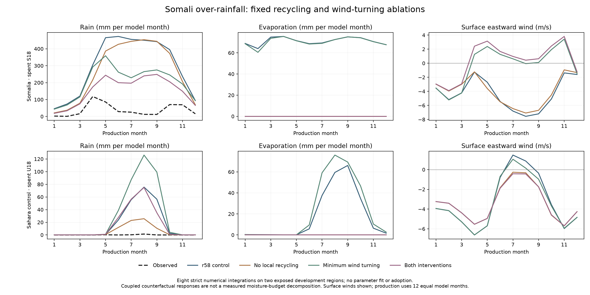

# Wind turning helps Somalia but worsens the desert control

This fixed eight-run diagnostic separates two model interventions on the
fresh r58 runtime. It supplies a next mechanism to investigate, **not an
adoptable climate**. All eight numerical certificates pass and both baseline
controls reproduce the reference cell arrays exactly.

The [plan](plan.json) was committed before the counterfactuals. Only two
already-spent development regions were used: southern Somalia `s_2n_43e` and
the hyperarid Sahara control `u_21n_21e`. No new parameter was fitted and no
unopened observation, fine-resolution result or W18c ranking was used.

## Full factorial results

Rain is the mean annual sum over the fixed scored land cells. Temperature
MAE is the mean absolute monthly temperature error, not the error of the
annual-mean temperature. The internal result key `annual_temperature_mae_C`
stores this all-month MAE; its scope is stated here to avoid that ambiguity.

| Intervention | Somalia rain mm/year | Somalia rain loss | Somalia T MAE °C | Sahara rain mm/year | Sahara rain loss | Sahara T MAE °C |
| --- | ---: | ---: | ---: | ---: | ---: | ---: |
| Observed rain | **457.4** | — | — | **2.07** | — | — |
| r58 control | 3556.4 | 3.6634 | 1.2982 | 215.0 | 1.6858 | 2.3639 |
| Land evaporative source disabled | 3155.4 | 3.2574 | 1.4421 | 72.6 | 0.7182 | 2.1495 |
| Minimum monsoon turning | 2439.6 | 2.5126 | 1.2517 | 357.3 | 2.4828 | 2.5179 |
| Both interventions | 1850.0 | 1.8672 | 1.3769 | 196.6 | 1.5699 | 2.1825 |

The evaporation intervention sets `land_recycling=0`; the turning intervention
sets `monsoon_westerly_floor=1`. They are deliberately extreme ablations,
with no search over intermediate values. The parameter named land recycling
scales the model's represented **land evaporation source**. Its removal makes
the exported land E field zero and changes the soil-water evolution through
P−E. This is not a pure change to a recycling fraction while surface
evaporation, latent cooling and soil conditions remain fixed.

## What the responses say

For these fixed interventions, annual Somali rain falls by 401.1 mm without
the land source, by 1116.8 mm with minimum turning, and by 1706.4 mm with both.
Those are 12.9%, 36.0% and 55.1% of the control's excess over observed annual
rain. They are **coupled model responses**, not measured causal shares or a
closed decomposition of the water budget. The factorial interaction is
−188.5 mm/year, so the two responses are not additive.

The wind intervention changes Somali month-7 surface eastward wind from
−6.81 to +0.63 m/s. Month-7 rain falls from 455.5 to 228.7 mm, still far
above the observed dry-season amount. With both interventions, the model
still produces 1850 mm/year, about four times observed. Correcting the
turning floor alone does not solve this rain error.

The Sahara control makes the failure mode concrete. Minimum turning raises
its already excessive rain from 215 to 357 mm/year. Disabling the land
source helps that box but still leaves 72.6 mm/year against 2.07 observed.
The combined intervention largely loses that benefit. Its factorial
interaction is −18.2 mm/year. Absolute amounts and loss are retained because
ratios to this tiny observed denominator are misleading by themselves.



## Decision

Keep the global turning floor off and retain adopted r58. The local wind
response supports investigating the regional pressure-gradient and remote
heat-low forcing behind the missing Somali circulation. A universal
minimum turning rule damages another dry region. A subsequent structural
test must distinguish those circulation regimes using physical inputs,
retain desert controls, and pass the full development/fine/sealed sequence.

The remaining rain after both ablations also needs a process-level check:
surface wind alone does not establish the moisture-transport wind, and
rain minus evaporation alone is not an audited advective flux. Existing
model trace hooks can examine transport winds, condensation drivers and
moisture forcing without changing the physical model or shared caches.
Do not infer a complete atmospheric water budget from this experiment.

W18c continues independently on its committed budget and gates. This
diagnostic does not select or retune its finalist. No physical source file,
published atlas, adopted parameter set or sealed-AA status was changed.

## Checks and reproduction

The producer preserves all 12 production months, including months 3, 5, 7
and 10. Its monthly integration uses the production convention of 12
equal-length model months, not a 30.4-day approximation or Gregorian month
lengths. The independent review checks 672 scalar monthly values against
the saved fields, eight numerical certificates, both exact reference
controls, the factorial interaction and source identities. The figure was
visually inspected.

```sh
.venv/bin/python scripts/somalia_mechanism_diagnostic.py
.venv/bin/python scripts/review_somalia_mechanism.py
```

Completed receipts are preserved; those commands refuse to overwrite the
completed producer or review. The full monthly table is
`output/somalia_mechanism_20261126/months.csv`.
