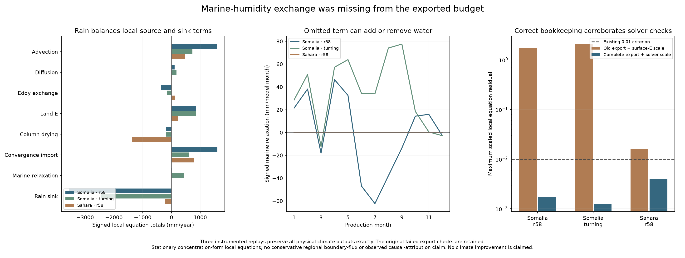

# Missing marine exchange explains the exported budget gap

The existing solver's numerical certificates are corroborated once the
exported local equation includes its onshore marine-humidity relaxation and
uses the solver's actual net-source normalization. **No temperature, rain,
evaporation, water or wind output changed.** This corrects diagnostic
bookkeeping; it does not improve the simulated climate.

The [original three-replay plan](plan.json) was committed before tracing.
Its physical replay checks passed, but its exported equation checks failed.
Those results remain unchanged under
`output/somalia_transport_trace_20261126/`. Source inspection identified
the omission, and the separately committed
[follow-up](marine_exchange_followup.json) permitted exactly three additional
instrumented replays of the same cases. All six integrations used already
completed parameter settings; no new candidate or observational target was
introduced.

## The defect and the correction

The e91 onshore-inflow branch adds a land relaxation rate to `lamE` and a
marine-humidity target. The moisture solver includes
`lamE * (target_water - column_water)` in its source. Over land, however,
the result's E field contains only represented land evaporation. The
downstream budget export used that E field and omitted the additional
marine term. The relaxation can supply **or remove** water.

A process-local wrapper calls the unchanged solver and captures that term
directly from its arguments and returned water; it is not inferred by
negating a budget residual. Frozen r58 has `ocean_sink=1`, so the supplied
exchange coefficient is also the coefficient used by the solver. The
wrapper records the exact total net source and global residual certificate,
then restores the original function.

The original diagnostic also divided by surface E rather than the solver's
total net source, which includes drying and convergence import. The
corrected comparison uses the existing definition
`abs(residual) / max(rain + abs(net_source), 0.1)` and the unchanged 0.01
tolerance. In the Sahara case, the marine term is zero: its apparent failed
maximum was a normalization mismatch, not missing marine input there.

| Case | Marine relaxation, signed mm/year | Old maximum scaled export residual | Corrected maximum scaled residual |
| --- | ---: | ---: | ---: |
| Somalia r58 | −12.683 | 1.7100 | **0.001696** |
| Somalia minimum turning | +424.487 | 2.0861 | **0.001273** |
| Sahara r58 | 0.000 | 0.01635 | **0.003952** |

The nearly zero annual marine total in the Somali control conceals large
opposite seasonal responses: month 7 removes about 62 mm, while several
other months add water. Mean absolute instantaneous residuals are retained
before aggregation so those cancellations cannot establish a false pass.

## What sustains the remaining modeled rain

These are signed totals of the **local stationary concentration-form
equation**, averaged over the fixed scored land cells. They are not
conservative regional boundary fluxes or measured causal contributions.
Rain is shown as a positive sink in this table; the figure plots it negative.
Monsoon drying is already included in total column drying and is not added
a second time.

| Local term, mm/year | Somalia r58 | Somalia turning | Sahara r58 |
| --- | ---: | ---: | ---: |
| Advection tendency | +1585.3 | +724.5 | +467.3 |
| Diffusion tendency | +105.6 | +175.9 | −5.4 |
| Eddy exchange | −372.3 | −145.8 | +131.0 |
| Land evaporation | +853.0 | +847.1 | +212.8 |
| Total column drying | −194.2 | −192.1 | −1378.4 |
| Positive convergence import | +1591.6 | +605.4 | +787.7 |
| Marine humidity relaxation | −12.7 | +424.5 | 0.0 |
| Rain sink | 3556.4 | 2439.6 | 215.0 |

Turning reduces the Somali advection and convergence-import terms by roughly
861 and 986 mm/year. Marine moistening and reduced eddy removal offset part
of that reduction. The column remains much wetter than observed. Eddy
exchange is a net **removal** in both Somali annual totals, so attributing
the problem simply to excessive net eddy import is unsupported by this
diagnostic.

Surface and moisture-transport u/v match exactly in every traced scored cell
and step of all three runs. The two winds are not interchangeable for all
possible model settings, but a hidden surface/transport-wind difference is
not the explanation in these cases.

## Next work and active campaign

W18c continues unchanged. Its physical-source inventory must remain fixed
until that campaign closes. The core export omission is therefore recorded
for a subsequent bookkeeping patch; the corrected external diagnostic and
source/sink regression cases are already available. This is not a claim that
`rotclimate/model.py` has been patched during the running campaign.

The next discriminating circulation check can use existing saved wind and
land/sea fields: audit the onshore marine-relaxation gate and its relationship
to upwind sea access, alongside the positive convergence-import response.
The nearest-sea directional gate deserves testing; this trace does not prove
its geometry is wrong. Any new structural climate change needs its own
declared experiment and full gates. Keep the global minimum-turning floor
off: the preceding factorial diagnostic showed it wets the Sahara control.

## Verification

All three corrected replays exactly match the previous full monthly
T/P/E/W/u/v fields, raw trace outputs and original budget arrays. All strict
numerical certificates pass. Independent checks reconstruct the signed local
equation and 180 monthly source/residual integrals from saved arrays. Seven
targeted tests pass, including manufactured source and sink cases where the
existing nonlinear solver converges but a budget omitting land marine
exchange fails. The figure was visually inspected.

The original failed export checks and unresolved historical runtime replay
differences remain preserved; neither is relabelled as an exact historical
reproduction. All source identities are pinned. No sealed target, adopted
climate or published atlas changed.
