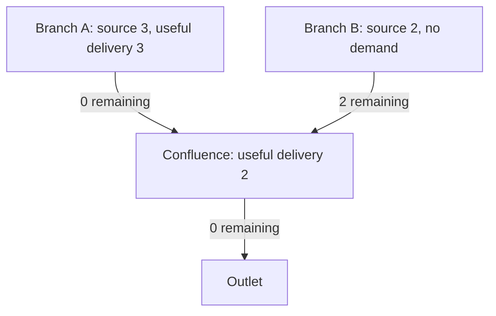

# Conserved monthly flood-water routing

`harvest.flood_water.route_water_budget` implements a water-volume ledger on a
drainage forest. It is off by default and is not connected to harvest or atlas
production. Inputs are twelve monthly **volumes in m³** at source nodes and
useful delivery demands at irrigation nodes.

The component subtracts each upstream gross withdrawal before routing the
remaining water downstream. A supplied delivery efficiency divides useful
delivery from paid loss; the default 1.0 is loss-free accounting, not an
empirical irrigation-efficiency estimate. Neither the flood-timing diagnostic
nor a terrain-area fraction is a delivery efficiency.

## Example: water cannot feed two withdrawals

Two headwater branches supply 3 and 2 m³ in one month. The first branch requests
5 m³ locally and the confluence also requests 5 m³. Upstream demand is served
first; the confluence receives only the unused 2 m³ from the other branch.



| Node | Local source | Useful demand | Water arriving | Useful delivery | Water remaining |
|---|---:|---:|---:|---:|---:|
| Branch A | 3 | 5 | 3 | 3 | 0 |
| Branch B | 2 | 0 | 2 | 0 | 2 |
| Confluence | 0 | 5 | 2 | 2 | 0 |

Sources total 5 m³, and actual delivery totals 5 m³. Summing accumulated river
fluxes as independent irrigation supplies would permit duplicate use.

With 10 m³ arriving, useful demand 3 m³ and supplied efficiency 0.5, the gross
withdrawal is 6 m³: 3 delivered, 3 lost, 4 remaining. Losses never create an
additional allowance of river water.

## Interface and invariants

```python
from harvest.flood_water import route_water_budget

result = route_water_budget(
    source_m3,       # (12, nodes), finite and nonnegative
    demand_m3,       # (12, nodes), useful crop-water demands
    order,          # distinct active nodes, downstream before upstream
    receiver,       # (nodes,), -1 at each outlet
    efficiency=1.0, # scalar or per-node values in (0, 1]
)
```

Results include node availability, useful delivery, delivery loss, remaining
downstream volume, outlet volume and unmet demand. Node availability and
downstream flux include water passing through successive nodes and must not be
summed as basin supply. Only delivery, loss and outlet volume close the basin
ledger:

`monthly source = useful delivery + delivery loss + outlet volume`.

The graph validator refuses cycles, repeated/out-of-range nodes, downstream
receivers absent from the active order, inverted drainage order, and nonzero
source or demand on inactive nodes. All monthly volumes are independent; one
outlet cannot supply another outlet's basin, and unused January water is not
automatically stored for February. Input arrays are not modified.

## Verification

```sh
.venv/bin/python scripts/review_flood_water_budget.py
```

The combined flood tests pass 37 controls, including 22 new water-budget tests.
Analytical branch/merge/loss cases, invalid graphs and volumes, monthly isolation,
rotation and scale invariance are covered. Fifty random forests check conservation
inside the test suite. A separate audit uses 200 further deterministic synthetic
forests, reconstructs incoming edge fluxes, checks every node's mass balance,
local demand complementarity, useful delivery/loss accounting and outlet totals.
Repeated outputs match exactly. [Audit receipt](../output/flood_water_budget_20261113/review.json).

## Remaining field work

The companion [field-storage experiment](../reports/FLOOD_BASIN_STORAGE_20261114.md)
now couples this ledger to finite monthly field stocks and fixed crop demand.
Its 96 Earth development scenarios retain all uncalibrated storage and loss
assumptions. It does not adopt an irrigated-area or harvest rule.

This component has instantaneous travel within each month and upstream-first
allocation. It does not infer runoff, choose crops, identify flood access, move
water from rivers to fields, retain pre-sowing water in soil, or simulate return
flows. Demand inputs need a declared aggregation and allocation policy when
multiple fields share a river node.

The Earth and fantasy adapter still needs qualified monthly runoff/discharge,
flood storage and drainage, field access and independently specified crop
calendars. The current crop optimizer has ties between fully watered seasons;
its tie policy must be explicit. Declare the field rule and test regions before
new area/capacity scoring. No Nile improvement, independent transfer or harvest
adoption follows from passing a synthetic conservation audit.
