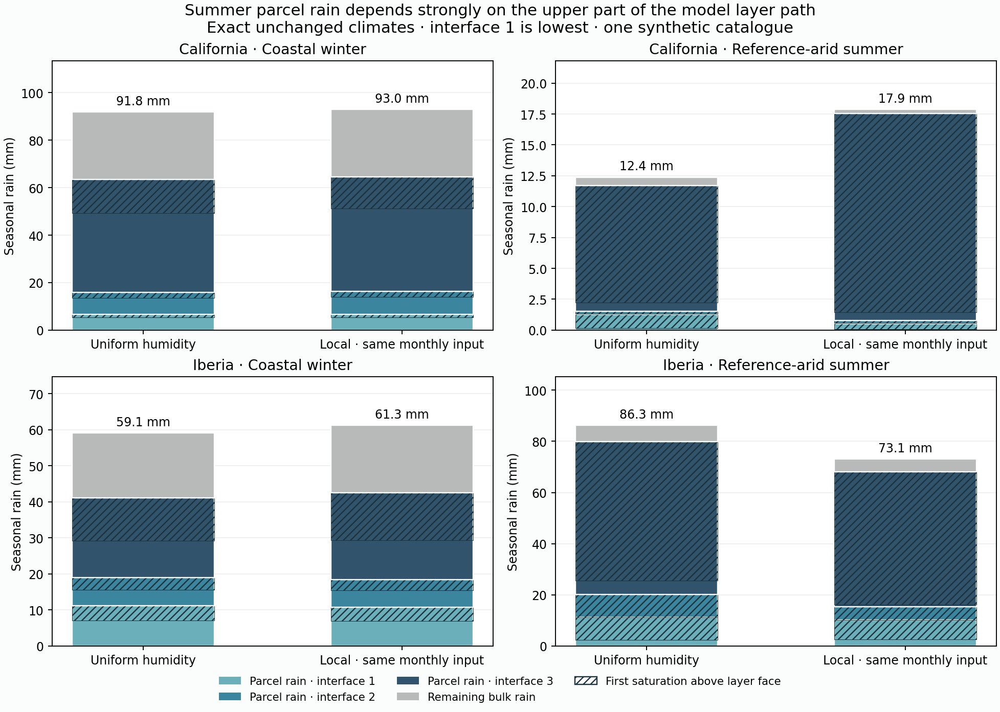

# Completed cloud-geometry diagnosis

All 4 exact final-year replays verified; 5.78 saved integration minutes. Physical arrays/ledgers reproduce, monthly actual incoming water and annual water/energy/thermal checks pass. Diagnostic layer rain, pressure weights, subsets and summaries reconcile.

| Case | Coastal winter parcel rain / total | Winter: first saturation above face | Arid summer parcel rain / total | Summer: first saturation above face | Summer: recipient pre-step RH <70% |
|---|---:|---:|---:|---:|---:|
| california_uniform | 63.40 / 91.83 mm | 28.0% | 11.70 / 12.39 mm | 92.2% | 98.3% |
| california_local_matched | 64.53 / 92.96 mm | 26.4% | 17.54 / 17.87 mm | 95.7% | 99.4% |
| iberia_uniform | 41.14 / 59.10 mm | 46.9% | 79.83 / 86.35 mm | 90.1% | 99.8% |
| iberia_local_matched | 42.45 / 61.28 mm | 47.3% | 68.08 / 73.08 mm | 94.9% | 99.8% |

## What differs between winter coast and arid summer land

In the input-matched Iberia-domain summer case, most surface rain comes from the unmixed parcel operator. Most of that parcel rain first saturates only after the true layer face, farther along the path to the receiving midpoint; almost all enters a dry pre-step environment. Winter coastal rain has a substantially smaller late-onset fraction. The same qualitative seasonal contrast occurs in California, whose reference-arid summer land is already too dry. This is a mechanism signature, not proof that all summer rain should be removed.

| Local-matched case / region | Parcel fraction of total rain | Parcel fraction at third tested interface | Rain-weighted midpoint gap | Vapor-weighted donor RH |
|---|---:|---:|---:|---:|
| california / coast winter | 69.4% | 74.8% | 191.9 hPa | 62.4% |
| california / reference_arid summer | 98.2% | 95.6% | 200.8 hPa | 32.7% |
| california / interior summer | 96.2% | 92.4% | 189.7 hPa | 36.3% |
| iberia / coast winter | 69.3% | 56.6% | 176.5 hPa | 60.9% |
| iberia / reference_arid summer | 93.1% | 77.6% | 194.8 hPa | 43.0% |
| iberia / interior summer | 87.8% | 97.6% | 214.0 hPa | 32.0% |

The separate late-onset and dry-environment marginals imply that **94.7%–94.9%** of Iberia-domain arid summer parcel rain satisfies both conditions. This is an inclusion–exclusion bound, not a stored joint histogram. Fractions refer to parcel rain, not all surface rain or the fraction of error.



## Consequence for the next mechanism test

First compare the vertical cloud path and conservative parcel/environment mixing under common manufactured forcing. The current data favor that controlled test over immediately adding a global RH cutoff or applying a buoyancy gate to all upward motion. A finite path may legitimately reach saturation inside the receiving layer, so deleting all above-face rain would not be a valid refinement test. A colder-than-recipient parcel is not a complete virtual-temperature/CAPE calculation, and mechanically forced rain need not require positive CAPE.

The research comparison identifies KiD-style prescribed-flow experiments as an appropriate method, with a possible later diagnostic rain shaft or cloud/rain stores. Winter storm forcing remains a separate open problem: these gross upward-vapor amounts can recount water and must not be interpreted as a climate rainfall ceiling. No physical proposal or atlas update is selected by this replay alone.

See [model research and proposed test sequence](../../reports/model_precipitation_research_20261016.md). Reproduce saved-only verification:

```sh
.venv/bin/python scripts/review_v10_cloud_geometry.py --write
```
