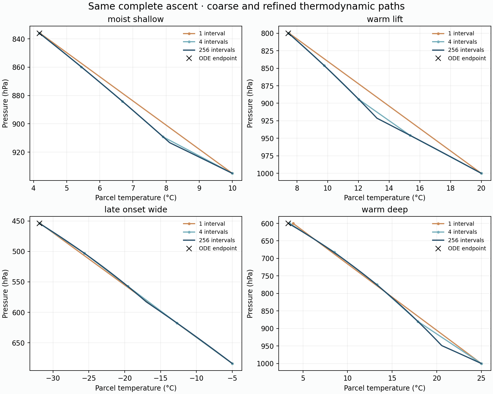
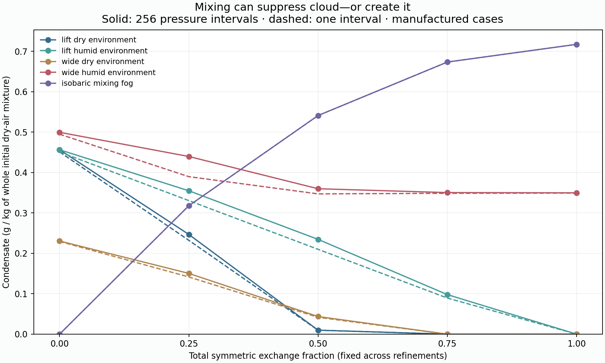
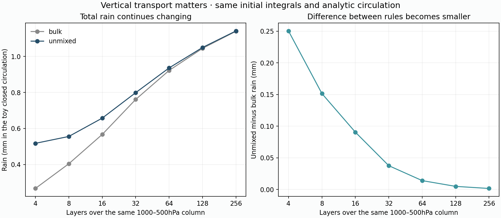
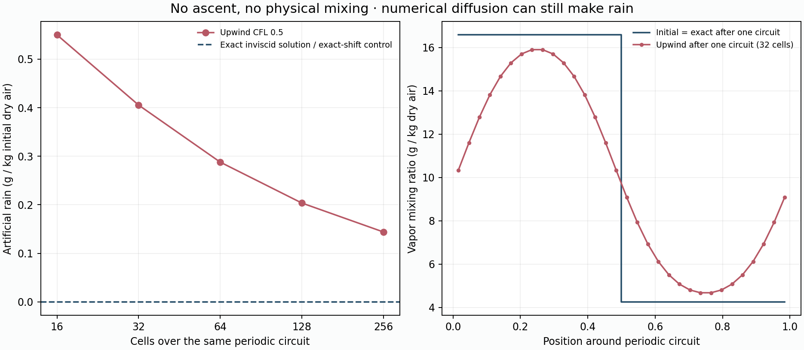

# Manufactured cloud-process laboratory

166 small parcel trajectories, 18 closed column runs and 10 periodic contact runs in 6.02 seconds. No regional climate integration or download; atlas unchanged.

## Refining the same pressure path

| Manufactured parcel | One jump | 256 intervals | Independent ODE | One-jump error |
|---|---:|---:|---:|---:|
| dry_no_lift | 0.00000 | 0.00000 | 0.00000 | zero reference rain |
| dry_shallow | 0.00000 | 0.00000 | 0.00000 | zero reference rain |
| moist_shallow | 1.24985 | 1.25816 | 1.25820 | -0.66% |
| late_onset_wide | 1.14753 | 1.15312 | 1.15315 | -0.49% |
| moist_wide | 2.63748 | 2.66375 | 2.66385 | -0.99% |
| warm_lift | 2.25601 | 2.28283 | 2.28299 | -1.18% |
| warm_deep | 7.79442 | 8.10831 | 8.10965 | -3.89% |
| zero_vapor | 0.00000 | 0.00000 | 0.00000 | zero reference rain |

Rain units: grams per kilogram of initial dry air. These are not mm/year or seasonal regional rainfall. All versions traverse the same complete pressure drop; cutting the path at a layer face would be a different experiment.

The 256-interval path differs from the independently integrated reference by at most 0.00134 g/kg and 0.00229°C on this fixed set. The reference solves the same liquid-only constant-Cp/Lv equations; it is not an observed cloud or independent saturation dataset.



## Mixing with a finite environment

| Manufactured pair | No exchange | 50% total exchange | Complete homogenization |
|---|---:|---:|---:|
| lift_dry_environment | 0.45657 | 0.00982 | 0.00000 |
| lift_humid_environment | 0.45657 | 0.23464 | 0.00000 |
| wide_dry_environment | 0.23062 | 0.04358 | 0.00000 |
| wide_humid_environment | 0.49971 | 0.36000 | 0.34988 |
| isobaric_mixing_fog | 0.00000 | 0.54125 | 0.71749 |

Units now refer to a kilogram of the **whole two-population dry-air mixture**, not a kilogram of donor air alone. Both populations have finite dry mass, vapor and enthalpy. Exchange preserves each dry mass and their total vapor/enthalpy; it is not dilution against an unlimited reservoir. The same total exchange fraction is distributed over the path at every refinement. No coefficient here is calibrated for the regional model.

The saturated warm/cold isobaric pair is a mixing-fog counterexample: homogenization can create condensate. Consequently neither perfectly unmixed parcels nor grid-average saturation is a universal upper/lower bound across thermodynamic states. Dry-environment suppression in another constructed case cannot justify suppressing all summer rain.



## A separate finite-volume grid comparison

| Layers over 1000–500hPa | Bulk rain | Unmixed rain | Added rain from the unmixed rule |
|---|---:|---:|---:|
| 4 | 0.267085 mm | 0.517523 mm | +0.250438 mm |
| 8 | 0.404162 mm | 0.555713 mm | +0.151551 mm |
| 16 | 0.566851 mm | 0.657435 mm | +0.090584 mm |
| 32 | 0.760928 mm | 0.798584 mm | +0.037656 mm |
| 64 | 0.921915 mm | 0.935979 mm | +0.014064 mm |
| 128 | 1.044480 mm | 1.049440 mm | +0.004960 mm |
| 256 | 1.139513 mm | 1.141168 mm | +0.001654 mm |

This is a manufactured two-column circulation, with one rising and one descending branch and a smooth fixed pressure-face flux profile. There are no external water sources, surface evaporation, relaxation or terrain. The initial vapor pool is 6.628mm per unit domain area, and the duration is one fixed column-mass/peak-flux timescale, about 7.08 toy hours. These are not regional rainfall rates or seasonal results.

Column mass and initial vapor/enthalpy integrals match on every grid. Fine horizontal fluxes sum to the coarse band fluxes; vertical fluxes match at shared pressure interfaces. Analytically integrated neutral dry profiles define the representative pressure/height, so this comparison does not mix a different initial heat or water supply into refinement.

The rain amounts can still move substantially with refinement even while the difference between cloud rules shrinks. Do not call the highest-resolution run an observed answer or assert spatial convergence from a small treatment gap. This illustrates sensitivity to finite-volume transport/mixing and phase changes; it does not attribute the Earth-region errors uniquely.



| Layer count | Half-step bulk rain change | Half-step unmixed rain change | Change in the cloud-rule gain |
|---|---:|---:|---:|
| 32 | -0.010100 mm | -0.010044 mm | +0.000056 mm |
| 128 | -0.020395 mm | -0.020277 mm | +0.000119 mm |

## Exact-answer transport control

| Periodic cells | Upwind CFL 0.5 rain | Exact-shift CFL 1 rain | Exact inviscid answer |
|---|---:|---:|---:|
| 16 | 0.549843 g/kg | 0.000000 g/kg | 0 g/kg |
| 32 | 0.405328 g/kg | 0.000000 g/kg | 0 g/kg |
| 64 | 0.287878 g/kg | 0.000000 g/kg | 0 g/kg |
| 128 | 0.203668 g/kg | 0.000000 g/kg | 0 g/kg |
| 256 | 0.144051 g/kg | 0.000000 g/kg | 0 g/kg |

Saturated 20°C and 0°C air at 900hPa undergo one periodic translation without ascent or physical diffusion. An inviscid parcel keeps its original temperature and vapor, so the exact solution produces no condensate. Conservative first-order upwind mixing of vapor and enthalpy produces artificial rain near the contact even while closing the water/heat ledgers. This uses the same upwind stencil as the frozen transport, on a distinct periodic fixture rather than its open-boundary regional implementation. CFL 1 is a special exact cell shift on this uniform grid, not a proposed regional time step.



The mixing-fog pair above deliberately allows physical exchange. This contact deliberately excludes it. Their different exact answers require distinguishing physical mixing from numerical diffusion rather than removing all mixing-induced clouds.

## Accounting and implementation consequences

Maximum water residual 5.90e-17 kg/kg; enthalpy/work residual 8.80e-10 J/kg. Pressure expansion/compression work is explicitly accumulated, while each liquid adjustment and symmetric exchange conserve the prototype's enthalpy convention.

The separate column comparison closes total water to 4.44e-15 mm and diagnosed energy/work to 7.45e-07 J/m².

The single-parcel path split and two-column grid comparison are different experiments. Neither refines the real regional grid, reconstructs real subgrid trajectories, adds ice or transports cloud/rain stores. They omit thermal relaxation, external moisture sources and momentum feedback. A path-corrected regional operator would also need the changed latent-heating/pressure-work distribution; substituting condensate alone would fail that physical comparison even if a bookkeeping residual were hidden.

The laboratory implements the controlled comparison method motivated by [KiD](https://rmets.onlinelibrary.wiley.com/doi/abs/10.1002/qj.1913). [MetPy documents a moist-path ODE](https://unidata.github.io/MetPy/latest/api/generated/metpy.calc.moist_lapse.html); the reference here uses exact derivatives of this project's saturation law and constants to isolate discretization rather than compare different thermodynamic conventions.

Reproduce this small saved audit:

```sh
.venv/bin/python scripts/audit_v10_cloud_lab.py --write
```
