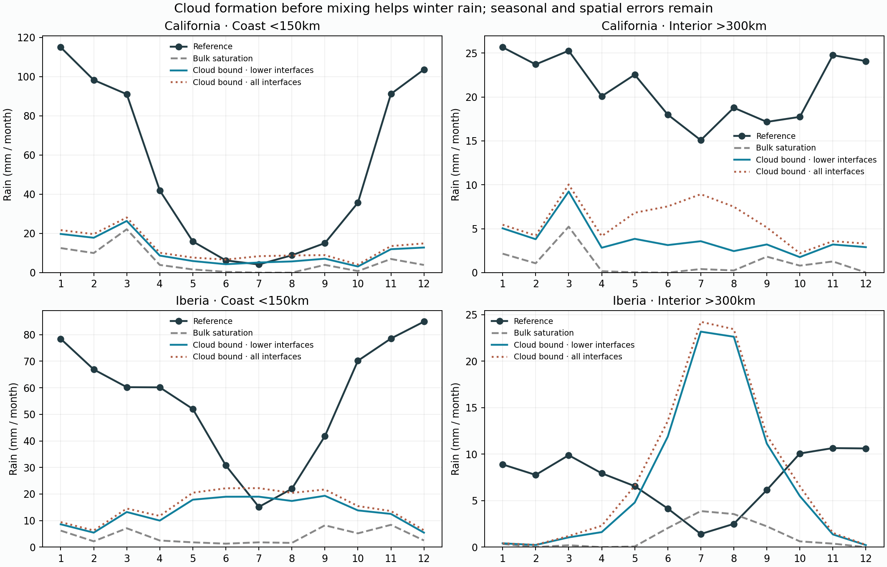
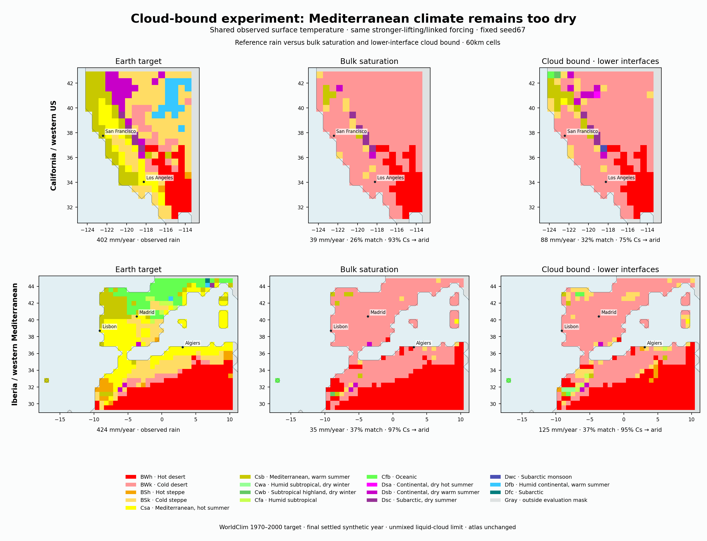

# Completed cloud-mixing review

52/52 cases; 192 saved years; 438.7 integration minutes. Four exact controls; settling, water, energy, thermal ledgers and monthly incoming-water checks verified.

| Region, stronger-lifting/linked case | Coastal winter rain across four catalogues | Added rain, lower-interface cloud bound | Reference | Mediterranean still arid |
|---|---:|---:|---:|---:|
| california | 91.8–104.9 mm | +31.9–39.5 mm | 534.8 mm | 71.0%–75.4% |
| iberia | 59.1–75.9 mm | +25.3–27.9 mm | 439.2 mm | 93.9%–94.9% |

Halving the permitted time step changes coastal winter rain by at most 0.173 mm over twelve checks. This supports time-step stability for this tested refinement and seed; it does not establish vertical or horizontal resolution convergence.

## Why the Iberia headline gain does not improve the whole climate

| Reference regime / location, seed67 stronger lift | Winter: bulk → cloud / reference | Summer: bulk → cloud / reference | Contribution to overall monthly-MAE improvement |
|---|---:|---:|---:|
| coast | 31.7 → 59.1 / 439.2 mm | 17.2 → 102.6 / 221.9 mm | +0.879 mm |
| interior | 1.6 → 8.8 / 57.9 mm | 11.8 → 75.2 / 28.7 mm | -1.096 mm |
| reference_mediterranean | 38.9 → 68.5 / 475.2 mm | 18.7 → 80.2 / 199.5 mm | +0.700 mm |
| reference_arid | 6.0 → 19.8 / 103.5 mm | 8.6 → 86.3 / 57.2 mm | -1.337 mm |
| other_reference_land | 31.9 → 51.9 / 444.0 mm | 29.5 → 89.5 / 376.3 mm | +0.738 mm |

Coast/interior masks overlap the reference-regime partition and must not be added to it. The three reference-regime contributions sum to the overall improvement. Positive values improve error. Interior includes North African land, not just the Iberian peninsula.

The primary lower-interface gain repeats in every fixed paired comparison, without highest-layer parcel condensation. Adding the highest interface increases rain further but generally worsens Iberia monthly MAE; it does not earn selection. The parcel limit lacks entrainment, cloud memory, ice and rain re-evaporation. No atlas promotion.





Maps use the predeclared seed67 stronger-lifting/linked case, identical observed surface temperatures, Gregorian monthly rainfall and shared score masks. Target is the project classification of WorldClim rain/T, not an external published Koppen raster. All four catalogue comparisons are retained in review.json.

Next priority is the origin and season of the misplaced rain, especially in reference-arid land. Diagnose ocean/boundary supply versus local land recycling with passive tags before adding another wetting mechanism. Do not treat more total rain as a successful Mediterranean fix.

Reproduce this saved-data review:

```sh
.venv/bin/python scripts/review_v10_cloud_mixing.py --write
```
