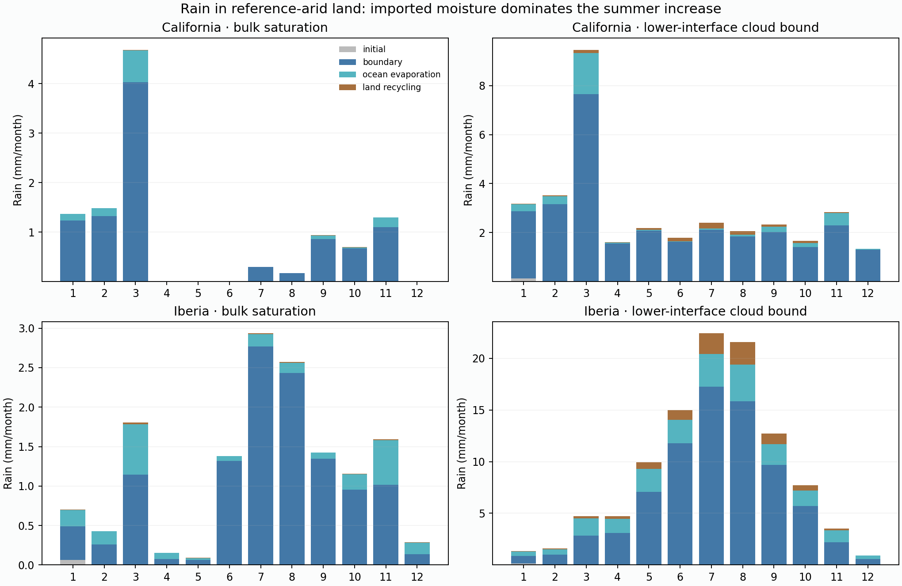

# Completed passive cloud-rain source review

Four exact physical replays verified; 8.81 saved integration minutes. Source stores/rain, annual budgets and monthly boundary inputs agree with physical fields.

| Reference-arid land, summer | Rain: bulk → cloud | Boundary share of cloud rain | Ocean evaporation | Land recycling | Initial unknown |
|---|---:|---:|---:|---:|---:|
| california | 1.41 → 12.39 mm | 90.7% | 3.5% | 5.7% | 0.000% |
| iberia | 8.56 → 86.35 mm | 74.9% | 16.9% | 8.2% | 0.000% |

The misplaced Iberia-domain summer rain is predominantly imported, with a modest direct last-vapor-entry land-recycling share. This deprioritizes soil evaporation as its principal direct water source; it does not establish the causal effect of suppressing recycling.

The boundary humidity currently uses one offshore-mean profile on every edge, including continental inflow. Test its spatial distribution against cached native monthly humidity before more amplitude or soil searches. Compare native local humidity with both original and matched-monthly-gross-input controls to separate placement from water amount. No new NOAA requests are needed.

Labels identify the most recent entry to atmospheric vapor, not soil ancestry. Parcel condensate inherits its ascending donor labels before recipient mixing. Initial vapor remains explicitly unknown; summer is April–September, long after initial atmospheric flushing. Domains include neighboring land and North Africa. Atlas unchanged.
