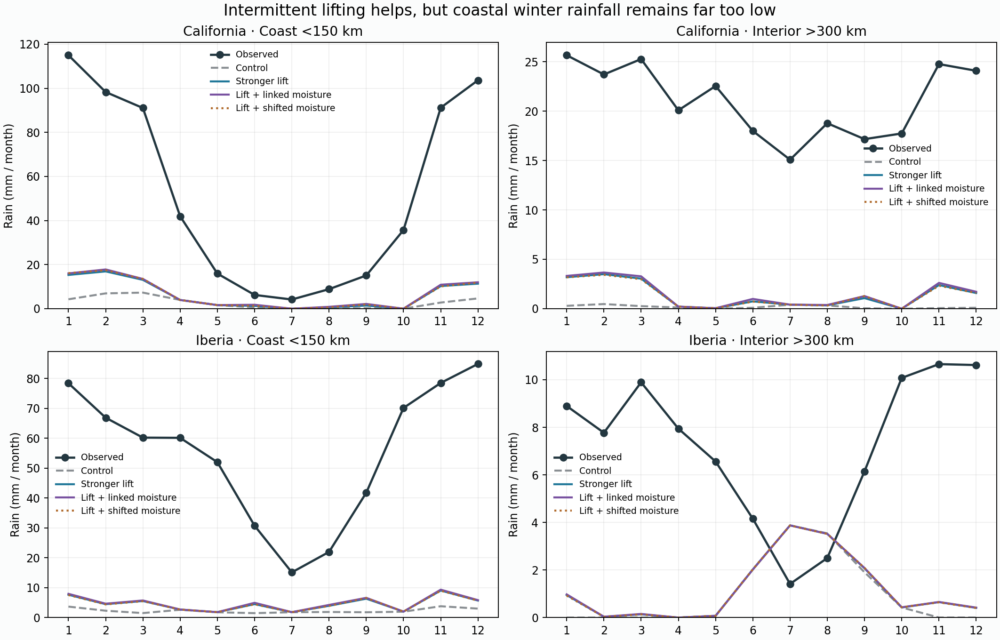
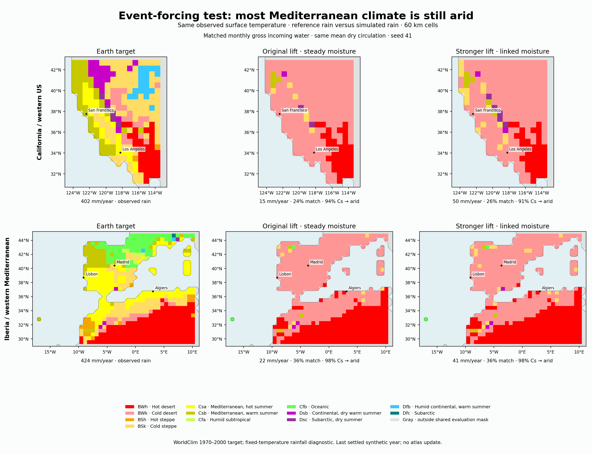

# Completed matched-import event experiment

12/12 cases, 48 cycles, 31.03 saved integration minutes. All settle; both held-boundary controls pass. Physical, thermal and monthly dose ledgers verify.

| Region | Coastal winter rain: baseline → lift16 + linked moisture | Reference | Original coastal deficit closed | Mediterranean still arid |
|---|---:|---:|---:|---:|
| california | 26.0 → 70.2 mm | 534.8 mm | 8.7% | 91.3% |
| iberia | 16.3 → 35.5 mm | 439.2 mm | 4.6% | 98.5% |

Stronger intermittent convergence produces useful additional coastal winter rain and reduces monthly error in both regions. It closes only a small part of the original deficit. This is not yet a Mediterranean climate fix.

| Region | Stronger lift alone: extra coastal winter | Linked vs shifted moisture at lift1 | Linked vs shifted at lift16 | Rain increase formed in middle three layers |
|---|---:|---:|---:|---:|
| california | +40.95 mm | -1.79 mm | +1.16 mm | 79.5% |
| iberia | +18.20 mm | -0.12 mm | +1.44 mm | 84.1% |

The timing effects are small and not uniformly positive at the original lifting amplitude. One synthetic catalogue and saturation/dose normalization do not establish a robust observed moisture-covariance gain. Most new rain forms in the middle three layers (representative sea-level pressures roughly 836/684/454 hPa; lower hybrid pressures vary over terrain), unlike the previous upper-humidity perturbation whose increment mostly formed at 150 hPa.

## Water accounting

| Region | Domain rain increase | Ocean evaporation change | Land recycling change | Reduced export | Remaining export / all vapor input |
|---|---:|---:|---:|---:|---:|
| california | +29.46 mm | +19.62 mm | +8.54 mm | +1.30 mm | 98.2% |
| iberia | +17.40 mm | +21.69 mm | +7.04 mm | -11.34 mm | 97.6% |

These are signed **full-domain atmospheric ledger differences**, including ocean and unscored land; they are not the water-source fractions of extra land rain. Boundary import is fixed, but ocean evaporation increases and land recycling responds to wetting. Atmospheric storage/roundoff close the small remaining difference. Most vapor input is still exported without precipitation.





Map columns are observed-rain target, lift1/steady control and the predeclared lift16/aligned mechanism case. They are not selected by best class score. Both sides share observed surface temperature, the project classifier and evaluation mask. Neighboring western US / Mediterranean / North African land is included. Arid means B climates; these are cell counts, not country areas or independent weather replicates. Atlas unchanged.

## Next diagnostic

Do not start another amplitude, timing or seed search. Replay the already completed final year of four fixed cases (the baseline and linked lift16 case in each region), collecting coastal vapor budgets and joint humidity/ascent/process diagnostics. Start from each saved preceding-year state, require exact physical reproduction, and save restartable diagnostic output separately. This should distinguish dry rising air, poorly placed lifting and thermal relaxation erasing condensation opportunities before considering another physics change. A diagnostic stage condensation opportunity is not the rainfall of an alternative climate.

No new regional integration, download, calibration or atlas update was launched for this review. Reproduce from saved fields:

```sh
.venv/bin/python scripts/review_v10_event_forcing.py --write
```
