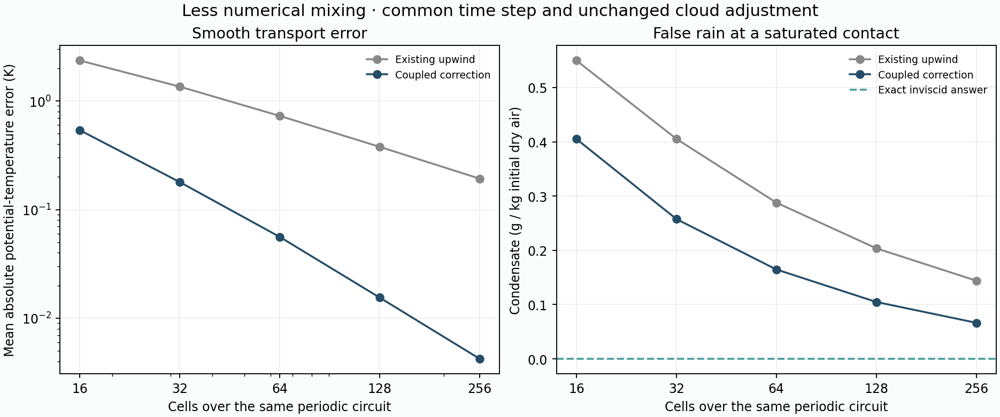
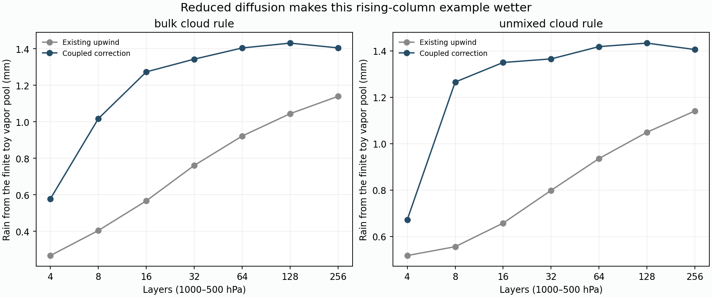

# Coupled flux-corrected transport laboratory

70 fixed manufactured runs in 12.99s; no regional climate year, download or atlas change.

## Passive transport and false cloud formation

| Cells | Smooth theta MAE: upwind / candidate | Artificial contact rain: upwind / candidate | Rain reduction |
|---|---:|---:|---:|
| 16 | 2.35557 / 0.53739 K | 0.549843 / 0.405094 g/kg | 26.3% |
| 32 | 1.35351 / 0.17883 K | 0.405328 / 0.257584 g/kg | 36.5% |
| 64 | 0.72811 / 0.05601 K | 0.287878 / 0.164691 g/kg | 42.8% |
| 128 | 0.37798 / 0.01547 K | 0.203668 / 0.104774 g/kg | 48.6% |
| 256 | 0.19262 / 0.00423 K | 0.144051 / 0.066403 g/kg | 53.9% |

Both problems complete one periodic translation at common CFL 0.5. Smooth inputs are analytic cell averages; their exact answer is the initial profile. The saturated warm/cold inviscid contact has exact zero rain. Candidate contact error is reduced, not eliminated. Neither number is seasonal regional rain.



Observed smooth theta L1 refinement orders: upwind 0.80, 0.89, 0.95, 0.97; candidate 1.59, 1.67, 1.86, 1.87. These empirical rates on this smooth case are not a global order guarantee near fronts or during condensation.

## Same closed circulation, unchanged cloud rules

| Layers | Upwind bulk / unmixed rain | Candidate bulk / unmixed rain |
|---|---:|---:|
| 4 | 0.267085 / 0.517523 mm | 0.578049 / 0.672321 mm |
| 8 | 0.404162 / 0.555713 mm | 1.017100 / 1.265960 mm |
| 16 | 0.566851 / 0.657435 mm | 1.273434 / 1.350281 mm |
| 32 | 0.760928 / 0.798584 mm | 1.343270 / 1.365644 mm |
| 64 | 0.921915 / 0.935979 mm | 1.404462 / 1.418650 mm |
| 128 | 1.044480 / 1.049440 mm | 1.431123 / 1.433814 mm |
| 256 | 1.139513 / 1.141168 mm | 1.404873 / 1.406009 mm |

Column mass, initial vapor/enthalpy, circulation, duration, cloud operators and permitted steps match the parent laboratory. This is a finite closed vapor pool, not a regional rainfall rate. The candidate makes this rising-column example wetter while reducing false rain at the isobaric contact. Numerical accuracy cannot be selected by a universal preference for less rain. A small bulk/unmixed gap still does not establish convergence; the parent mixing-fog counterexample also rules out universal bounds across thermodynamic states.



## Time-step checks

| Comparison | Half-step rain change |
|---|---:|
| n32_bulk_upwind | -0.010100 mm |
| n32_bulk_coupled_fct | +0.000521 mm |
| n32_unmixed_upwind | -0.010044 mm |
| n32_unmixed_coupled_fct | +0.000319 mm |
| n128_bulk_upwind | -0.020395 mm |
| n128_bulk_coupled_fct | +0.011152 mm |
| n128_unmixed_upwind | -0.020277 mm |
| n128_unmixed_coupled_fct | +0.004217 mm |

Periodic half-step inputs at 32/128 cells and direction reversal at 32 cells are also saved in the JSON. Exact convergence requires more than a small difference between two cloud rules.

## Development gates

- PASS: smooth error reduced every grid
- PASS: smooth error decreases with refinement
- PASS: contact artificial rain reduced every grid
- PASS: contact artificial rain decreases with refinement
- PASS: reversal scalar metrics agree
- PASS: dry uniform theta preserved
- PASS: both frozen cloud rules complete without clipping
- PASS: fourteen controls match saved parent exactly

Periodic maximum water/heat residuals: 8.67e-18 kg/kg / 2.91e-10 J/kg. Column maximum water/work-ledger residuals: 5.11e-15 mm / 2.15e-06 J/m².

## Scope before regional use

This candidate supports balanced fixed-mass closed/periodic meshes only. It has no tested open-boundary inflow/outflow contract, monthly forcing/checkpoint integration or regional runtime estimate. No annual comparison is ready yet. Next add boundary tests with independently prescribed tracer/heat fluxes, and extend manufactured multidimensional circulation checks beyond the tested diagonal periodic translation; retain the same face limiter and physical ledgers. All old climate sources and evidence remain unchanged.

Each bounded field gets a 64-machine-epsilon arithmetic allowance scaled to its own magnitude, with an exact zero lower floor. This prevents roundoff in nearly uniform theta from vetoing a real moisture correction. No prognosed scalar is clipped; zero face correction in a field consumes none of its limiting budget. A regression checks this against scalar vapor transport on four nested grids.

Method references: [Zalesak (1979)](https://www.sciencedirect.com/science/article/pii/0021999179900512) for multidimensional flux correction; [Möller, Kuzmin and Turek, §§7.1–7.2](https://diamhomes.ewi.tudelft.nl/~mmoller/files/publications/TecRep221.pdf) for limiting budgets and synchronized coefficients. Our explicit finite-volume implementation is not their implicit finite-element solver.

Already completed; reproduce only if desired:

```sh
.venv/bin/python scripts/audit_v10_flux_transport.py --write
```
