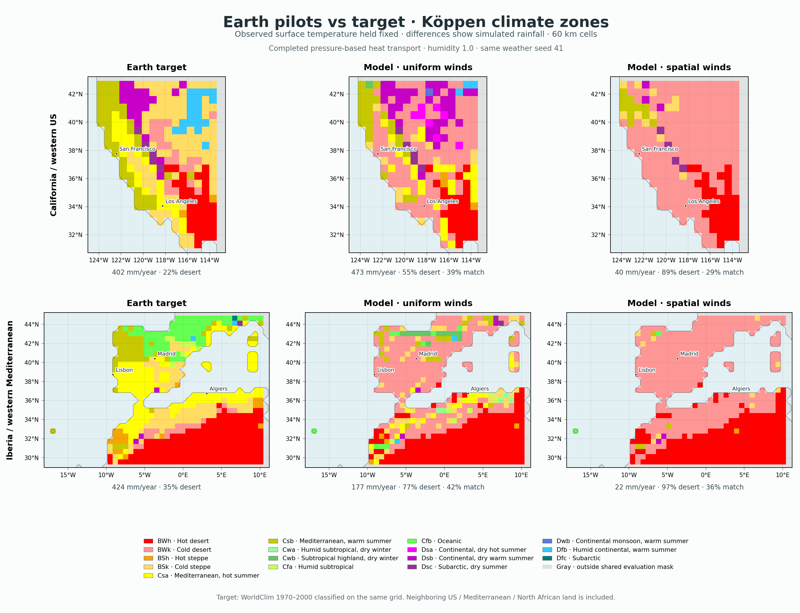
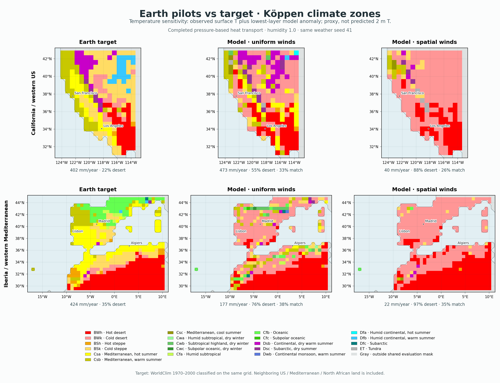

# Earth Köppen comparison from completed regional pilots



Main maps hold WorldClim surface temperature identical on both sides and classify observed versus simulated monthly rain. They isolate rainfall errors; the Earth pilots do not predict independent near-surface temperature. Uniform and spatial controls both use humidity 1.0, rate-one storms and seed 41. The completed pressure-law experiment is included. Each model map classifies the final settled year of one repeated synthetic weather catalogue, not a multi-decadal weather ensemble; warm-up cycles are not independent climate samples.

| Region / completed model | Same Köppen code | Desert land | Reference Mediterranean becoming arid |
|---|---:|---:|---:|
| California / western US / uniform | 38.7% | 55.0% | 46.4% |
| California / western US / spatial | 28.6% | 88.8% | 84.1% |
| Iberia / western Mediterranean / uniform | 42.0% | 76.7% | 82.3% |
| Iberia / western Mediterranean / spatial | 36.2% | 96.9% | 98.5% |

Arid includes desert and steppe (B climates); desert is BW only. Mediterranean means Csa/Csb/Csc. Statistics count the shared scored 60 km cells, including neighboring land within each regional test domain; they are not country-only area statistics or independent observation replicates.

The target is derived from the exact observed monthly fields used in these tests, not copied from a different published Köppen atlas. Both sides use the unmodified project classifier, 0°C C/D boundary, April–September summer and Gregorian monthly rainfall totals directly. No fantasy-calendar rebinning, solstice or mm/day conversion is applied. Reference temperatures confirm that April–September is the warmer half-year at every evaluated cell. Rim and imputed-temperature cells are excluded and shown gray; coastlines reflect the coarse model grid. Minor threshold conventions belong to the existing classifier and are not adjusted for this comparison.

The classification follows the project’s Peel-style rules; the C/D boundary and seasonal criteria are described in [Peel et al. (2007), Table 1](https://hess.copernicus.org/articles/11/1633/2007/hess-11-1633-2007.pdf). The same data/grid/classifier comparison avoids confounding a model error with a different reference-map period, resolution or classification convention.

## Temperature sensitivity, explicitly a proxy



This companion adds the simulated lowest atmospheric layer’s monthly departure from its prescribed target to observed surface temperature. It is an inferred surface-anomaly sensitivity, not a simulated 2 m temperature or an independent temperature validation. Directly classifying lowest-layer temperature would confuse free-air altitude with surface climate.

| Region / model | Class match using proxy | Fraction changed from fixed-temperature map |
|---|---:|---:|
| California / western US / uniform | 32.7% | 20.8% |
| California / western US / spatial | 25.7% | 11.2% |
| Iberia / western Mediterranean / uniform | 37.9% | 12.7% |
| Iberia / western Mediterranean / spatial | 35.2% | 5.7% |

Both views expose serious errors, especially replacement of Mediterranean and steppe climates by desert. They are development diagnostics and do not support an atlas update. Monthly rain and continuous aridity margins remain necessary alongside these threshold-based labels.

## Reproduce

```sh
.venv/bin/python scripts/plot_v10_koppen.py --write --include-pressure
```

Saved-field analysis only. No climate integration, calibration, input download or atlas mutation. `comparison.json` includes full class counts/confusion tables and source/evidence identities; `classes.npz` stores exact masks, grids and class arrays; `class_counts.csv` and vector SVG versions are also included. Sources of the ongoing experiment remain unchanged.
