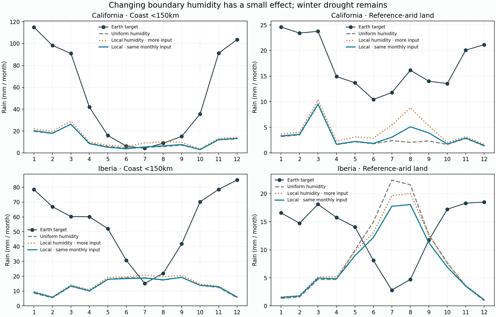
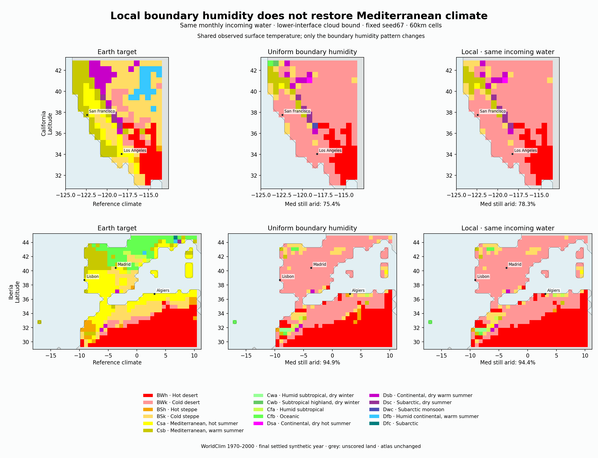

# Completed boundary-humidity comparison

All 12 cases and 28 saved years verified; 34.7 integration minutes. Four exact physical controls. Annual water/energy, signed thermal ledgers, monthly input, settling and reconstructed summaries pass.

## Primary result: local humidity with the same monthly incoming water

| Region / cloud rule | Coast winter: uniform → local matched / reference | Arid summer monthly MAE: uniform → matched | Med still arid | Declared process screen |
|---|---:|---:|---:|---|
| california / bulk | 56.37 → 56.91 / 534.8 mm | 13.277 → 13.348 mm | 92.8% → 92.8% | Fail |
| california / parcel_lower | 91.83 → 92.96 / 534.8 mm | 11.810 → 11.386 mm | 75.4% → 78.3% | Pass |
| iberia / bulk | 31.65 → 33.26 / 439.2 mm | 9.468 → 9.362 mm | 97.0% → 97.5% | Pass |
| iberia / parcel_lower | 59.10 → 61.28 / 439.2 mm | 16.051 → 14.137 mm | 94.9% → 94.4% | Pass |

The screen requires reduced cell/month absolute error in reference-arid summer land, no coastal winter loss greater than 2mm, settling and temperature guards. Passing this small mechanism screen is not sufficient for production selection. An improved spatial mean or overall MAE alone is not the criterion.

## Separate redistribution from adding water

| Region / lower-interface cloud rule | Gross incoming water change | Coast winter gain | Overall monthly MAE change | Arid summer monthly MAE change |
|---|---:|---:|---:|---:|
| california / local | +11.9% | +10.07 mm | -0.795 mm | -1.124 mm |
| california / local_matched | +0.0% | +1.13 mm | -0.243 mm | -0.424 mm |
| iberia / local | +4.5% | +5.01 mm | -0.527 mm | -1.109 mm |
| iberia / local_matched | +0.0% | +2.18 mm | -0.639 mm | -1.914 mm |

Negative MAE change improves error. Unmatched local humidity changes amount and pattern together; it is retained as a sensitivity, not selected as the winner.





The same observed surface temperatures classify target and simulated rain. These are project classifications of WorldClim monthly data, not an external published Koppen raster. The Iberia domain includes North Africa. One reused synthetic catalogue does not give an observational uncertainty interval or independent validation. No atlas update, downloads or new climate integration during review.

Reproduce saved-data review:

```sh
.venv/bin/python scripts/review_v10_spatial_humidity.py --write
```
