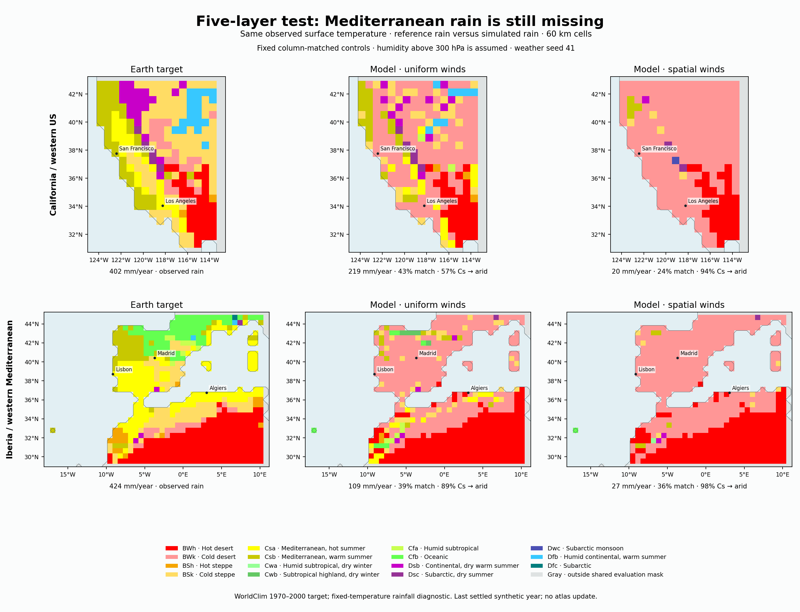
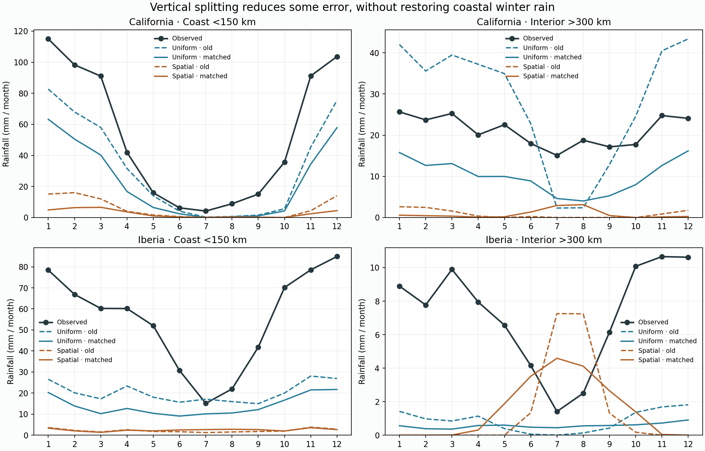

# Completed five-layer structural review

12/12 cases verified, 48 cycles, 31.85 saved integration minutes. All settle; reconstructed annual water/energy and gross-flow budgets close.

| Region / winds / upper control | Rain MAE | Annual rain / observed | Coastal winter / observed | Import change | Highest-layer rain |
|---|---:|---:|---:|---:|---:|
| california_uniform_split_dry | 28.99 | 185.7 / 401.8 mm | 237.3 / 534.8 mm | +15.8% | 14.5% |
| california_spatial_split_dry | 32.24 | 15.2 / 401.8 mm | 26.0 / 534.8 mm | +21.1% | 3.1% |
| iberia_uniform_split_dry | 32.27 | 98.4 / 424.2 mm | 97.5 / 439.2 mm | +13.7% | 11.6% |
| iberia_spatial_split_dry | 34.66 | 22.0 / 424.2 mm | 16.3 / 439.2 mm | +18.8% | 23.2% |
| california_uniform_split_rh300 | 28.42 | 263.5 / 401.8 mm | 271.5 / 534.8 mm | +18.1% | 39.3% |
| california_spatial_split_rh300 | 31.62 | 25.8 / 401.8 mm | 30.1 / 534.8 mm | +24.1% | 42.3% |
| iberia_uniform_split_rh300 | 31.92 | 119.9 / 424.2 mm | 111.4 / 439.2 mm | +15.7% | 27.1% |
| iberia_spatial_split_rh300 | 34.61 | 28.9 / 424.2 mm | 16.6 / 439.2 mm | +21.6% | 40.7% |
| california_uniform_split_column_matched | 27.37 | 218.6 / 401.8 mm | 250.5 / 534.8 mm | +9.8% | 39.8% |
| california_spatial_split_column_matched | 31.98 | 20.4 / 401.8 mm | 24.7 / 534.8 mm | +15.3% | 39.6% |
| iberia_uniform_split_column_matched | 32.09 | 109.1 / 424.2 mm | 104.3 / 439.2 mm | +9.6% | 26.3% |
| iberia_spatial_split_column_matched | 34.66 | 26.6 / 424.2 mm | 15.0 / 439.2 mm | +15.2% | 40.2% |

Import change compares actual gross vapor influx with the paired four-layer control. Matching incoming column concentration did not match wind-weighted water supply.

## What the lower error means

California uniform-wind monthly MAE improves 40.07 → 27.37 mm in the matched-column control, but annual rain falls 473.3 → 218.6 mm against 401.8 observed. Coastal winter rain falls 335.0 → 250.5 mm against 534.8 observed. This is useful error reduction without the desired coastal wetting. Iberia uniform MAE barely changes; the spatial-wind controls remain severely dry. No broad regional success.

The California uniform MAE gain of 12.70 mm decomposes into +13.72 mm from cells that were annually too wet and -1.02 mm from those already too dry. Only 46.8% of scored cells improve their monthly error. This is an additive error decomposition, not a causal experiment.

| Dry upper boundary → retained RH300 | Extra annual rain | Extra rain in highest layer | Fraction of increase there |
|---|---:|---:|---:|
| california_uniform | 77.80 mm | 76.59 mm | 98.4% |
| california_spatial | 10.67 mm | 10.46 mm | 98.1% |
| iberia_uniform | 21.53 mm | 21.12 mm | 98.1% |
| iberia_spatial | 6.82 mm | 6.62 mm | 97.1% |

The upper incoming humidity is an assumption, not observed. These are changes in condensation/rainfall by formation layer, not tagged molecular origins. The new highest layer is represented at 150 hPa; liquid saturation adjustment and immediate surface rainout remain unchanged. These results do not validate high-cloud/ice processes or demonstrate that previously missing middle-level humidity becomes useful coastal rain.

## Mediterranean climate response

| Fixed column-matched control | Old → new exact class match | Old → new reference Mediterranean becoming arid |
|---|---:|---:|
| california_uniform | 38.7% → 42.8% | 46.4% → 56.5% |
| california_spatial | 28.6% → 24.2% | 84.1% → 94.2% |
| iberia_uniform | 42.0% → 39.4% | 82.3% → 88.9% |
| iberia_spatial | 36.2% → 36.2% | 98.5% → 98.0% |



Both sides hold the same observed surface temperature; only monthly rain changes. Reference is the same-grid WorldClim classification, not an external published Köppen raster. The 60 km evaluation domains include neighboring western US / Mediterranean / North African land. Statistics count shared scored cells, not country-only areas or independent weather samples. No fantasy-calendar rebinning or conversion from monthly totals is applied.



## Decision

Retain this as structural evidence, without selecting a fantasy climate or publishing an atlas. Do not start another parameter or storm-seed search. Next distinguish missing transient ascent/fronts and event-linked moisture from immediate rainout and vertical transport artifacts. Audit forcing and manufactured limits first; the paused six-hourly NOAA audit remains necessary for observational covariance, but cached monthly means cannot supply that information. A synthetic timing experiment would establish mechanism sensitivity only, not measured real-weather forcing.

Reproduce this saved-only review:

```sh
.venv/bin/python scripts/review_v10_split_column.py --write
```

No seasonal simulation, optimization, download or atlas update was run.
