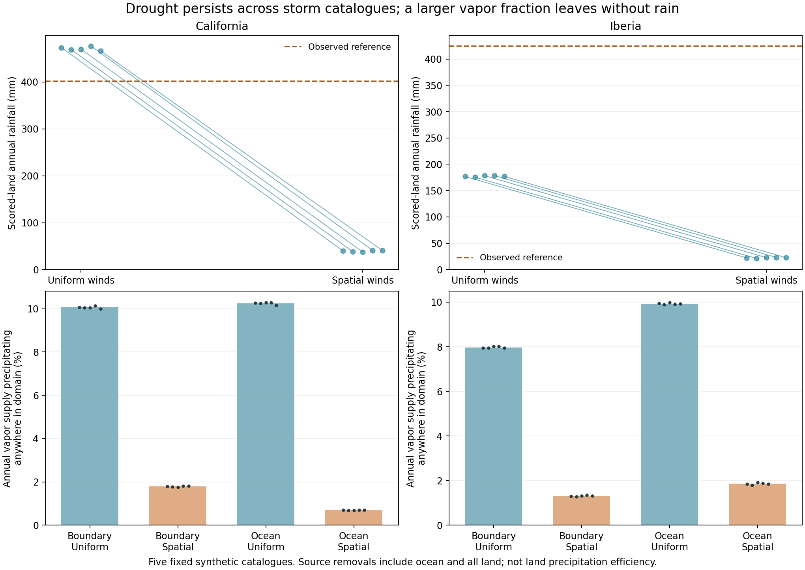

# Completed water-source / paired-weather review

20/20 cases verified; 80 cycles; 112.1 saved integration minutes. All settle. All four seed-41 physical controls reproduce exactly.

| Region / winds | Annual scored-land rain across five seeds | Reference | Boundary share of land rain | Boundary supply leaving again | Ocean vapor leaving again |
|---|---:|---:|---:|---:|---:|
| california_uniform | 465.9–476.7 mm | 401.8 mm | 92.3% | 89.9% | 89.8% |
| california_spatial | 37.7–40.9 mm | 401.8 mm | 91.3% | 98.2% | 99.3% |
| iberia_uniform | 175.5–178.4 mm | 424.2 mm | 83.1% | 92.0% | 90.1% |
| iberia_spatial | 21.2–23.1 mm | 424.2 mm | 63.9% | 98.7% | 98.1% |

Rain and source shares refer to scored land. Export/supply fractions refer to full-domain atmospheric source ledgers; they are not land precipitation efficiency. Vapor supply is gross external influx or local evaporation. Store changes and explicit tiny numerical adjustments close each source balance.

Spatial background winds underproduce rain in every tested storm catalogue. Boundary supply falls only about a fifth, while its domain precipitation falls far more. Local ocean evaporation rises, but almost all of that water leaves without precipitation. A uniform humidity/evaporation increase is therefore not yet a justified fix for the rain-placement problem.

These are last-vapor-source tags; land evaporation resets soil ancestry. They establish source balances and catalogue sensitivity, not causal attribution between missing real fronts, thermal/vertical forcing, boundary structure and cloud physics. Five synthetic catalogues are not actual climate uncertainty, and repeated settling cycles are not independent weather years.

Next use cached forcing/operator audits to distinguish those mechanisms. Do not spend another batch on storm-seed selection. Real six-hourly weather covariance still awaits accessible reference data. No atlas update.

