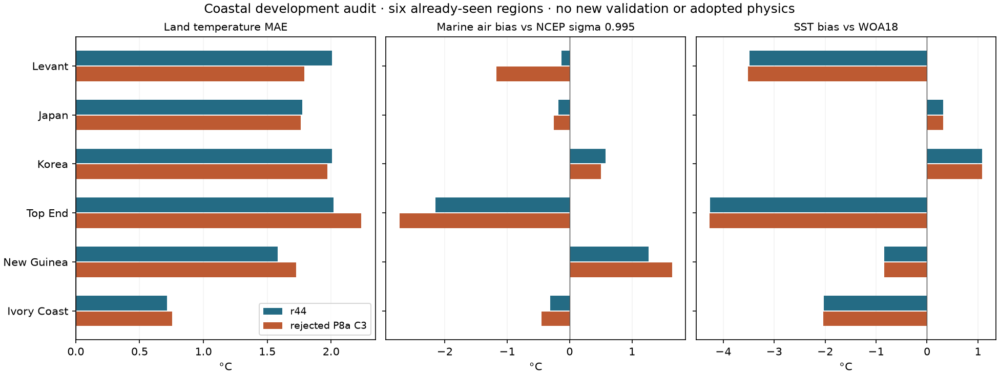
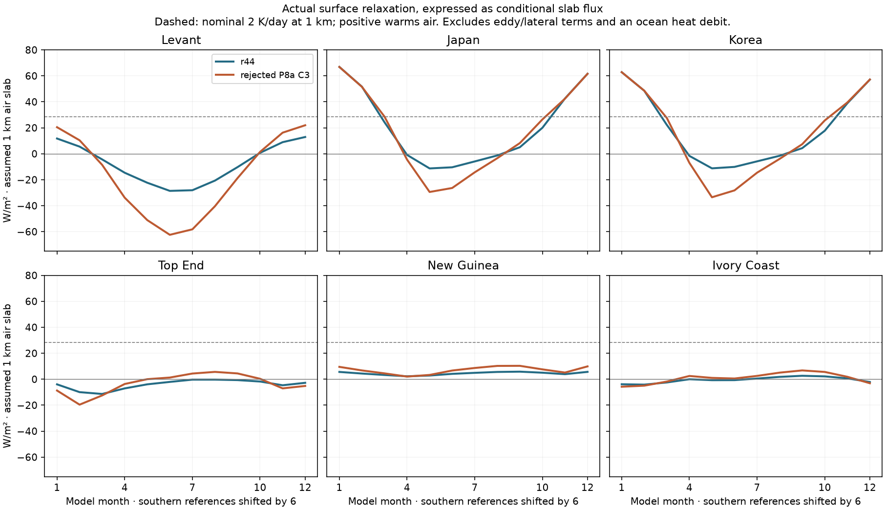

# Actual air–sea exchange on r44 and rejected P8a — 9 November 2026

**Result:** faster coupling exposes compensating errors; it is not a qualified replacement for r44.
Twelve runs passed numerical checks, on six already-seen regions. No new fit or unseen pool was used.
The plan was frozen in `calibration/air_sea_audit_20261109/plan.json` before the runs. References moved
from rate-limited THREDDS ASCII to NOAA's official static files, with the same verified period and level.

## What was measured

An opt-in recorder observes the last linear temperature solve of each final-year step: actual SST,
rate-evaluation air, solved air, surface relaxation rate and heat winds. Tests show every model output
and numerical check stays bit-identical with recording enabled, on r44 and P8a C3. No physical equation changed.

Surface tendency is `lambda * (SST - solved_air)`, evaluated before monthly aggregation. Eddy exchange
and lateral transport are separate terms. Conditional slab flux is `rho cp h lambda (SST - air)`, at
rho = 1.225 kg/m³ and cp = 1,004 J/kg/K. The 1 km illustration scales by 0.25/0.5/2 for 250/500/2,000 m.
There is no prognostic ocean heat debit, so this is not a coupled heat-budget validation.

The optional depth proxy `h = CH U/lambda`, with illustrative CH = 0.001, is not COARE or an observed
boundary-layer depth. Resolved model wind is not a validated 10 m relative wind; stability, gustiness and
vertical representativeness remain unresolved. [Fairall et al. (2003)](https://journals.ametsoc.org/view/journals/clim/16/4/1520-0442_2003_016_0571_bpoasf_2.0.co_2.xml)
and [NOAA's implementation notes](https://www.pmel.noaa.gov/ocs/flux-documentation/) motivate that distinction.

Ocean cells lie within 300 km of scored land; the mask does not select by climate error. NCEP/NCAR air
and winds are at **sigma 0.995**, not fixed 995 hPa (an older report mislabeled this), from 1991–2020.
WOA18 SST is compared separately. Different periods, resolutions, heights and coastal interpolation limit
the comparisons; the mixed climatologies cannot supply an observed instantaneous air–sea heat flux.
Southern references rotate six months, and northward wind reverses, in the model's mirrored frame.

## Findings

| Region | Land monthly MAE: r44 → C3, °C | r44 mean SST bias vs WOA18, °C |
|---|---|---|
| Levant | 2.006 → 1.792 | −3.48 |
| Japan | 1.773 → 1.762 | +0.31 |
| Korea | 2.009 → 1.969 | +1.08 |
| Top End | 2.018 → 2.236 | −4.25 |
| New Guinea | 1.580 → 1.727 | −0.84 |
| Ivory Coast | 0.715 → 0.757 | −2.03 |

* **The cap is not a universal ceiling.** C3 deliberately retains the baseline exchange-rate floor. At the
  actual coefficient state, its nominal 2 K/day bound is exceeded in 78.7% of eligible cold-air samples
  near Japan and 75.3% near Korea. Winter relaxation there is nearly unchanged from r44. This alone is
  not a reason to remove the floor: that would change the physics and needs independent testing.
* **A numerical distinction matters.** Counting at solved air gives 90.6%/88.2%, partly including the
  fixed-point tolerance. Final counts instead use the recorded rate-evaluation state, with solved-state
  counts retained separately. The corrected audit repeats all twelve runs; every prior monthly climate
  and flux array is exactly identical. Original outputs remain in `output/air_sea_audit_20261109`;
  final output is `output/air_sea_audit_20261109_operator_state` with `replay_check.json`.
* **A better land score can hide worse marine air.** In the Levant, C3 lowers land MAE but shifts mean
  marine-air bias from −0.13 to −1.17 °C against the coarse NCEP reference. Strengthening exchange toward
  a sea already several degrees cold is a plausible compensation problem, not a physically independent gain.
* **Tropical failure is not one mechanism.** C3 cools Top End marine air by about 0.58 °C, but warms
  New Guinea marine air by 0.37 °C while its land error worsens. Coupled circulation, moisture and land
  feedbacks require attribution; a single local stable-cooling explanation does not describe both responses.

## Next test

Before a broad refit, screen a small, declared family of **shared modeled-SST offsets/current strengths**,
both with r44 exchange and with C3. Test whether warmer tropical/semi-enclosed seas can coexist with the
already closer East Asian SSTs. Keep Earth forcing, geography, model winds/SST and numerical tolerances
fixed; no regional masks, observed-SST substitution or new planetary forcing. Report temperature and
rainfall together, alongside marine diagnostics. This is development screening only; all h cases are spent.

Only a candidate with broad development and finer-grid gains can advance to an independently declared
milestone test. Multiple dispersed starts can test the basin within a bounded parameter family; they
cannot establish a global optimum. r44 and the v2.2 atlas remain adopted throughout this diagnosis.
