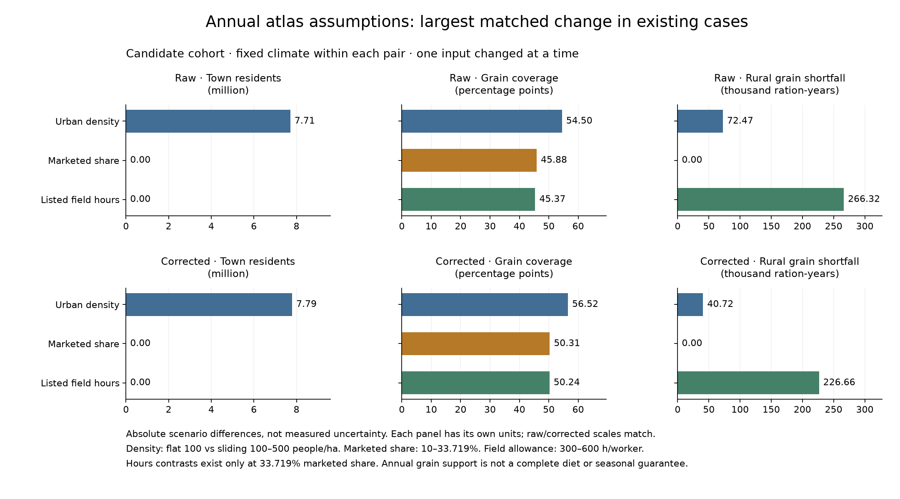

# What most changes the annual settlement economy — 17 November 2026

**Population density and the agricultural work budget are the next priorities.**
The marketed grain share is also influential, but its present value is a
development calibration, not an observed Roman surplus fraction. The existing
cases do not establish a credible empirical range for any of these inputs.
Detailed warehouse mechanisms cannot settle those larger uncertainties.



## Matched comparisons, without another simulation

This implements the [frozen task](../calibration/roman_benchmark_20261117/annual_assumption_impact.json)
and [exact reduction rule](../calibration/roman_benchmark_20261117/annual_impact_reduction.json).
Only the already reviewed November 16 supply and hierarchy results are read.
Candidate results are primary; the published-cohort control is kept separate.
Raw and corrected climate are separate scenarios, never a one-input contrast.

| Available settings, per cohort and climate | 600 listed hours/worker | 300 listed hours/worker |
| --- | --- | --- |
| Central density, each of 10%, 14.049%, 33.719% marketed share | All three | Only 33.719% |
| Flat 100 people/ha, each of those same shares | All three | Only 33.719% |

The central rule slides from 100 to 500 people per inhabited hectare. The exact
marketed shares are 0.10, 0.14049021985082757 and 0.3371937035110408. Across two
cohorts and two climates there are 32 present and 16 unavailable combinations.
The [availability table](../output/annual_assumption_impact_20261117/availability.json)
retains every missing case. Nothing is interpolated.

Every pair changes exactly one input at fixed cohort and climate: four density,
six marketed-share and two work-allowance contrasts per cohort/climate, or 48
in total. Density changes include their existing endogenous rural redistribution,
workers and production; rural supply is not frozen to another density's output.
The frequently shown low-density/14.049% versus central/33.719% comparison
changes two inputs and is excluded from this attribution.

## Results and their units

The table gives the **largest absolute matched change across the available
endpoints**. The full [rankings](../output/annual_assumption_impact_20261117/rankings.csv)
also retain medians, pair counts, signs and maximizing scenarios. These are
scenario magnitudes, not confidence bounds or importance normalized by equal
parameter ranges. Extraction pairs overlap and are not independent samples.

| Outcome / input changed | Raw candidate | Corrected candidate |
| --- | ---: | ---: |
| Town residents / density | 7.712 million | 7.795 million |
| Town residents / marketed share or work hours | 0 | 0 |
| Grain coverage / density | 54.500 percentage points | 56.521 percentage points |
| Grain coverage / marketed share | 45.879 percentage points | 50.315 percentage points |
| Grain coverage / work hours | 45.371 percentage points | 50.239 percentage points |
| Rural shortfall / work hours | 266,324 ration-years | 226,663 ration-years |
| Rural shortfall / density | 72,471 ration-years | 40,724 ration-years |
| Rural shortfall / marketed share | 0 | 0 |
| Town shortfall / density | 7.979 million ration-years | 8.085 million ration-years |
| Town shortfall / marketed share | 6.042 million ration-years | 6.699 million ration-years |
| Town shortfall / work hours | 5.976 million ration-years | 6.689 million ration-years |
| Number of short towns / work hours | 244 | 239 |
| Number of short towns / marketed share | 224 | 224 |
| Number of short towns / density | 207 | 207 |

All five outcome-specific factor orders agree in both climates and the separate
control cohort. This is stability within these existing endpoints, not proof
that the chosen ranges are historically comparable. Marketed share and work
hours are almost tied for maximum central coverage effect; their difference
should not become a historical ranking claim.

The corrected density contrast changes requested residents from **5.520 to
13.315 million**, about 2.41 times, by transferring people from the fixed world
population. It does not predict the world total. At fixed 10% marketed share
and 600 hours, coverage falls from 92.820% to 36.299%. At fixed central density
and 600 hours, raising marketed share from 10% to 33.719% increases coverage
from 36.299% to 86.614%. At central density and 33.719% share, increasing the
allowance from 300 to 600 hours increases it from 36.375% to 86.614%.

Work hours most change rural deficits and the number of short towns. The
maximum rural change occurs under **low** density, from 259,595 to 32,932
ration-years on the corrected map. Marketed share does not change rural
shortfall in this accounting: it acts on the surplus remaining after rural
need. That zero is a property of the model's ordering, not historical proof
that surplus extraction cannot harm rural households.

## Evidence and practical priorities

1. **Constrain inhabited area and population density together.** The population
   factor dominates resident demand and has the largest tested coverage effect.
   Existing catalogue areas mix walls and inhabited extents. The
   [Greek wall correction](GREEK_WALLS_20261114.md) uses Hansen's interpreted
   inhabited shares, not an independent measurement for every city. The
   [housing diagnostic](SETTLEMENT_HOUSING_DIAGNOSTIC_20261112.md) measures
   encountered properties per investigated hectare; it supplies neither a
   complete occupied extent nor a dated household count. The earlier AD150
   housing audit rejected three phases and left 47 unresolved; that does not
   establish AD200 compatibility. Assuming a
   household multiplier would add another unmeasured input. The conditional
   city-area benchmark's modest skill does not validate population conversion.
2. **Constrain the agricultural work and output budget before adding detailed
   logistics.** Columella 2.12 gives prescriptive cereal task counts to the
   threshing floor, not a full household occupation schedule. The eight-hour
   conversion, rural worker fraction and 300/600-hour allowance are supplied
   assumptions. Land use, yields, crop mix, processing, draft services and
   competing duties must have compatible definitions. The present cases vary
   only the listed allowance; unvaried inputs are **unranked**, not negligible.
   The [work-readiness audit](WAREHOUSE_WORK_READINESS_20261117.md) finds 84.62%
   of the original B600 listed task-hours without monthly placement. Spare
   listed hours do not authenticate spare workers or their availability at harvest.
3. **Separate marketed fraction from production, rural retention and delivery.**
   The 33.719%/14.049% values were fitted to annual town-support targets using
   exposed Roman development data and a supplied Frier total. They are not
   independent observations of farm sales, rent, tax or state collection.
   A receipt from one institution cannot supply the all-farm marketed share
   without its production and rural-retention denominator. Transport remains
   conditional on the existing freight rules; no new freight sensitivity exists
   here. Complete-diet and seasonal continuity claims remain unavailable.

**One concrete next period-evidence target:** assess whether Karanis has a
compatible pair of approximately AD200 occupied residential extent and
household/person evidence, using the dating and inclusion definitions of each
source. This is a proposed feasibility screen, not a claim that such a pair
exists. It must distinguish census declarations from a complete settlement
enumeration, excavated footprint from occupied area, and a village observation
from transferable city density. If those denominators cannot be matched, record
the failure rather than fitting a new density. No census or source pool was
opened during this reduction.

The recent [South Levant spatial check](LEVANT_SPATIAL_DIAGNOSTIC_20261117.md)
also remains a limitation: legacy/refreshed fields coincide locally and have
equal-source gain −0.03950 nats/site against within-survey uniform opportunity,
with AUC 0.4770. Its 565 broad-period observations occupy only 55 native 9km
cells, with unequal detection and no simultaneous AD200 census. It neither
fixes regional population nor licenses a parameter refit to make the score pass.

## Checks and reproduction

The separate reviewer rereads all archived scalars, recomputes coverage and
town unmet grain through independent identities, enumerates allowed pairs by
Cartesian factor settings, checks all 48 availability combinations, all 48
contrasts and all 60 ranking rows, and cross-checks density populations against
the hierarchy packet. All five scientific exports reproduce byte for byte in
a separate directory. The existing source/atlas protection chain is verified;
the previous food/work/freight computations are reused, not revalidated here.
The plot's 18 values are checked against the reviewed ranking table and the
figure is visually inspected. No new model run, fit or atlas change occurs.

```sh
.venv/bin/python scripts/annual_assumption_impact.py
.venv/bin/python scripts/annual_assumption_impact.py --out output/annual_assumption_impact_20261117/fresh
.venv/bin/python scripts/review_annual_assumption_impact.py
.venv/bin/python scripts/render_annual_assumption_impact.py
.venv/bin/python scripts/seal_annual_assumption_impact.py
```

Completed output directories are preserved; use a fresh `--out` for the producer.
Reviewer, renderer and sealer refuse to overwrite their completed receipts.
The live r5 map remains provisional; climate development stays deferred.
