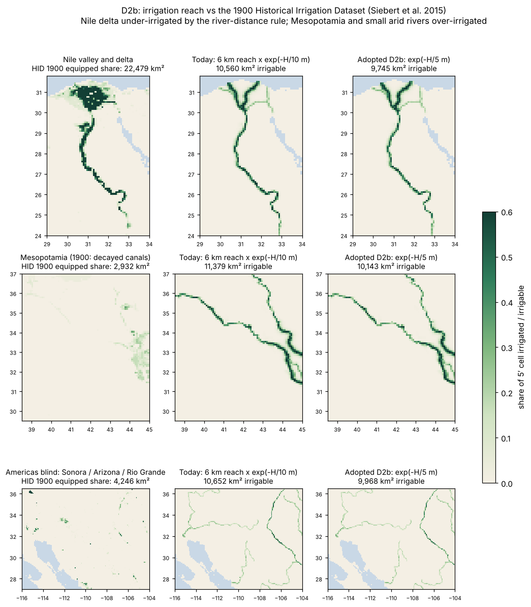
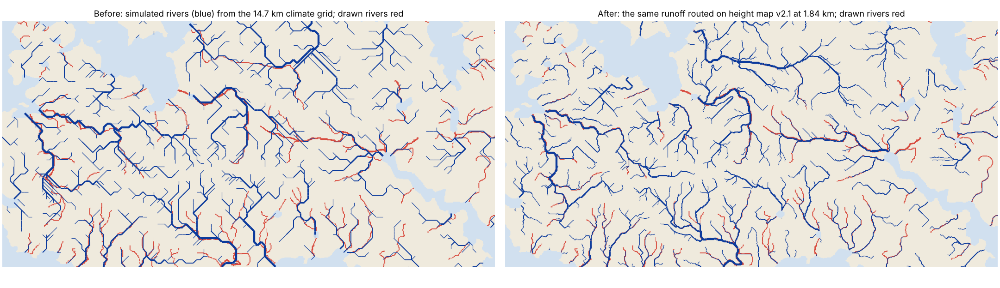

# Arable land from slope and irrigation by height above the river (block D, D1 + D2) — 8 November 2026

Plan: `calibration/geography_control_20261107/plan_D1.json` (D1, D1b). Code: `scripts/arable_slope_d1.py`,
`scripts/arable_slope_earth.py`, `harvest/export.py` (`geometry`), `scripts/land_people_earth.py --arable slope`.

## Why

Now that the eroded height map carries the drawn rivers in Earth-fitted valleys (`reports/RIVERS_TERRAIN_20261108.md`),
farming should follow the terrain. Until now, the share of a cell that can be ploughed was one constant per drawn tier
(0.85 / 0.75 / 0.45 / 0.08). The constants came from the GAEZ slope classes (Fischer et al. 2012), weighted by typical
landform slopes. Valley floors and steep valley sides in the same tier were therefore treated alike, and a flat high
plateau counted as almost unploughable.

## D1: the rule, fitted on Earth at the map's own scale

* **Kept rule.** GAEZ's slope classes: land under 8 % slope is fully arable, 8–16 % 0.6, 16–30 % 0.3, steeper 0.05.
* **Earth target.** That rule applied to every 90 m pixel of Copernicus GLO-90. Each ~1.85 km cell takes the mean of its
  pixels.
* **Predictor.** The slope S the map itself resolves: the ~1.85 km block-mean surface, in degrees.
* **Fitted curve.** a(S) = 0.018 + 0.982 / (1 + (S / 2.75°)^1.29), on 12 development tiles (1° each).
* **Rejected variant.** A separate lowland and upland ceiling gained 0.001, below the frozen 0.01, so it was not adopted.

| | Tier constants | a(S) |
|---|---|---|
| Development tiles, tile-mean RMSE | 0.240 | 0.119 |
| Blind tiles (12, never used), RMSE | 0.308 | 0.184 |
| Blind tiles where a(S) is better | | 12 of 12 |
| Blind bias | | +0.036 (gate ±0.05) |

Weak spot: finely dissected hill country whose 1.85 km slope is moderate, such as the Shanxi loess (+0.19) and the Fujian
hills (+0.20). There the curve over-states arable land.

On the map, height map v2.1 gives these mean arable shares per tier:

| Tier | a(S) | Old constant |
|---|---|---|
| 1 | 0.85 | 0.85 |
| 2 | 0.58 | 0.75 |
| 3 | 0.44 | 0.45 |
| 4 | 0.30 | 0.08 |

* Tier-1 valley floors come out at 0.91.
* The land-weighted mean is almost unchanged, 0.744 → 0.739, so farming moves into valleys and plains rather than growing
  or shrinking.
* Atlases without an eroded terrain file (free, Whittaker) keep the tier constants.

## D1b: one calibrated chain on Earth

The same rule now drives the Earth harness: ETOPO 2022 slopes at 60″, a(S), averaged over each 5′ cell.

### FALLOW refit

* `FALLOW` sets the share of single-cropped fields sown each year. It had been fitted so the North China Plain's AD 2 census
  (80.7 per km²) sits at capacity.
* It is refitted the same way: 0.68 → 0.599. The plain's flat land is about 0.99 arable, not 0.85.

### No-harm checks (frozen gates)

| Check | Before | After | Gate |
|---|---|---|---|
| 10 unfitted historical regions, RMS of ln(historical / capacity) | 1.701 | 1.648 (8 of 10 closer) | worse by ≤ 0.05 |
| Earth control development pools, v2.1 rules, balanced accuracy: Rome AD 150 | 0.8488 | 0.8486 | lose ≤ 0.01 |
| Earth control development pools, v2.1 rules, balanced accuracy: Han AD 2 | 0.6637 | 0.6630 | lose ≤ 0.01 |

The control check rebuilt the whole Earth chain in a separate worktree: harness, window people, food fields, staffing chain
and territory. A baseline worktree reproduced 0.8488 and 0.6637.

* Both gates pass, so D1 is adopted on the map and on Earth.
* A first slope run was not consistent: it took the window people from a harness computed before the `FALLOW` refit. It was
  re-run; the numbers above are from the consistent run (`output/arable_slope_d1/d1b_checks.json`).
* Older Earth intermediates stay as they were when their tests ran: the spent blind pools and the settlement-model harness.

## D2: irrigation gated by height above the river

* **Old rule.** Irrigable share by distance alone: exp(−d / 6 km) from navigable rivers and 0.6·exp(−d / 2.5 km) from
  streams. A slope 300 m above its river counted as much as the floodplain.
* **Candidate.** The old rule × exp(−H / H0), where H is the height of the ~1.85 km cell above its nearest river cell.
* **Earth reference.** The Historical Irrigation Dataset (Siebert et al. 2015, CC0): area equipped for irrigation in 1900 at
  5′, `AEI_HYDE_FINAL_IR`. Cells count as irrigated at ≥ 10 % equipped.
* **Cells scored.** Dry land (P/PET < 0.65) within 30 km of a mapped river.

| | Development (12° W – 45° E) AUC | Blind (60° E – 125° E) AUC |
|---|---|---|
| Distance only | 0.663 | 0.539 |
| × exp(−H / 10 m) | 0.720 | 0.671 |

* H0 = 10 m was the narrowest value in the frozen grid.
* The cropland-placed HID variant ranks the candidates the same way.
* On the map, H is measured against the drawn rivers on height map v2.1. The irrigable share falls from 0.032 to 0.019
  (land mean): irrigation now stays on valley floors.
* On Earth, the distance-only field is kept as `irr_distance` for the settlement water distance.

### Refit and checks (D1 + D2 together)

* **FALLOW:** 0.600 (the North China Plain census, as before).
* **10 regions:** RMS of ln(historical / capacity) goes from 1.701 (the original rules) to 1.652.
* **Weak spot, Egypt:** +0.32 → +0.64; capacity is now about half the 1st-century population. The gate correctly removes
  the desert cliffs within 6 km of the Nile (cells there sit at a median 2.5 m above the river, but the upper quarter at
  20–57 m). The distance rule's 6 km decay is too narrow for the Nile's 10–20 km floodplain, an older problem that the gate
  now exposes.
* **Note on the D2 metric:** AUC measures ranking, not the absolute level of irrigation. The population check is the one
  that tests the level.
* **Earth control development pools (balanced accuracy, D1 + D2 against the original chain):** Rome 0.8488 → 0.8485, Han
  0.6637 → 0.6628. Both lose less than 0.01, so the gate passes and D1 + D2 is adopted together (`output/arable_slope_d1/`).

## D2b: irrigation reach on wide floodplains

* **Question.** Is the 6 km distance decay too narrow for floodplains like the Nile's (10–20 km)? D2 was chosen on
  ranking only; D2b also scores the amount.
* **Candidates.** Reach 6, 12, 24 or 48 km from navigable rivers (streams scaled alike) × height gate exp(−H / 5, 10 or
  20 m); nothing beyond 60 km of a mapped river.
* **Amount metric.** |ln(model irrigable area / HID 1900 equipped area)| over arid cells (P/PET < 0.2) within 30 km of a
  mapped river, where farming is irrigation or nothing.
* **Regions.** Development 12° W – 45° E; the spent D2 blind region (60° E – 125° E) reported only; fresh blind: the
  Americas, 10° S – 50° N.
* **Selection (frozen).** Among candidates with development AUC at most 0.01 below today's rule, the lowest amount error.

| Rule | Dev AUC | Dev amount | Blind (Americas) AUC | Blind amount |
|---|---|---|---|---|
| Today: 6 km × exp(−H / 10 m) | 0.720 | 2.30× | 0.725 | 2.51× |
| **Chosen: 6 km × exp(−H / 5 m)** | 0.726 | 2.00× | 0.726 | 2.33× |
| 24 km × exp(−H / 10 m) | 0.747 | 4.62× | 0.742 | 4.20× |
| 48 km × exp(−H / 20 m) | 0.747 | 7.06× | 0.751 | 5.99× |

* **Blind gate passes** (amount better, AUC not lower), so the gate scale becomes 5 m; the reach stays 6 km.
* **The finding is the bigger result: reach is not the lever.** Every candidate already irrigates too much in arid land,
  and a wider reach only adds more. By region (development, arid cells within 30 km of a river, today's rule against
  1900):

| Region | HID 1900 | Today's rule |
|---|---|---|
| Nile valley | 8,200 km² | 7,600 km² |
| Nile delta | 12,500 km² | 5,200 km² |
| Mesopotamia (1900 canals decayed) | 2,300 km² | 10,300 km² |
| Rest of Sahara and Arabia | 2,200 km² | 34,800 km² |

* The Nile valley is about right. The delta is a solid irrigated fan that a distance-to-two-branches rule cannot reach,
  and every small arid river irrigates as much as the Nile. Both are water-supply questions: discharge and distributaries,
  not floodplain width.
* **Population check.** `FALLOW` refit 0.5997, kept at 0.600. Ten regions RMS 1.652 → 1.653 (gate ≤ +0.05). Egypt
  +0.64 → +0.72: the delta shortfall, as above.

## Simulated rivers drawn at the map's resolution (plan_R2)

Owner: "The Simulated Rivers are still wildly different from the Target ones".

* **Cause.** The atlas drew the climate grid's own network: 14.7 km cells, cell centre to cell centre, routed over cell
  means. In Earth-fit only 24 % of its length lay within 5 km of a drawn river, and 44 % of drawn-river pixels had a
  simulated river nearby.
* **Fix.** The model's annual runoff is now routed at source resolution (`rotclimate/routing.py`):
  * over height map v2.1, where every drawn river is a flow path;
  * or, in the free and Whittaker worlds, over their tier ramps with the drawn rivers burned in.
* **Result in Earth-fit:** 71 % of drawn-river pixels now have a simulated river nearby.
* **The water is there.**
  * 64 % of drawn-river length carries more than 15 m³/s, falling from a median 68 m³/s near the mouths to 10 m³/s near
    the sources.
  * 82 of 107 drawn rivers reach the sea with more than 15 m³/s.
  * Their basins match Hack's law as Earth's main rivers do (3.2× against 4.1×).
* **What still differs.**
  * Small headwaters and short coastal rivers below the 15 m³/s display threshold.
  * Undrawn tributaries in wet uplands.
* **Rejected lever.** The river boost (a corrected-units erosion solve) did not change how much land drains into the main
  rivers on Earth, so height map v2.1 stays (`calibration/geography_control_20261107/plan_R2.json`, amendment 1).

## Release

* **Drivers:** `scripts/release_d1_arable.sh` (Earth-fit base from the height map v2.1 checkpoint, plus the free and
  Whittaker food chain refreshed in place) and `scripts/release_d1_arable_addons.sh` (promotion and add-ons).
* **Climate:** unchanged.
* **Changed:** the arable share, `FALLOW`, and everything downstream of them (farming, population, settlement, institutions,
  control).
