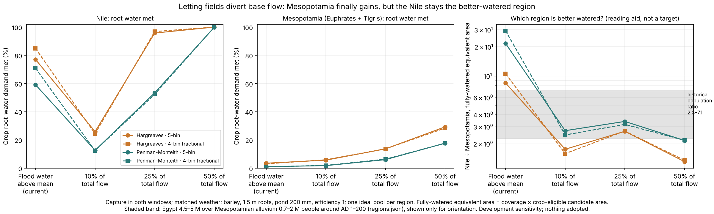

# Base-flow diversion: Mesopotamia gains, the Nile stays better watered

**Outcome.** The declared base-flow sensitivity is complete. Letting fields
divert a share of the total river flow, not just flood water above the annual
mean, is the first change that moves Mesopotamia substantially: at half the
flow its crop root water reaches 18–29%. The Nile still saturates first and
stays the better-watered region at every share tried. Nothing is adopted.

Protocol: [plan](../calibration/base_flow_20261114/plan.json), committed in
`5a718dc8` before any output. Builds on the [capture-season](CAPTURE_SEASON_20261114.md)
and [Tigris](TIGRIS_GAUGE_20261114.md) steps.



## Results (5-bin calendar; the 4-bin fractional calendar is within about 1.5 points)

Capture in both windows, matched weather. Values are Hargreaves / Penman-Monteith
unless marked. "Fully-watered equivalent area" is root-water coverage times the
crop-eligible candidate area (Nile 24,497 km², Mesopotamia 63,986 km²); it is a
descriptive comparison added in reporting, not a declared metric.

| Source rule | River source km³/yr, Nile / Mesopotamia | Nile root water | Mesopotamia root water | Fully-watered equivalent km² (Hargreaves), Nile / Mesopotamia | Nile ÷ Mesopotamia |
|---|---|---:|---:|---|---:|
| Flood water above mean (current) | 39.2 / 11.1 | 77.1% / 59.2% | 3.5% / 1.0% | 18,891 / 2,233 | 8.5 / 21.7 |
| 10% of total flow | 10.7 / 5.8 | 25.9% / 12.6% | 5.7% / 1.8% | 6,347 / 3,617 | 1.8 / 2.7 |
| 25% of total flow | 26.8 / 14.4 | 95.8% / 53.4% | 13.6% / 6.0% | 23,464 / 8,733 | 2.7 / 3.4 |
| 50% of total flow | 53.6 / 28.8 | 100.0% / 99.9% | 29.3% / 17.7% | 24,497 / 18,720 | 1.3 / 2.2 |

- **Flood water only (current):** Mesopotamia is nearly dry; the Nile has 8–22
  times its equivalent watered area.
- **10–25% of total flow:** the Nile is 1.7–3.4 times better watered.
- **50%:** every Nile candidate field is fully watered; the ratio falls to 1.3–2.2.
- The declared "at least 95% of root demand" area stays zero in Mesopotamia at
  every share, because one ideal pool spreads water over all 64,000 km² of
  candidates. That shows the sharing rule, not a hard limit: real canals
  concentrate water on fewer fields.
- The eight flood-only runs reproduce the archived capture-season arrays exactly.

## Reading against history, with care

The plan allowed historical populations only as orientation: Egypt 4.5–5 M and
the Mesopotamian alluvium 0.7–2 M around AD 1–200 give a ratio of about 2.3–7.1
(grey band in the figure). Flood-only capture puts Mesopotamia far too dry;
diverting roughly 10–25% of total flow lands inside or near the band. That is a
hint for the next declared step, not a calibration: these are water diagnostics,
and population depends on far more than root water.

## Checks

Independent review with the reviewed scalar river/soil/pond reference, a
separate capture mask and every source (flood excess and total flow) rebuilt
from the raw gauge pages with Decimal arithmetic: 9,114,336 field-steps,
eligibility, annual field stocks and fluxes, monthly basin ledgers and daily
stocks for all 32 runs; largest annual field difference 7.0e-12 mm. A fresh run
reproduces both files byte for byte; the capture-season outputs are unchanged.

## Limits

Mosul understates the lower Tigris, so Mesopotamia's water is if anything too
low. One ideal pool ignores canal command areas, salinity and drainage, which
historically constrained Mesopotamia. Modern flows. Root water is not grain,
cultivated area or residents.

## Next

Freeze a harvest translation (root water to grain) and declare the
Nile-gain-and-Mesopotamia-non-inflation test with its pass rule before scoring,
using the ratio band above only as a declared target if the plan says so. Then
the whole-empire supply calibration can be rerun with Egypt included.

## Reproduce

```sh
.venv/bin/python -I scripts/base_flow_fields.py
.venv/bin/python -I scripts/base_flow_fields.py --out output/base_flow_20261114/fresh
.venv/bin/python -I scripts/review_base_flow_fields.py
```
