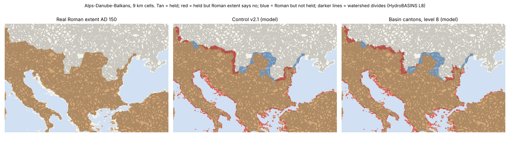

# Basin cantons and river frontiers: Earth test, 16 November 2026

**Outcome: not adopted.** Deciding control per small drainage basin ("canton") keeps the
accuracy of control v2.1 but moves the borders the wrong way. On Earth at 9 km, real
borders of the state space do **not** favour watershed divides; they sit on them
slightly *less* often than on the land around them. Control v2.1 is already about neutral,
which is closer to Earth than the cantons. Control v2.1 stays.

Protocol: [plan](../calibration/basin_cantons_20261116/plan.json), committed before any
canton result. Development on the two seen pools, then one blind run on three pools
never used for a control test.

## Method

* **Basins.** HydroBASINS v1c (Lehner & Grill 2013), levels 7 (about 2,500 km²) and 8
  (about 800 km²), rasterised to the 9 km Earth windows.
* **Canton rule.** Every basin takes the majority of its land: it is territory if at
  least half its cells are v2.1 territory.
* **Scores.**
  * Balanced accuracy against Cliopatria extents.
  * **Divide enrichment**: the share of border cells on a watershed divide, divided by
    the share in the land within 33 cells of the border. A value of 1 means borders ignore
    divides; above 1 means they follow them.
  * River and desert-edge enrichment are reported only.

## Results

Divide enrichment (real = Earth's own borders):

| Pool | Real | v2.1 | Cantons | Accuracy v2.1 | Accuracy cantons |
|---|---:|---:|---:|---:|---:|
| Rome AD 150 (development) | ×0.86 | ×1.01 | ×1.13 | 0.848 | 0.846 |
| Han AD 2 (development) | ×0.94 | ×1.01 | ×1.13 | 0.663 | 0.662 |
| Ming AD 1400 (blind) | ×0.65 | ×1.00 | ×1.10 | 0.717 | 0.719 |
| Late Tang AD 900 (blind) | ×0.86 | ×1.01 | ×1.10 | 0.767 | 0.768 |
| Europe and Near East AD 1200, Bosker cities (blind) | ×0.82 | ×1.01 | ×1.10 | 0.567 | 0.567 |

Level 8 was chosen on development; level 7 was worse (×1.41).

Gates:
* G1 (accuracy not more than 0.01 below v2.1 in every blind pool) passes.
* G2 (divide pattern closer to Earth's in at least two of three blind pools) fails in
  all three.

### River frontiers (diagnostic, workstream E)

Real borders within two cells of a mapped river, relative to nearby land:

| Pool | Real | v2.1 |
|---|---:|---:|
| Rome | ×0.72 | ×0.87 |
| Han | ×1.31 | ×1.48 |
| Ming | ×0.27 | ×1.24 |
| Late Tang | ×0.79 | ×1.28 |
| AD 1200 | ×0.27 | ×1.16 |

Only the Han pool shows real borders on rivers. A general "rivers are frontiers" rule
would therefore push the model further from Earth, so it was not built. v2.1 already puts
borders on rivers more often than Earth does, because its two-day reach often stops at a
river crossing.

The Roman Danube is a famous exception (see the figure): there the real border follows the
river and v2.1 overshoots north of it. At this scale, though, it is an exception rather
than the rule.



## Why this is plausible

The outer edge of the state space at this scale is mostly:
* **coasts**;
* **the reach limit of the road network**;
* in some places, **dry edges**. With this test's narrow desert-edge definition (aridity
  below 0.2 next to wetter land), real borders score ×0.82–1.32, so dry edges are only
  mildly enriched. The 7 November diagnosis found a stronger desert-edge effect for Rome
  with a broader definition.

None of these is a simple terrain line the canton rule could follow.

Watersheds are rarely where empires stopped. Kitamura & Lagerlöf's ridge and river effect
is a finer-scale, internal-border result. These tests score only the outer edge of all
states together, so borders *between* neighbouring states (such as Song and Jin on the
Huai) are not tested. That would need a multi-owner Earth target, which we do not have yet.

## Reproduce

```sh
.venv/bin/python -I scripts/basin_cantons.py prep rome   # likewise han, T6, T7, T8
.venv/bin/python -I scripts/basin_cantons.py dev
.venv/bin/python -I scripts/basin_cantons.py blind       # run once
```

Sources were re-fetched in this container: HydroBASINS, CHGIS V6 (same sha256 as recorded),
the Cliopatria v0.2.1 pinned archive, Bosker et al. (Harvard Dataverse doi:10.7910/DVN/24747),
and Hanson 2016 (rebuilt from the OxREP CSV export; A3 development scores reproduce within
0.002). None are redistributed.
