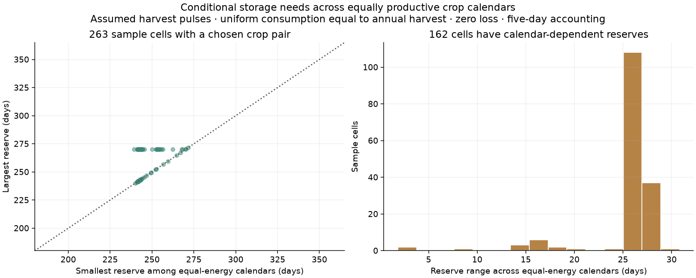

# Reserve requirements across equally productive crop calendars

This prototype connects the experimental joint crop scheduler to a conserved
food inventory without choosing a historical granary capacity, spoilage rate
or population. It retains alternative optimal annual schedules and computes
the range of storage each could require under an explicit scenario. Perennial
harvest timing remains unknown.

## Literature and mathematical scope

The crop-sequence mechanism follows the academic basis documented in
[the sequence report](CROP_SEQUENCES_20261103.md): Waha and colleagues' work on
joint sowing/cropping choices and non-overlapping seasons, plus the inherited
FAO crop-water response. The
[FAO post-harvest framework](https://www.fao.org/4/ac301e/AC301e03.htm) distinguishes
production, storage and consumption. Neither source supplies a universal
200 AD granary capacity or storage-loss coefficient.

The reserve calculation here is **our explicit inventory scenario and algebra**,
checked against the existing food-ledger implementation. It is not a reproduced
published model of ancient storage behavior. Meals are uniform and annual food
need equals annual edible harvest. Food arrives in pulses at climate-bin
maturity boundaries rounded to an inventory step. Loss is zero to measure a
mathematical minimum; actual losses and safety margins can only add constraints.
Seed and processing deductions are already included in net harvest and are
not applied twice.

For two harvests, balanced annual supply means the required stock equals the
largest of either harvest's energy and either inter-harvest gap's demand,
less the immediate meals at the harvest step. Single-harvest storage equals
one year's demand less those immediate meals. All values are divided by daily
need and reported in **days of the specified demand**, not tonnes or people.
The formula matches the independent cyclic-deficit inventory algorithm and
the repeating-stock simulation in 120 fixed random cases at three resolutions.

## Same fixed r43 fantasy sample

| Diagnostic | Result |
|---|---:|
| Sample cells | 4,096 |
| Cells with a timed annual optimum | 4,091 |
| Unknown perennial-only harvest timing | 5 |
| Cells where equal-energy calendars require different reserves | 162 |
| Largest reserve range across tied annual calendars | About 31 days of demand |
| Largest bound difference between five-day and one-day accounting | 4 days |

The scatter shows the 263 sample cells whose example optimum contains a crop
pair. The histogram omits cells with zero reserve range. These are systematic
sample counts, not map-wide areas. A one-harvest year needs 360 days of demand
in storage on the five-day clock, versus 364 on the daily clock. The difference
comes from meals consumed immediately in the harvest step, not historical
evidence for different granaries.

The model reports bounds over all tied optimal annual schedules. The example
schedule used for labels does not determine those bounds. Five perennial-only
cells have blank CSV bounds, rather than false zeros. If an annual and perennial
option tie, an annual range can be reported while perennial timing remains
explicitly unknown.

## Limits and next checks

This is a perfectly repeating, zero-loss, uniform-demand scenario with no
production slack. It estimates no shortage frequency or famine probability.
The underlying crop-water approximation, secondary-crop discount and water
gate still require agronomic validation. Climate-bin maturity is not a real
harvest date. Add observed-calendar evaluation, sequential soil moisture,
period-specific storage evidence and harvest-timing sensitivity before adopting
world food-security maps. The original production yields and population layers
remain unchanged.

Implementation: `harvest/calendar_stocks.py`. Driver:
`scripts/review_calendar_storage.py`. The receipt and per-sample CSV are in
`output/calendar_storage_20261103` and the browser economy lab.
