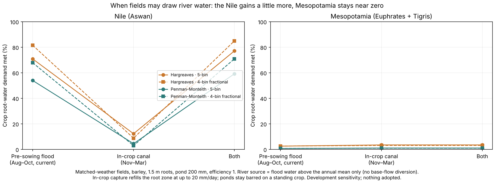

# Capture season: the Nile gains, Mesopotamia does not inflate

**Outcome.** The declared capture-season sensitivity is complete. Letting fields
also draw river water while the crop stands (canal-style refilling of the root
zone) adds 3–6 points of crop root water on the Nile and at most about one point
in Mesopotamia, where coverage stays between 0.9% and 3.5%. No capture season
inflates Mesopotamia. Under the current source rule, which takes only flood
water above the annual mean, the source rule rather than timing is now what
limits Mesopotamia. Nothing is adopted.

Protocol: [plan](../calibration/capture_season_20261114/plan.json), committed in
`0042b81b` before any output. Builds on the [Tigris step](TIGRIS_GAUGE_20261114.md).



## Results

Crop root-water demand met (area-weighted over crop-eligible fields), and
delivered river water in km³/yr (pre-sowing / in-crop / both).

| Region · reference ET · calendar | Pre-sowing (current) | In-crop canal | Both | Delivered km³ |
|---|---:|---:|---:|---|
| Nile · Hargreaves · 5-bin | 70.83% | 12.25% | 77.12% | 22.35 / 1.09 / 23.30 |
| Nile · Hargreaves · 4-bin fractional | 81.52% | 8.78% | 84.97% | 22.73 / 0.55 / 23.19 |
| Nile · Penman-Monteith · 5-bin | 53.93% | 4.44% | 59.18% | 27.96 / 1.09 / 29.02 |
| Nile · Penman-Monteith · 4-bin fractional | 67.85% | 2.93% | 70.90% | 28.50 / 0.55 / 29.03 |
| Mesopotamia (Euphrates + Tigris) · Hargreaves · 5-bin | 2.52% | 3.49% | 3.49% | 0.86 / 1.15 / 2.01 |
| Mesopotamia (Euphrates + Tigris) · Hargreaves · 4-bin fractional | 2.60% | 3.08% | 3.08% | 0.86 / 0.57 / 1.43 |
| Mesopotamia (Euphrates + Tigris) · Penman-Monteith · 5-bin | 0.67% | 1.05% | 1.05% | 0.86 / 1.15 / 2.01 |
| Mesopotamia (Euphrates + Tigris) · Penman-Monteith · 4-bin fractional | 0.73% | 0.93% | 0.93% | 0.86 / 0.57 / 1.43 |

- **Nile:** most of the gain is already in the pre-sowing flood; adding in-crop
  capture lifts it by about 3–6 points. In-crop capture alone is weak (3–12%)
  because the Nile is low in winter.
- **Mesopotamia:** in-crop capture uses the only above-mean flood water inside
  the crop window, in March; coverage rises from 2.5–2.6% to 3.1–3.5%
  (Hargreaves) and from 0.7% to 0.9–1.0% (Penman-Monteith). Pre-sowing capture
  adds nothing on top.
- The eight pre-sowing runs reproduce the archived arrays exactly (Nile from the
  matched-weather run, Mesopotamia from the Tigris run).

## What this means for the Egypt problem

The test the harvest work needs — the Nile gains while Mesopotamia does not
inflate — holds for every capture season tried. The next limit is the source
rule: real Mesopotamian canals diverted winter base flow, which the
above-the-mean rule cannot reach. A base-flow diversion scenario has to be
declared and run on both regions together, because it is the one change that
could inflate Mesopotamia.

## Checks

Independent review with the previously reviewed scalar river/soil/pond
reference, the capture mask separated from the pond mask by declared text
substitutions, and sources rebuilt from gauge results and raw pages:
6,835,752 field-steps, eligibility, annual field stocks and fluxes, monthly
basin ledgers and daily stocks for all 24 runs; largest annual field difference
6.1e-12 mm. A fresh run reproduces both files byte for byte; protected
matched-weather and Tigris outputs are unchanged.

## Limits

Mosul understates the lower Tigris; one ideal pool per region; in-crop requests
refill soil to capacity, an efficient-irrigation bound; root coverage is a water
diagnostic, not grain, area or residents.

## Reproduce

```sh
.venv/bin/python -I scripts/capture_season_fields.py
.venv/bin/python -I scripts/capture_season_fields.py --out output/capture_season_20261114/fresh
.venv/bin/python -I scripts/review_capture_season_fields.py
```
