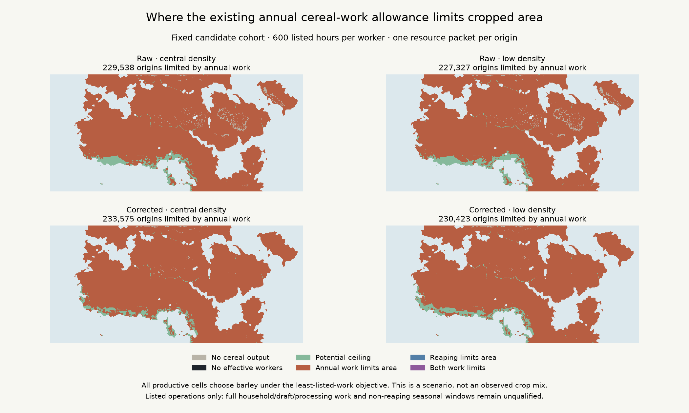
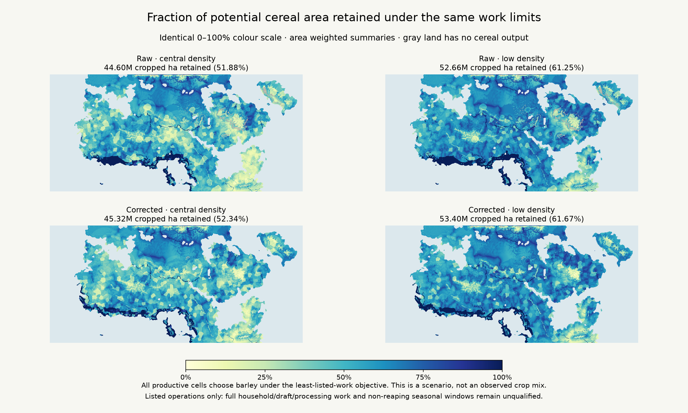

# Cereal area and work recovered by origin — 17 November 2026

The existing annual grain model now has a reusable per-origin crop-activity
packet, with **all416 original scalar controls exact across32 supply scenarios**.
Every majority-land origin is retained, including places without cereal output.
Marketed-share alternatives reference the same physical activities, so they
cannot create duplicate hectares or workers in a later seasonal account.

Two findings matter for the realism programme:

* **Every productive origin selects barley.** This is the result of minimizing
  the listed work per net calorie among the two supplied cereals. It is not an
  observed AD200 crop mix or a complete diet, and should not be presented as one.
* **The annual allowance limits area; the supplied reaping limit does not.**
  All work-limited cells in these existing cases bind on annual listed hours.
  A30-day reaping allowance cannot diagnose bottlenecks in the remaining tasks,
  which have no seasonal placement in this packet.





These are inspection maps of the unchanged candidate scenario, not a new
published settlement atlas. Both figures use the same native463×1000 grid and
the same241,889 majority-land source cells. The four panels hold hours at600
and show raw/corrected climate and central/flat density separately.

## What was recovered

The [frozen task](../calibration/roman_benchmark_20261117/cereal_activity_packet.json)
and [precision rules](../calibration/roman_benchmark_20261117/cereal_activity_precision.json)
precede the packet. Inputs are archived crop energies, arable fractions, work
rates, cell areas, source populations and the existing supply results. No climate,
crop, route, placement, source-population or new parameter scenario is calculated.
The unchanged field-support arithmetic is replayed16 times, solely to recover
and control the16 distinct existing model/climate/density/hour cases.

Origin ID is `row*1000+column`; IDs match in both climate scenarios. The two
tracked NPZ files contain shared crop/area/yield/work-rate fields, eight distinct
rural population vectors across cohorts/climates/densities, and16 retained-area
fractions across the two files. The32 supply scenarios alias these physical
cases. The reader materializes potential/retained hectares, net yield, workers,
annual/reaping allowances and use, production, rural need/retention/shortfall,
surplus and signed precision residuals. It performs multiplication and accounting
identities, not another constraint solve.

Download the [raw packet](../output/cereal_activity_packet_20261117/activities_raw.npz),
[corrected packet](../output/cereal_activity_packet_20261117/activities_corrected.npz),
[schema](../output/cereal_activity_packet_20261117/schema.json),
[case summaries](../output/cereal_activity_packet_20261117/cases.csv) or
[scenario aliases](../output/cereal_activity_packet_20261117/scenario_aliases.csv).
The two compressed packets total about54.3MB; physical cases and common fields
are deduplicated rather than storing a separate full activity table per share.

## Area and limitation results

| Candidate case | Potential cereal area, million ha | Retained area, million ha | Area retained | Origins limited by annual work |
| --- | ---: | ---: | ---: | ---: |
| Raw / central /600h |85.979|44.603|51.88%|229,538|
| Raw / flat100/ha /600h |85.979|52.661|61.25%|227,327|
| Corrected / central /600h |86.589|45.316|52.34%|233,575|
| Corrected / flat100/ha /600h |86.589|53.397|61.67%|230,423|
| Raw / central /300h |85.979|23.027|26.78%|238,704|
| Corrected / central /300h |86.589|23.137|26.72%|241,302|

Area retention differs from calorie retention because modeled yield varies
between origins. For example, corrected central600h retains52.34% of potential
cropped hectares and53.59% of potential grain calories. Both quantities remain
conditional on the supplied land-use, crop-choice and work recipe. Excluded
potential area is not historically available land waiting to be cultivated.

The raw packet has238,796 barley origins and3,093 with no selected cereal;
corrected has241,391 and498. Neither has a selected wheat origin. Both exclude
3,142 coastal farm-mask cells outside the existing majority-land transport
domain. We preserve that domain instead of expanding the population/work budget.
Cereal area and yield are undefined (`NaN`) where no cereal is selected. Those
origins remain in source IDs, rural meals and deficits; unknown cereal area does
not mean zero residents or zero essential work.

Relative-utilization checks separate active work constraints from a potential
ceiling. They use no absolute near-zero floor. All16 cases have zero origins
limited by reaping, both work constraints, or zero effective workers. This is
the behavior of these supplied allowances, not evidence that historical harvests
were unconstrained. For barley, reaping is32/208 of listed hours: even600 listed
hours/worker can require at most about92.31 reaping hours/worker, below the
supplied240-hour peak allowance. Increasing that allowance would not change
these cases; other tasks and resource windows need attention first.

## Precision and checks

Potential grain reconstructs exactly from archived energy, land-area and arable
inputs. Old work rates are float32 snapshots promoted exactly to float64; they
are not silently replaced with208 or336 hours/ha divided by a new yield.
Per-hectare area/work equations therefore retain tiny signed residuals. Maximum
relative listed-hour residual is about5.90×10⁻⁸. Corrected central600h sums to
about−194.94 listed hours across the entire grid. It is a rounding residual,
not a worker credit or an extra work pool.

Independent review caught an extra float32 rounding in the first recovery code's
hectare conversion. The recovery now promotes the stored cell area before that
conversion. The original input area snapshot, crop energies, work rates, retained
fractions and every original production/work result remain unchanged.

The separate reviewer independently decodes the three needed harvest fields,
checks crop choice and source identity at every origin, uses scalar division and
minimum operations to derive retention, and checks every materialized area/work/
food column. The packet reader is the interface under test, not the review's
constraint implementation. Prior independent freight/food reviews are reused;
this stage makes no new freight-physics or historical-validation claim.
All scientific outputs reproduce byte for byte in an isolated fresh directory.
Figure source arrays, categorical counts and displayed area summaries are checked
against the packet, and the figures are visually inspected before qualification.

```python
from pathlib import Path
from scripts.cereal_activity_packet import load_packet, activity

folder = Path('output/cereal_activity_packet_20261117')
p = load_packet(folder, 'corrected')
a = activity(p, 'candidate', 'corrected', 'central', 600.)
# a['origin'], a['retained_area_ha'], a['annual_hours_used'], ... align exactly.
```

```sh
.venv/bin/python scripts/cereal_activity_packet.py
.venv/bin/python scripts/cereal_activity_packet.py --out output/cereal_activity_packet_20261117/fresh
.venv/bin/python scripts/review_cereal_activity_packet.py
.venv/bin/python scripts/render_cereal_activity_packet.py
.venv/bin/python scripts/seal_cereal_activity_packet.py
```

Completed receipts are preserved; use an isolated output path for reproduction.
The next preparation is explicit operation demand on these same hectares and
workers: ploughing, harrowing, hoeing and reaping, with the rounding remainder
kept separate. It must identify missing human/draft/processing requirements and
operation windows before claiming seasonal feasibility. Both density alternatives
and the single-barley limitation remain visible; no default atlas or climate change.
