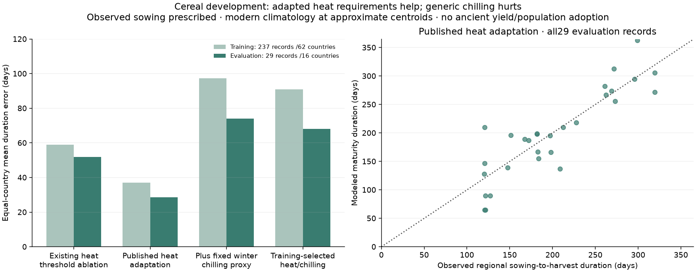

# Daily cereal development: conditional calendar evaluation

The new isolated clock implements heat accumulation, chilling effectiveness,
vernalization reduction and optional photoperiod response from
[Schaphoff et al. (2018), LPJmL4 §2.6.2, equations73–79](https://doi.org/10.5194/gmd-11-1343-2018).
Supplement Tables S10/S11 supply the cereal heat ranges and senescence fraction.
Photoperiod is insensitive in the reference run, as in the paper; enabling it
requires explicit cultivar thresholds. This is not LPJmL biomass, yield,
frost survival or endogenous cultivar selection.

`harvest/phenology.py` independently implements the published mathematics.
Reference v4 commit `d25d8739ad90` was checked for the boundary convention at
PVD≤10 and the winter-heat lower bound, where the printed expression is
ambiguous. No upstream C code is imported. Source identities and adaptations
are retained in the declared plan.

## Evaluation declared before fitting

`calibration/cereal_phenology_20261103/plan.json` was committed before scoring.
It partitions all calendars of a country together using a fixed hash. There
are237 training records/62 countries and29 evaluation records/16 countries;
all19 QC exclusions are recorded. Global duration/exposure summaries of this
dataset were already inspected, so this is not an untouched dataset. Neighboring
countries and regional observations can remain correlated.

Sowing midpoints come from the Sacks2010 records. WorldClim2.1 temperature is
sampled at approximate crop-area-weighted regional centroids and interpolated
to daily means. Centroid climate is not a crop-area-weighted regional field;
source climate periods also differ. We predict elapsed physiological-maturity
days conditional on supplied sowing, not sowing dates or harvest operations.

Only a shared heat scale and shared winter chilling requirement are trained.
Heat requirements stay inside published ranges. Fixed45-day chilling is an
explicit proxy, not a claimed LPJmL default or reproduction of equation77.
The selected0.8 heat scale/15-day winter requirement and all training results
were committed in `f805ea3c` before evaluation scoring. No region-specific fit
or Earth climate holdout was used.

## Complete results

| Predeclared clock | Training error, days | Evaluation error, days | Evaluation cases without maturity |
|---|---:|---:|---:|
| Existing heat-threshold ablation | 58.96 | 51.99 | 0/29 |
| Published heat adaptation, no chilling | 36.96 | 28.56 | 0/29 |
| Same adaptation with fixed winter chilling proxy | 97.28 | 74.05 | 2/29 |
| Training-selected heat/chilling pair | 90.86 | 68.06 | 2/29 |

Errors are equal-country means of absolute duration errors. Failure to mature
within365 supplied days costs365days and remains in the denominator. The
existing-threshold comparator is a thermal-only ablation, not the production
atlas's harvest-date prediction accuracy.

A fixed heat-only comparator improves this limited conditional-duration check.
The actual trained chilling candidate performs worse than that comparator and
the existing-threshold ablation. No adoption gate has passed. The results
support further work on thermal adaptation, while a blanket cold requirement
for every source-labelled winter calendar is unsupported here. Cultivar
requirements and endogenous adaptation need their own evaluation.

## Integration status

The clock is available, with analytic tests for chilling limits, maturity,
senescence, photoperiod and vectorized cultivar fields. Country-training tests
verify that changing evaluation targets cannot change the selected parameters.
Production crop yields, population and r43 physics remain unchanged. Water,
biomass, frost survival, cultivars and historical practices still need validation
before adoption. This evaluation pool is now scored; future reuse must not be
described as an unseen test.

Driver: `scripts/evaluate_cereal_phenology.py --stage select`, commit its
selection, then `--stage evaluate`. The evaluator refuses uncommitted selection
or changed source/input hashes. Complete records, exclusions, all predictions
and metrics are under `output/cereal_phenology_20261103`.
