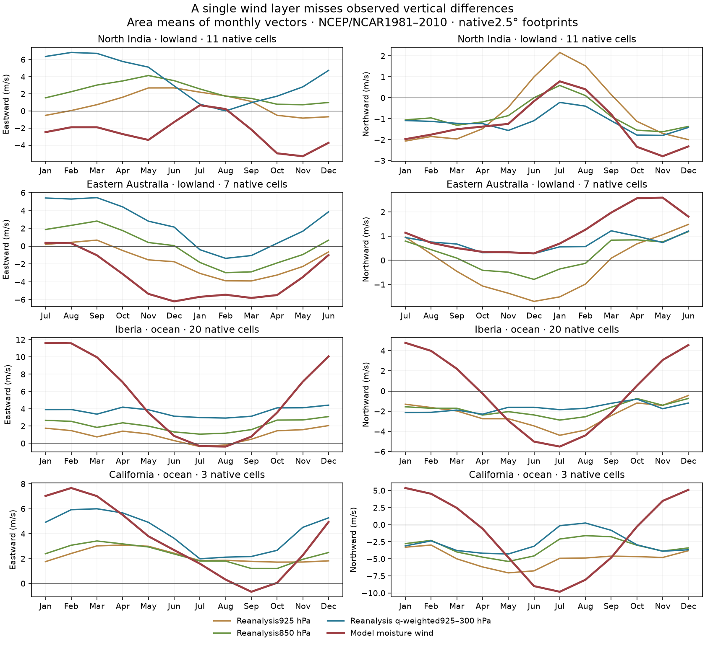
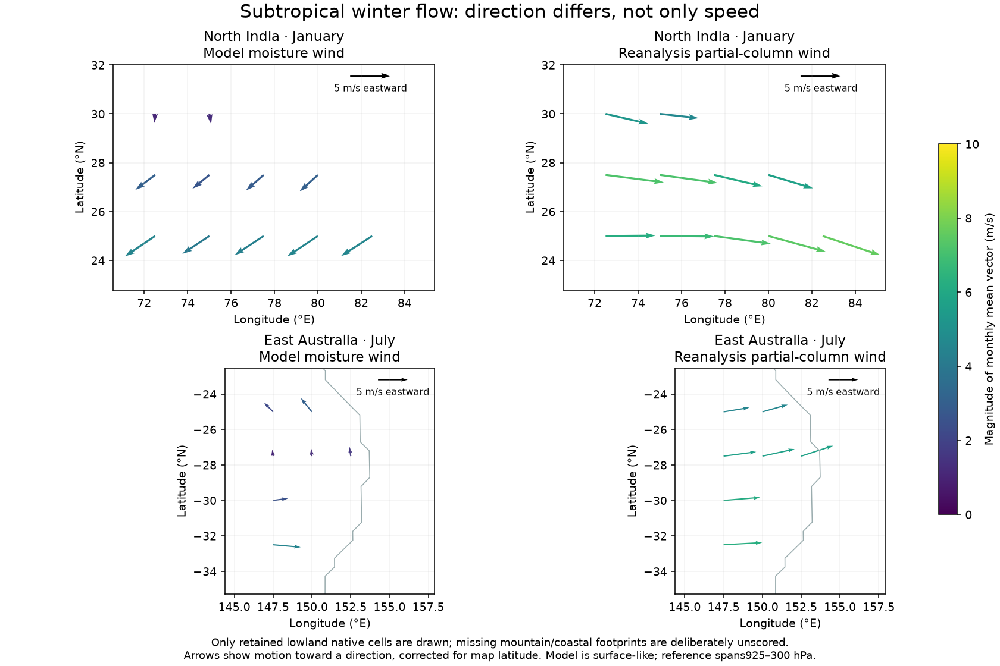

# Production winds against pressure-level reanalysis

The new circulation audit identifies a direction/height problem that a wind-speed
limit cannot solve. Over retained North India lowlands, r39's single moisture
wind layer blows broadly westward outside summer; the humidity-weighted
925–300hPa reference is eastward. Over Iberia's retained ocean footprints,
the modeled monthly mean vector magnitude is too large. These are circulation
diagnostics, not an adopted rainfall improvement or proof of rainfall causation.

All four unchanged56km integrations reproduce their archived float32 monthly
temperature/rain and observations exactly, retain identical derived geography,
and pass strict numerical certificates. No atmospheric reference enters a model
integration. The fixed plan was committed before running the model. Earlier
V10 atmospheric experiments remain separate from this production r39 audit.

| Region and footprint | Native cells |925hPa vector RMSE |850hPa vector RMSE |q925–300hPa vector RMSE | Partial-column direction cosine |
|---|---:|---:|---:|---:|---:|
| North India lowland |11|4.21m/s|5.32m/s|7.21m/s|−0.54|
| Eastern Australia lowland |7|3.09m/s|4.16m/s|6.27m/s|−0.14|
| Iberia ocean |20|7.37m/s|7.11m/s|6.99m/s|0.66|
| California ocean |3|6.79m/s|6.69m/s|6.96m/s|0.39|

Direction cosine excludes monthly footprint pairs with either vector slower
than1m/s; the retained physical-area/month-duration fraction is recorded.
It is not the cosine of just the annual regional mean. RMSE combines both
components with actual-month/physical-area weights. Mean vector magnitude,
component biases and all monthly regional vectors are also downloadable.
For Iberia ocean, modeled mean vector magnitude is7.77m/s versus4.21m/s in
the partial column. North India's corresponding values are3.07/4.09m/s:
merely changing speed would miss the direction difference.

## Geometry and atmospheric definitions

References are public NOAA PSL NCEP/NCAR Reanalysis1 monthly climatologies,
1981–2010, on a native2.5-degree pressure grid. Existing SHA-verified V10
California/Iberia ASCII subsets are reused. Eight small NI/Australia subsets
are separately acquired, dimension/coordinate/unit checked and SHA-recorded.
No global download, new dependency or NOAA authentication is required.

Model right/up velocities are converted to geographic east/north with the
inverse full azimuthal-equidistant projection Jacobian. That projection is
not conformal: normalizing its basis would discard metric factors. Southern
model-up is reflected back to physical map-north first. Calendar overlap
matches reference wind months using actual model steps; southern references
retain physical July-through-June order with the declared half-year phase.
Legacy climate scores continue to use their original equal-month definition.

Model vectors are aggregated by true area into native reference footprints.
Only cells with at least80% physical-area coverage inside the scored rectangle
are retained. Mixed20–80% land/coast footprints are excluded from both groups.
Every monthly925hPa height must exceed the footprint's maximum model mean
terrain elevation, and be positive. This deliberately excludes many mountains.
There are no retained California land cells; its three ocean cells are a very
small sample. The four sets have24/27 retained land/ocean native footprints
in total, plus eight excluded mixed footprints. Spatial/monthly dependence
remains; native cells are not independent statistical replicates.

925hPa and850hPa winds are compared separately. The partial-column diagnostic
uses trapezoidal pressure integration over925/850/700/600/500/400/300hPa:
`Uq = integral(q U dp) / integral(q dp)`. The legacy reader returns dry-air
mixing ratio, so it is explicitly converted back to specific humidity before
weighting. The source is a product of monthly means, which omits transient
`q'u'` moisture covariance. It omits water below925hPa and above300hPa.
There is no claim to have measured full atmospheric moisture transport.

Native reanalysis below-ground flags are unavailable in these products. The
mask is conservative relative to model geography, not proof of native terrain
validity. Reanalysis is model-assisted, rather than independent point wind
observations. Its1981–2010 period differs from WorldClim1970–2000 rainfall.
The surface-like model and several pressure targets represent different heights;
the model cannot reasonably be required to match all of them simultaneously.

## Development implication and reproduction

The sign and season differences justify testing a physical vertical-shear
closure rather than another uniform speed multiplier. A thermal-wind response
to the modeled horizontal temperature gradient is one possible next experiment;
it would need a declared height assumption and equatorial validity treatment.
No such mechanism is adopted by this audit. Rain, temperature, ocean and
regional safeguards still apply to any subsequent candidate.

Run `.venv/bin/python scripts/check_circulation.py --fetch --run` from the
matching source epoch. `--fetch` alone only acquires/verifies references.
Frozen code, source URLs/checksums, case identities and records live in
`output/circulation_audit_20261026/`. Optional local NPZs retain monthly native
vectors, masks, areas and partial water columns. Changed sources require a new
output folder; do not bypass the epoch guard to resume this completed audit.
Seven known-answer tests cover metric/reflection, humidity conversion,
pressure integration, reversed vectors and footprint/terrain exclusions.

Four reused regions do not measure global wind skill. Qualified Earth physics
remains r39; the normal world Earth atlas remains r38 after its earlier failed
transfer tests. Climate, food, population and trade fields are unchanged.
The new charts/data are in the launcher-linked accuracy companion.

