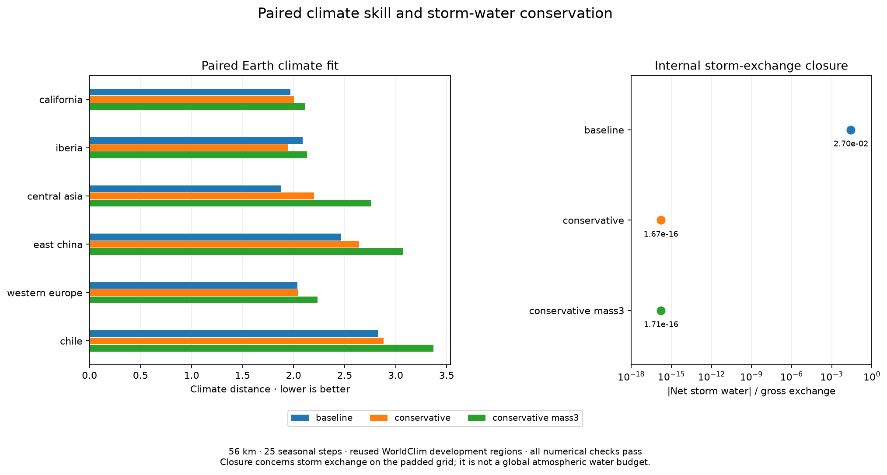

# Climate physics and calibration — 23 October 2026

## Milestone 1: conservative storm-water exchange

The production storm approximation applies a spatially varying rate after
Gaussian mixing: `r_i * (G(W)_i - W_i)`. Even on a closed domain this can
create or remove water. The new opt-in `eddy_moisture_scheme="conservative"`
uses symmetric pair conductances instead. For column mass `c`, specific
humidity `q=W/c`, and reflecting Gaussian `G`, the transfer from j to i is

`G_ij * (r_i*c_i + r_j*c_j)/2 * (q_j - q_i)`.

Each transfer has an equal and opposite partner. Rates and incoming water
stay nonnegative, and uniform specific humidity is an equilibrium. The loss
coefficient enters the implicit solver; incoming water is updated by the
existing checked nonlinear iteration. Reflecting Gaussian kernels agree
with SciPy, including the FFT implementation for wide kernels. The fixed
outer ring remains a reservoir: its delivery to the solved interior is
recorded explicitly. This conserves **storm exchange**, not the entire
atmosphere: the existing mean-wind concentration advection, prescribed
circulation and subsidence closure remain approximations.

The old crest-clipping option removes mixed vapour without adding that loss
to rainfall. It is incompatible with this scheme and rejected explicitly;
`eddy_rainout=0` is required. The default remains `legacy`, preserving saved
fits. No atlas climate or physical parameter file changes in this milestone.

### Paired Earth pilot

Four predeclared profiles were run on six cached WorldClim development
regions at 56 km, 25 seasonal steps, with the saved strict linear,
temperature and nonlinear moisture criteria. The baseline uses the current
Earth-fit physics. All **24 cases** pass every observed numerical check.
These regions have been used previously; they are not independent validation.

| Profile | Mean climate distance, lower better |
|---|---:|
| Current physics | 2.211846 |
| No crest clipping | 2.211846 |
| Conservative exchange, equal column mass | 2.284636 |
| Conservative exchange, column mass scale 3 km | 2.612372 |

Earth physics already has crest clipping disabled, so its control exactly
reproduces the baseline. Conservative exchange improves Iberia from 2.090786
to 1.941968 but worsens Central Asia from 1.876983 to 2.198520 and East China
from 2.465534 to 2.642198. It therefore needs calibration and **is not
promoted** as a better climate fit. The 3 km mass profile is also retained
as a negative result.

Across the conservative cases the maximum storm-exchange cancellation error
is below **1.72e-16** of gross exchanged water. The baseline maximum is
0.026963. These full padded-grid operator measurements include the Gaussian
edge rule; they are not estimates of a planet-wide rainfall bias.

The reproducible protocol, per-region temperatures/rainfall/Köppen metrics,
all parameters, source hashes, numerical certificates and boundary exchanges
are in `output/climate_physics_20261023/earth_pilot/`. Run with:

```sh
.venv/bin/python -I scripts/screen_climate_physics.py \
  --profiles calibration/climate_physics_20261023/storm_profiles.json \
  --regions california iberia central_asia east_china western_europe chile \
  --out output/climate_physics_20261023/earth_pilot --workers 2
```

Thirteen new focused tests cover Gaussian symmetry, pairwise conservation,
terrain mass, humidity-variance dissipation, zero rates, invalid mass,
unaccounted crest clipping, and a coupled climate solve whose recorded
moisture residual matches the new exchange. Existing core, Earth, moisture,
transport, seasonal-column and solver-certificate tests also pass.

## Milestone 2: calibrate the climate that the atlas actually displays

The former calibration averages scores over surroundings layouts; atlas
publication averages their temperature/rainfall fields before classification.
Those operations differ for nonlinear climate rules, biome boundaries and
outside-diagram penalties. A search could therefore select a winner for a
different mathematical objective from the published atlas.

New CLI searches default to `--ensemble-objective climate`: they use the
same shared `ensemble_mean` function as atlas publication, then measure all
fit metrics and source-terrain coverage on that averaged climate. Every
layout is evaluated; racing is disabled and explicitly rejected if requested.
The Python API retains its previous `scores` default, and
`--ensemble-objective scores` explicitly reproduces historical searches.
Saved publications and their reported scores are unchanged.

The shared average rejects mismatched calendars, physical parameters or
geography inside the mapped domain. It preserves failed member numerical
certificates. New calibration checkpoints have a configuration sidecar with
objective, aggregation, layouts, parameter bounds, coefficients, source/input
hashes and optimizer settings; incompatible resumes fail rather than mixing
objectives. A bounded `storm-water` search space varies eight moisture/storm
coefficients while retaining the selected exchange scheme and world geometry.

Six focused tests prove the distinction with a nonlinear manufactured score
(mean scores 5 versus score of mean climate 4), exact agreement with the
atlas's averaging path, source-terrain coverage after averaging, rejection of
incompatible members and racing, preservation of failed certificates, and
the new CLI default. All 36 calibration, Whittaker coverage and storm tests
pass. Earth retuning and map comparisons are separate experiments; changing
the search objective alone is not claimed as an accuracy gain.

## Milestone 3: reject simple storm retunes and repair the Earth search

Two predeclared follow-up screens completed another **64 regional runs** on
the existing eight training regions, with all strict numerical checks passed.
Their control reproduces the earlier training baseline to the precision of
the saved strict solver profile. These are reused fitting regions.

| Conservative-exchange retune | Training climate distance |
|---|---:|
| Current legacy control | 2.121919 |
| Original coefficients | 2.138911 |
| Eddy rate 2/day | 2.138709 |
| Ocean humidity 0.78 | 2.269966 |
| Eddy rate 2/day, humidity 0.78 | 2.286736 |
| Land recycling 0.55 | 2.173356 |
| Eddy rate 2/day, recycling 0.55 | 2.167700 |

None beats the control, so this screen selects no profile for publication.
In particular, increasing moisture supply is not a general solution to the
regional tradeoffs. Conservative cancellation remains below 1.79e-16 of
gross storm exchange in these cases. Full rainfall, temperature, seasonal
and classification diagnostics are in `earth_retune/` and `earth_recycling/`
under `output/climate_physics_20261023/`.

The Earth CMA calibrator previously overrode a verified start's linear
tolerance and disabled strict linear convergence. It also exceeded an
evaluation budget when the remaining budget was smaller than one optimizer
population, and failed to save the starting fit for a one-evaluation run.
It now preserves saved verified numerical profiles, records each region's
observed numerical certificates, respects complete-population budgets and
saves the baseline immediately. Six tests cover verified and legacy profiles
and evaluation budgets 1, 8, 9 and 18. A `--plan` option exposes the exact
configuration without running, and `storm_water` supplies the bounded
eight-coefficient search for continuous Earth retuning.

The map-round driver separately calibrates free and Whittaker moisture
coefficients and the Earth fit's world geometry, always on the actual
three-layout mean climate. It checks that search bounds do not clip the
supplied baseline. Coarse candidates require paired finer-grid and native
checks before any atlas publication; their calibration gain is not itself
an atlas accuracy claim.



## Milestone 4: make resolution and regional protections decide selection

Both initial ds64 moisture searches completed all **17 candidates** with no
failed numerical checks and no racing. They optimize the three-layout mean
climate, not the former mean of layout scores.

| Search | Starting objective | Best coarse objective |
|---|---:|---:|
| Free seasonal zone fit | 0.449438 | 0.459834 |
| Whittaker covered-biome fit | 0.482832 | 0.547069 |

These are deliberately coarse screens, not atlas gains. The free winner
loses its apparent improvement at ds32: **0.480249 → 0.465920**, with cold-dry
recall falling **54.84% → 45.97%**. It is rejected. Its same-resolution
published-world baseline was reused from the physical pilot, with verified
layout identities and successful observed numerical certificates.

The Whittaker coarse winner increases source-land grey from **0.00113% to
1.03699% on that same coarse climate**. It is not adopted as-is. The adaptive
refinement retains its other moisture coefficients, restores the baseline
orographic coefficient, sets ocean humidity to 0.74, and compares lapse rates
4.25 and 4.0 K/km. The full starting profiles and rationale are recorded in
`calibration/climate_physics_20261023/whittaker_refinement.json`. This is a new
refinement experiment, not a retroactive claim that the original search
passed publication gates.

`review_climate_round.py` compares saved baseline fields with candidate
fields at the same weather resolution. It preserves the existing exact-zone,
cold-dry, hot-dry and Mediterranean protections. Whittaker must also improve
its covered score, meet the strict-biome floor and have **no increase in
outside-diagram land** relative to its paired baseline. Each completed native
layout is checkpointed separately; the final mean checkpoint can be passed
directly to the atlas exporter. Interrupted verification need not repeat
completed layouts. Three tests verify the selection protections and layout
identities. Native reviews remain separate from actual atlas publication.

## Milestone 5: coupled terrain-aware exchange and explicit target policies

The map physics pilot completes **eight three-layout mean climates** at ds32:
24 individual simulations, **61,612 checked linear solves and 792 temperature
steps**, all successful. Terrain-aware conservative exchange eliminates grey
land in this *coarse* Whittaker scenario but loses annual-biome fit; it is a
mechanism to calibrate, not an already-qualified atlas replacement.

| World / exchange | Zone objective | Strict biome objective | Source land outside, ds32 |
|---|---:|---:|---:|
| Free, legacy | 0.480249 | 0.491316 | 7.2482% |
| Free, conservative | 0.476910 | 0.501056 | 7.2480% |
| Free, conservative with 3 km carrier scale | 0.475271 | 0.492195 | 4.2128% |
| Whittaker, legacy | 0.346002 | 0.513383 | 0.1480% |
| Whittaker, conservative | 0.336201 | 0.503344 | 0.3727% |
| Whittaker, conservative with 3 km carrier scale | 0.333090 | 0.484832 | 0.0000% |

These source-pixel percentages classify weather simulated at ds32; they are
not the native atlas's 1.21% figure. The unclipped legacy controls and all
per-layout certificates are retained in `map_pilot/`. Changing an operator
does not establish predictive accuracy merely because its budget closes.

A further nine-candidate free search retunes the conservative scheme around
the selected coarse coefficients: its own starting score 0.451263 improves
to 0.457404 at ds64, with zero numerical failures. This is also a coarse
candidate requiring a paired finer check. All complete candidate journals
are now retained alongside their parameter, source and optimizer manifests.

Before evaluating the humidity/lapse refinement outcomes, the promotion
policy is made explicit by target definition in `selection_policy.json`.
Free and Earth retain seasonal-zone and Mediterranean protections. Whittaker
uses its **annual** covered-biome objective, exact allowed-biome agreement,
strict-biome floor and no increase in grey land. Its seasonal metrics are
always reported to show the different hypothesis. Annual biomes do not
encode a Mediterranean precipitation season, as documented in the original
crosswalk. The initial coarse Whittaker winner still fails its grey-land
constraint under this policy; the rejected free winner is also unchanged.

Completed finer checks reject the free secondary candidate (zone objective
0.480249 → 0.480132) and conservative retune (0.480249 → 0.472616, also losing
protected exact-zone and cold-dry agreement). The mild Whittaker refinement
improves its covered objective to 0.525316 but increases outside-diagram land
from 0.1480% to 0.5149% at ds32, so it is rejected even under the annual
selection policy. The terrain-aware Whittaker coarse retune completes all
nine candidates, improving 0.484884 → 0.509827; it has not passed finer or
native checks and is not published.

The Earth geometry search completes 17 candidates, improving its map objective
0.161213 → 0.169138 without changing Earth physics. Separately, the conservative
Earth physics search completes nine candidates and all eleven final regional
comparisons. Its best combined training distance, 2.1284, remains worse than
the legacy control's 2.1219. No rainfall accuracy gain is inferred from either
search. All complete journals and regional diagnostics are retained.

The user has now prioritized observed rainfall accuracy. Further fantasy-map
searches and the partially completed native Earth geography review are paused;
its completed first-layout checkpoint is retained for an explicit later resume.
No atlas climate has been replaced by this campaign. The next round will
separate rainfall losses from temperature and biome scores. The 46 targeted
calibration, exchange, ensemble, coverage and selection tests pass.
