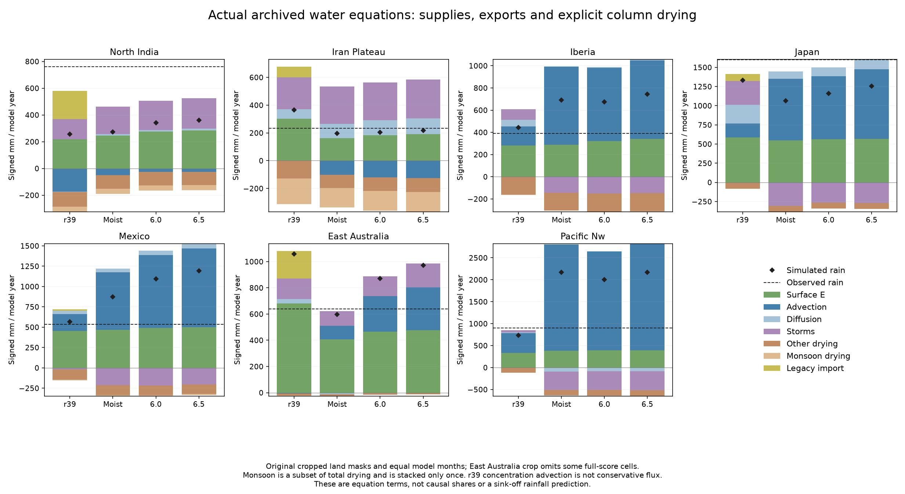
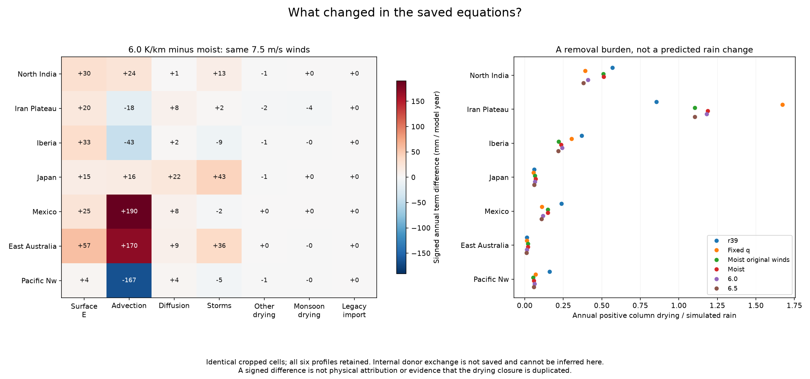

# Explicit column drying in the archived climate equations — 27 October 2026

The environmental-profile comparison changes rainfall mainly alongside changes
in the saved advection and evaporation terms. Its explicit column-drying term
changes little in the regions with the largest rainfall shifts. This is an
**equation audit**, not causal attribution or a prediction of rainfall after
removing that sink.

The design was committed as `0c2a705`, with the metadata-only serialization
correction committed as `255ac32`. The successful audit is in
`output/column_drying_20261027_verified/`, using
`calibration/column_drying_20261027/plan.json` and
`scripts/audit_column_drying.py`. It adds **zero Earth climate integrations,
fitted coefficients or adopted changes**. The existing count remains 941
attempts, 937 passes and four preserved original climate failures.

## What is checked

All six declared profiles and seven regions retain their original masks,
parameters, climate arrays and scores. The audit verifies the completed parent
protocol identity, every current frozen source hash, all 42 row identities and
main NPZ hashes, six separate native companions, cached case identities and
paired cropped geometry before deriving results. It then checks every saved
monthly cell equation:

`E + advection + diffusion + storms + column drying + legacy import − rain = residual`

All terms are signed amounts in mm per **equal model month**, as originally
saved. They must be finite on the unchanged diagnostic mask. The fixed limit
is `0.0002 mm + 0.000005 × sum(abs(all equation terms))`; the residual itself
also contributes to that absolute-magnitude sum. This is an archive-rounding
check, separate from the original climate solver residual tolerance.

Monsoon drying is already a subset of total column drying. Its disjoint
complement is `other drying = column drying − monsoon drying`. Figures stack
those two components once. They never add monsoon drying to total drying.
All original full-score rainfall measurements remain separately available.

The maximum source reconstruction discrepancy is **0.00013456 mm/model month**,
using at most **0.8792% of the allowed rounding tolerance**. All 28 saved
independent-layer water packets sum to their column water within the fixed
`0.00002 mm + 0.000002 × water` limit; maximum discrepancy is
**0.0000034333 mm**. Numerical verification passes for every archived case.

## Actual removal loads and paired rainfall changes

The following table uses the environmental 6.0 K/km profile on the original
cropped diagnostic land cells. Drying is shown as a positive removal burden;
its signed equation contribution is negative.

| Region | Cropped cells | Simulated rain mm/year | Observed rain mm/year | Column removal mm/year | Monsoon subset mm/year | Water-weighted removal timescale days |
|---|---:|---:|---:|---:|---:|---:|
| North India | 494 | 340.59 | 760.83 | 139.37 | 37.81 | 55.16 |
| Iran Plateau | 520 | 204.23 | 232.39 | 240.91 | 142.59 | 24.84 |
| Iberia | 675 | 673.20 | 391.83 | 162.92 | 2.22 | 43.80 |
| Japan | 158 | 1,160.50 | 1,601.36 | 75.20 | -0.00 | 104.46 |
| Mexico | 509 | 1,095.69 | 536.71 | 130.29 | 9.87 | 74.63 |
| East Australia | 347 | 870.56 | 639.40 | 11.63 | 1.02 | 786.73 |
| Pacific Nw | 267 | 2,001.99 | 897.46 | 128.58 | 1.44 | 44.91 |

East Australia's cropped diagnostic mask contains **347 cells**, versus **358
cells** in its original climate score. The rounded-pad crop omits a fringe of
the full scoring rectangle. Its cropped 6.0-profile rain is **870.56 mm/year**,
while the original full-score mean remains **882.37 mm/year**. These describe
different fixed cell samples; neither value replaces the other. All other six
regions have the same diagnostic and full-score counts. Paired budget changes
always use identical cropped cells.

The next table subtracts the same-wind moist control from environmental 6.0.
Both use the predeclared 7.5 m/s background-westerly amplitude. These are signed
**annual equation differences**, not percentages or causal contributions.

| Region | Rain change | Advection change | Surface evaporation change | Storm exchange change | Column drying change |
|---|---:|---:|---:|---:|---:|
| North India | +68.75 | +24.30 | +30.26 | +13.28 | -0.43 |
| Iran Plateau | +6.45 | -18.34 | +20.20 | +2.44 | -6.00 |
| Iberia | -17.52 | -43.23 | +32.89 | -8.84 | -0.69 |
| Japan | +94.25 | +16.24 | +14.82 | +42.68 | -1.39 |
| Mexico | +221.35 | +190.41 | +24.64 | -2.45 | +0.31 |
| East Australia | +272.68 | +169.90 | +57.41 | +36.37 | +0.02 |
| Pacific Nw | -165.17 | -166.54 | +3.75 | -4.52 | -1.46 |

Mexico and eastern Australia become substantially wetter while their explicit
drying term changes by less than 0.4 mm/year. The Pacific Northwest's rain
reduction accompanies a similarly sized decline in net advection supply.
The complete download retains diffusion, residuals, every profile and all
lowland/upland bins; a shortened table cannot replace the full equation.
These observations do not establish an independent response to any one term.

## Meaning of the reported rate

Only four independent-water profiles saved both monthly column and layer
water. The original r39 and fixed-profile transport control saved neither;
their water-dependent diagnostics remain unavailable.

For every available cell and equal model month, the reported effective rate is

`k_eff = −column_drying_mm_month / ((year_days/12) × mean_column_water_mm)`.

Because the saved loss averages the product of instantaneous rate and water,
this ratio is a **water-weighted removal rate**, not the mean prescribed
coefficient. It does not recover within-month covariance or instantaneous
subsidence. Bin rates divide mean loss by mean water exposure; annual rates
divide annual loss by the sum of monthly water exposures. The report never
averages cell reciprocal timescales to obtain a bin rate.

Positive water with zero loss has rate zero and infinite reciprocal timescale
(JSON null for the timescale). Zero water with zero loss makes both quantities
unavailable; the raw arrays retain NaN and JSON uses null. Positive loss with
zero water is invalid. Raw derived water, rate, timescale and original valid-cell
indices remain in `monthly_sink_rates.npz`: **112 fields** across 28 packets.
Every group's twelve monthly budget means and rates remain in `review.json`.

## What the audit cannot decide

The independent transport operator carries donor humidity in diagnosed vertical
air exchange, whose two signed transfers cancel in the total column. The
retained legacy drying closure separately removes column water. Its original
interpretation involves replacement by dry descending air; whether it still
represents unresolved transport after adding explicit donor exchange is a
physical hypothesis worth testing, not a defect proved by a large removal
burden.

Branch winds on the model's arithmetic faces, instantaneous donor dry-mass and
vapor flux, layer rain, layer drying and step water were not saved. Native
footprint-averaged moisture winds cannot substitute for those branch fields.
The audit therefore reports donor-overlap analysis as **unavailable**. It does
not infer an instantaneous layer flux from monthly humidity, prescribe a new
humidity ratio, reset solved water or estimate a sink-off rainfall response.

The r39 baseline uses concentration-form advection, which is not a conservative
moisture flux; its equation can be diagnosed without treating that term as a
closed flux budget. These regional equations also retain explicit external
sources, sinks and boundary exchange. Passing their numerical checks does not
close a global atmospheric energy or water cycle, validate new climates, or
qualify a model for adoption. No climate, economy, settlement or headline packet
is replaced by this diagnostic.

## Preserved first attempt and publication

The first directory, `output/column_drying_20261027/`, retains its protocol,
arrays, two figures and `failure.json`. That attempt passed its numerical work
but failed when the final review tried to serialize a NumPy integer in
`geometry.map_slice`. The correction converts only those metadata integers to
Python integers. It changes no diagnostic arithmetic, tolerance, profile or
input. The corrected source was committed before a fresh run in the distinct
`_verified` directory. Both attempts add zero Earth climate integrations.

The verified publisher rechecks every frozen source, all 112 derived fields,
all monthly/bin summaries and paired differences against the original climate
archives before nesting the two figures and full JSON inside the existing
environmental-partition study. The `.bat` launcher therefore serves the updated
evidence without adding another top-level map topic or changing any adopted
climate.
