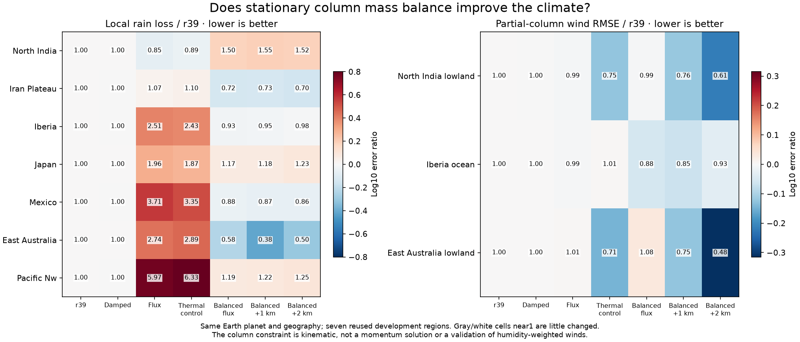
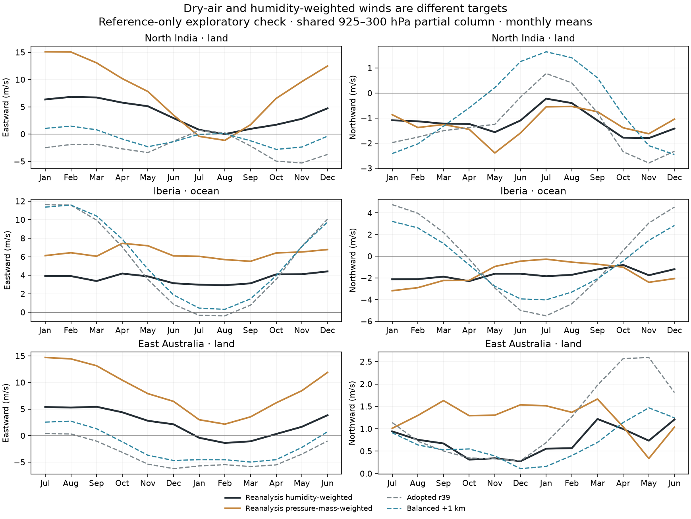
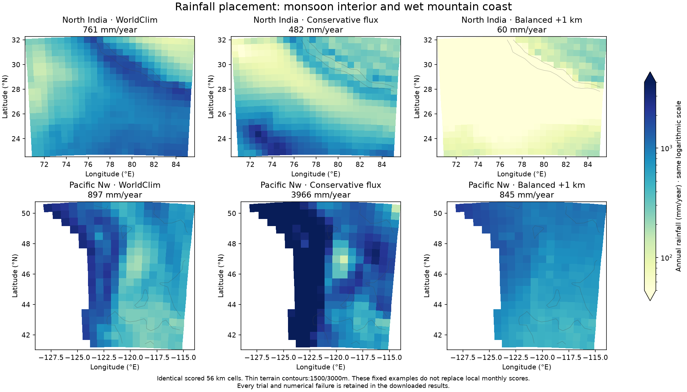

# Stationary column mass: coastal gains, a failed monsoon

The new mass-consistent moisture wind sharply reduces the coastal excess in
the conservative-vapor experiments. It also improves several regional errors
relative to adopted r39. But it collapses the Indian monsoon, so **no candidate
qualifies**. A mass-consistent dry-air wind is not automatically the right
humidity-weighted wind for transporting water.

The fixed pilot completes49 integrations with passing strict numerical
certificates. Seven adopted climate/geography controls and three native wind
controls reproduce exactly. Another21 physical/numerical controls reproduce
every saved NPZ field, including vapor budgets, observed fields and circulation
vectors, with matching NaN masks. All28 control runs precede the21 new trials.
No full31/fine/established6 stage runs because all three candidates fail their
predeclared safeguards. No planetary forcing, observed-wind forcing, adopted
Earth profile or fantasy atlas climate changes.

## What improved, and what failed

Annual regional rainfall, in mm/year:

| Region | Observed | Adopted r39 | Conservative flux | Balanced flux | Balanced +1km | Balanced +2km |
|---|---:|---:|---:|---:|---:|---:|
| North India |760.83|256.26|481.71|80.86|59.72|57.48|
| Iran plateau |232.39|365.10|165.99|283.59|270.56|254.46|
| Iberia |391.83|444.93|1056.53|393.80|392.72|396.70|
| Japan |1601.36|1330.35|2025.02|1243.19|1215.34|1132.61|
| Mexico |536.71|568.63|2542.43|476.63|442.15|403.19|
| East Australia |640.69|1068.15|1722.20|843.07|714.76|534.80|
| Pacific Northwest |897.46|732.06|3965.80|806.72|845.11|884.19|

Annual averages alone are insufficient. Balanced+1km changes local monthly
rain MAE from36.52 to15.32mm in eastern Australia,16.52 to12.00mm in Iran,
and39.27 to33.67mm in Mexico. But NI worsens from50.01 to59.85mm, Japan
from76.11 to88.42mm and Pacific Northwest from29.03 to34.61mm. Iberia's
near-perfect annual total still has19.41mm monthly error versus19.16mm for
r39. The maps show that a good annual total can still miss coast/interior
structure and seasonality.

| Candidate | Seven-region S | Mean rain-loss ratio | Mean T-MAE ratio | NI wind ratio | Iberia ocean wind ratio | EA lowland wind ratio |
|---|---:|---:|---:|---:|---:|---:|
| Balanced flux |0.9981|1.0239|0.9724|0.990|0.882|1.077|
| Balanced +1km |0.9889|1.0119|0.9659|0.759|0.854|0.749|
| Balanced +2km |0.9919|1.0287|0.9550|0.605|0.927|0.484|

Ratios compare adopted r39 on identical inputs; lower is better. S averages
aggregate rain/temperature ratios. Rain loss combines local annual log error
and normalized monthly MAE. Neither quantity is an accuracy percentage.
The+1km trial passes the combined-score threshold and all three outside-wind
protections, but fails the rain-improvement, NI, Japan and Pacific NW guards.
These are seven reused development regions, not a new global climate score.
The qualified31-region and3,667-city headline measurements remain unchanged.

## The physical and numerical constraint

Opt-in `moisture_mass_balance=True` projects the column moisture wind onto
stationary mass-consistent flow. The default is False and never constructs a
projector. Shared joint physics explicitly includes the new field; Earth
orbit, tilt, rotation, radius and radiation remain locked by `joint.earth_profile`.

Approximate fixed hydrostatic column mass is
`M=(101325/g)*exp(-terrain/8000m)`. The projection minimizes
`sum M*|delta_U|²` subject to zero interior divergence of
`M_face*U_face`. Its cell-to-face divergence uses exactly the arithmetic
velocity averaging used by conservative vapor transport, with the correct
northward row sign. Open-border velocities may adjust; net boundary dry-air
flux is diagnosed explicitly. A sparse weighted orthogonal solve enforces the
constraint directly on cell velocities, avoiding a face-to-cell reconstruction
that would silently reintroduce divergence.

All21 projected integrations meet the fixed scaled residual1e-10 threshold;
the largest actual residual is7.68e-15. The largest velocity correction is
9.76m/s. Tests independently verify the face stencil, terrain weighting,
boundary cancellation, repeated-projection identity and weighted orthogonality.
The mass-weighted quadratic norm cannot increase under this projection; that
mathematical property is **not** a prognostic atmospheric energy budget.
The coupled vapor/storm ledgers retain their independent strict certificates.
The current focused model/reference suite passes140 tests.

This is an equivalent-barotropic **kinematic** closure. It does not solve
momentum, surface-pressure storage, vertical return circulation or a vertical
humidity profile. The mass profile is an approximation, and the numerical
constraint uses the model's flat projected grid rather than exact spherical
area factors. Divergence-null cell-scale modes are not separately filtered;
the actual face mass flux is what the constraint and vapor solver use.
No claim of a closed global atmosphere, realistic momentum balance or validated
full-column moisture transport follows from the small numerical residual.

Only moisture transport uses the corrected wind. Surface heat transport,
evaporation, convergence lift and terrain ascent retain surface winds. Optional
thermal shear acts before the projection. Candidates use conservative mean
and storm vapor transport with positive-only convergence import disabled.
All non-original controls/candidates share the declared.05 moisture relaxation
and1024 cap, with unchanged residual.01, linear and temperature tolerances.
Earlier failed solves remain preserved in their original campaigns.

## Independent warning about atmospheric weighting

A reference-only exploratory calculation compares pressure-mass-weighted and
humidity-weighted NCEP/NCAR1981–2010 monthly vectors over the **same925–300hPa
partial column and retained native footprints**. The RMS vector differences
are5.42m/s in NI,2.95m/s over Iberia ocean and6.61m/s in eastern Australia.
These different weights select substantially different winds, especially winter
westerlies aloft versus moisture concentrated near the surface.

This is not full-column wind validation: both partial integrals omit air outside
925–300hPa and products of monthly means omit transient q'u' covariance. The
conservative model-terrain mask is not proof of native below-ground validity.
Reanalysis is model-assisted, uses a different period from WorldClim1970–2000
rainfall, and these are reused regions. This exploratory calculation changes
no candidate, target, score, safeguard or validation sampling after outcomes.
It is consistent with the reason to test separate moist inflow and drier return
flow; it does not prove that such a model will improve rainfall.

## Concrete next experiment: retain counterflow

Let `Ub` be the mass-consistent column flow and `Ul` a lower-layer flow.
For a declared lower dry-mass fraction eta, define
`Uupper = Ub - eta/(1-eta)*(Ul-Ub)`. Then the two layers' mass-weighted sum
is exactly `Ub`, including at arithmetic faces. Lower convergence can be
balanced by an upper return without requiring their humidity-weighted flux to
have zero convergence. A fixed lower/upper humidity-ratio closure would be an
explicit first approximation, not a resolved vertical thermodynamic profile.

An implementation must transport both branches conservatively. Replacing them
by a single averaged velocity before upwinding loses real counterflow: two
opposed streams with zero mean velocity can still exchange water down a humidity
gradient. Use the weighted sum of their directional face fluxes/operators, and
use those same faces in all local and boundary water ledgers. Validate an
opposed-stream known-answer case, dry-mass cancellation, unchanged disabled
path and separate branch-speed limits before any climate trial. The current
mass projector and analytic tests can supply that experiment's dry-air basis.

This is a design for a **new** fixed experiment, not an extra candidate added
to this completed pilot. Keep a new source/output epoch, exact original and
physical controls, the existing seven-region safeguards and outside wind
constraints. Qualification still needs the full31/ocean/fine/established6 and
matched-world checks. Do not promote a coastal annual-total match or compensate
for the monsoon deficit by changing Earth planetary forcing.

## Reproduction and atlas publication

Source `6eddef6`; plan `calibration/column_mass_20261026/plan.json`:

```
OPENBLAS_NUM_THREADS=1 OMP_NUM_THREADS=1 .venv/bin/python scripts/check_vapor_flux.py \
  --plan calibration/column_mass_20261026/plan.json \
  --out output/column_mass_20261026
```

`output/column_mass_20261026/` records the frozen sources/references, all49
outcomes, NPZ hashes, exact controls, mass certificates and complete safeguard
decisions. Historical control comparisons are equal-NaN aware and bind all
array fields; they cannot be replaced by matching regional scalar averages.
Changed sources require a new folder; do not bypass the guards to resume or
republish this campaign under new physics.

`publish_column_mass.py` verifies those sources/results and writes three plots,
the NI table and downloadable diagnostics to the normal launcher's accuracy
page. `package_fit_atlases.py` includes these assets/report; portable, browser
and Windows byte-integrity checks are recorded alongside results. Normal
climate/farm/population/trade data remain unchanged: qualified Earth physics is
r39, while the world Earth atlas remains r38 after its earlier transfer failures.






