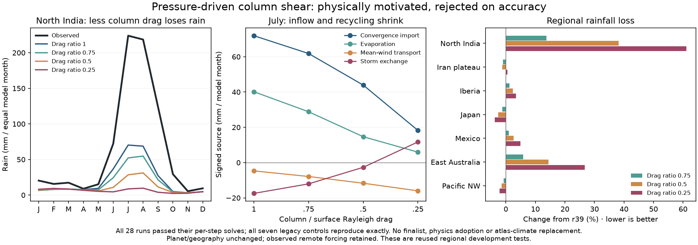

# Pressure-driven moisture-column shear: rejected

The new opt-in `moisture_pressure_drag_ratio` tests reduced effective Rayleigh
drag above the surface. Under the existing pressure gradient and Coriolis
balance it turns the pressure flow toward geostrophic, rather than merely
multiplying surface speed. The same column flow drives mean moisture transport
and parameterized convergence import. Surface heat transport, terrain lift,
convergence ascent and divergence suppression retain surface winds. Seasonal
soil/rain feedbacks can subsequently change the surface climate.

Ratio 1 is the exact legacy path. Inconsistent combinations with a separate
column speed factor or capped pressure winds are rejected. The lower-drag
closure is available experimentally; it is not adopted physics or a resolved
vertical boundary layer. Positive convergence import remains a parameterized
source in a nonconservative concentration-advection moisture equation.

## Completed fixed pilot

The plan fixes ratios .75, .5 and .25 before results, seven reused development
regions, numerical criteria, regional protections, ocean and wind-speed limits,
and at most two full-development finalists. All seven fresh default controls
exactly reproduce archived float32 monthly climate/observation arrays. All 28
climate integrations pass observed per-step numerical checks.

| Drag ratio | Mean temperature ratio | Mean rainfall-loss ratio | Combined S | North India annual rain |
|---|---:|---:|---:|---:|
| 1, r39 reference | 1 | 1 | 1 | 256 mm |
| .75 | .99581 | 1.03992 | 1.01787 | 203 mm |
| .5 | .99489 | 1.11114 | 1.05302 | 130 mm |
| .25 | .99543 | 1.18766 | 1.09154 | 75 mm |

North India receives 761 mm observed. Its July convergence import falls from
71.9 to 61.9, 43.9 and 18.3 mm/model month. Evaporation/recycling also falls
from 40.2 to 28.8, 14.7 and 5.9. Japan and Pacific NW rainfall improve slightly,
but North India and eastern Australia worsen. The screen rejects all three;
**no full31, finer-resolution or established-six stage runs** for these rejected
column-shear candidates. The advancement script records this skip explicitly.
Planetary forcing and actual geography do not change.

## Ocean check restored

Only January's WOA profile existed initially. Preflight stopped before creating
a protocol or any climate result. Months2–12 were then downloaded from NOAA's
WOA18 objectively analyzed 1-degree temperature climatology; the existing
`scripts/build_woa_sst.py` builds the SST field and embeds raw-source hashes.
January is unchanged. Actual case hashes protect all derived model inputs.

Unlike the older static SST diagnostic, this pilot records the integrated
SST actually used each seasonal step, including wind-dependent upwelling. Sea
cells are selected from observations only (finite monthly climatology with
minimum above −1°C), within the padded domain excluding its fixed border.
Every candidate uses its reference's identical sea mask. The per-region
allowed increase in monthly MAE is .02°C. All three candidates pass that ocean
protection and the wind-speed limits; their rejection is due to land errors.

Baseline ocean MAE on these seven domains ranges from 2.01 to 4.26°C. It is
not interchangeable with the static19 MAE of 2.87°C: region set, sampling,
ice mask and inclusion of wind-dependent cooling differ. These measurements
do not turn conditional regional runs into coupled global validation.

## Next experiment and reproducibility

This failure suggests testing the surface momentum balance, where cross-isobar
inflow is generated, rather than reducing column drag further. A separate
three-candidate surface-drag plan is declared before its results under
`calibration/surface_momentum_20261026/plan.json`; it uses the full31 gate and
preserves the rejected shear campaign. It is a new development experiment,
not a retry on independent validation data.

Source for this completed pilot is commit `f22b0eb`. Input/source hashes, all
regional JSON records, failed selection review and explicit stage skip are in
`output/column_shear_20261026/`. The optional NPZ caches are local, ignored,
and SHA-256-bound to their records. Use a new output directory after source
changes; do not reinterpret old runs under modified code. The 60 focused
preflight tests cover force balance, pressure work/frictional dissipation,
rotation/row signs, exact legacy path, coupled residuals and acceptance guards.

The launcher hub's Climate accuracy page includes the full result and a
portable JSON download. All atlas climate, farming and population data remain
unchanged; r39 remains the qualified Earth profile and the Earth atlas retains
the separately verified r38 world.

