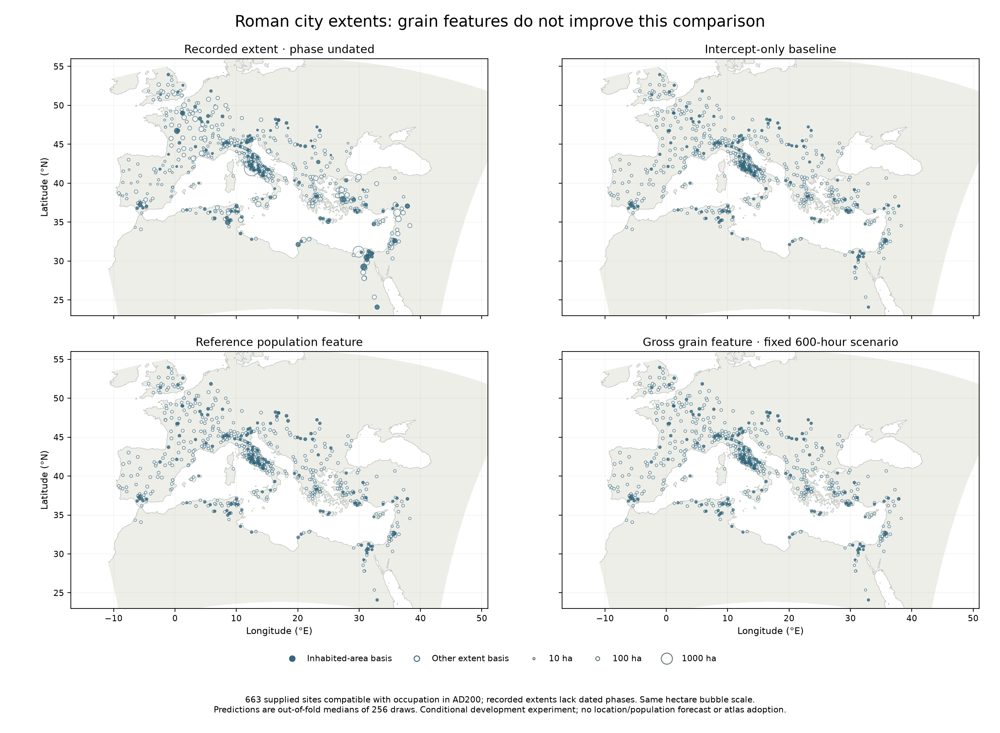
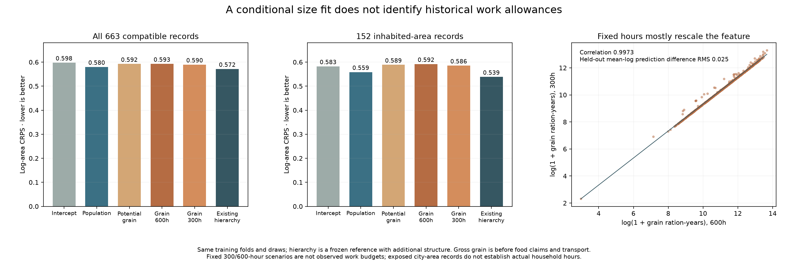

# Grain features lose to the existing population feature

17 November 2026. The first numerical experiment after the closed agricultural
target screens fits **recorded city area**, the outcome available in the exposed
Roman catalogue. It does **not** estimate historical household hours, draft
availability or population density. The fixed grain scenarios do not improve
on the existing population feature, so none is adopted.

The [protocol](../calibration/roman_benchmark_20261117/conditional_grain_extent.json)
was committed as `53edba13a` before new feature construction or fitting. This
explicitly changes the estimand from the blocked agricultural task-rate fit.
The [reaping screen](REAPING_CONTRACT_TARGET_20261117.md) remains closed with zero
eligible area/work-time pairs; its contract allotment is not used as a rate.

## Numerical result

The table gives mean empirical CRPS of log area; lower is better. All models
use the same outer training rows, target masks and 256 paired random seeds.
The hierarchy is an archived reference with additional structure, not a newly
tuned competitor in this experiment.

| Feature/model | 663 AD200-compatible records | 152 inhabited-area records |
| --- | ---: | ---: |
| Intercept only | 0.597820 | 0.582518 |
| Existing hinterland reference population | **0.580108** | **0.558584** |
| Potential gross grain | 0.592324 | 0.588896 |
| Gross grain, fixed 600 hours | 0.592722 | 0.591992 |
| Gross grain, fixed 300 hours | 0.589611 | 0.585539 |
| Existing hierarchy, frozen reference | 0.571526 | 0.538607 |

The simple population feature improves CRPS over the intercept by 2.96% on
the compatible records and 4.11% on the inhabited-area subset, winning all
four folds in each. The 600-hour grain feature is 2.17% worse than the
population feature on the broad set and 5.98% worse on the stricter set.
All three grain features are worse than the intercept on pooled strict CRPS.

Do not erase the mixed regional evidence: each grain feature beats the
intercept in three of four strict folds, and its equal-province strict mean
is slightly better than the intercept. Pooling weights cities differently.
Against the population feature, each grain feature wins only one of four
strict folds and has worse equal-province CRPS. Complete tables retain all
provinces, including small samples and empty target groups.



## What was fitted

Twenty outer mean fits: five models times four original province-hash folds.
The four nontrivial features each fit an intercept and slope by least squares
on log area. Dispersion is the RMS of inner-held-out log residuals. There is
no hour search, hierarchy selection, capital term, all-data deployment fit or
new source cohort. All 664 original rows remain in training; AD200 occupation
compatibility filters evaluation targets only, as in the previous benchmark.

The 400×600, 9-km Roman window, 1,315 supplied centre cells and 60-km
equal-tie hinterlands are fixed. Of 664 source rows, 654 have distinct centre
features. The original reference-population field and centre sums replay
exactly. No city areas or area-derived resident counts enter the new grain or
workforce features. All reference people are a supplied workforce proxy; this
is not a rural census with known city residents removed.

The restored Earth crop field covers 173,983 of 174,047 land cells (99.9632%).
Missing coverage is zero and remains counted. Minimum listed work per net
calorie selects barley in 117,993 cells and wheat in none; 56,054 land cells
have no available cereal output. This does not establish actual Roman crops.
Every city row has positive aggregated grain; no zero-feature exclusions occur.

Gross output uses fixed arable ×0.6×0.6 area, existing net cereal yields,
208 hours/ha for barley and a 32-hour reaping subset. Reference workers are
40% of the supplied reference people, at fixed 600 or 300 allocated hours;
reaping availability is capped at 30 eight-hour days. These are assumptions
carried into the experiment, not values inferred from the areas. Production is
before local consumption, reserve losses, extraction and transport. Dividing
by 912,500 kcal labels a unit; the result is not exportable food or a complete
diet population capacity. Animal services and other household duties remain
unmeasured.

## Hours remain unidentified

The 300- and 600-hour log-grain features correlate at 0.997334. The best affine
relationship has slope 0.999880 and an intercept of −0.667516; RMS residual is
0.099222 log units. Their held-out mean-log-area predictions differ by only
0.025265 RMS, much less than their roughly one-log-unit predictive dispersion.
The features are similar, not identical: potential ceilings cause local
departures from proportional scaling.

A multiplicative food-output change can be absorbed by the free area-model
intercept. The small score advantage of the 300-hour scenario therefore does
not establish actual household hours or a historical preference for 300.
No capacity interval, new operator rate or animal stock is inferred.



## Checks and limits

The independent reviewer reconstructs nearest-neighbour sampling by direct
array indexing, the reference population field, all cell resource minima and
1,315 centre disks with integer-distance ties. It checks crop choice and
conservation, recomputes all 20 outer OLS fits and inner dispersions with a
centred scalar formula, and perturbs held-out outcomes to check fitting
isolation. Direct pairwise CRPS checks cover all six ensembles and 5,010
aggregate score cells. Original baseline and hierarchy draws are preserved
exactly. A fresh producer run reproduces all nine exports byte for byte.
The final seal separately checks feature transforms, comparison tables, plot
values, figure identities and the unchanged science/publication inventory.
Both figures were visually inspected.

This is exposed development data, not new blind validation. Province hashes
hold out provinces but are not contiguous geographical blocks. Occupation
intervals do not date measured extents; even the inhabited-area subset lacks
qualified AD200 extent phases. All locations are supplied. Neither locations,
settlement counts nor population are forecast here.

## Decision and next discriminating test

Keep the existing model and published r5 atlas. Stop trying to infer annual
labour allowances from these city-area targets, and do not add grain-feature
tuning to rescue this result. The historical agricultural calibration remains
blocked by missing matched work-time observations.

The existing population feature has a small positive development signal.
Before treating it as a transferable calibration, test that signal with
contiguous geographical holdouts and a 120-km exclusion buffer, keeping shared
centre rows together. Compare only the intercept and the existing population
feature under a separately committed protocol. This tests transfer more
directly without reopening labour searches or adding parameters. It still
cannot qualify dated extents, household resources or atlas adoption.

## Reproduction

Completed receipts are preserved. Use an isolated directory for a new run:

```sh
.venv/bin/python scripts/conditional_grain_extent.py --out /tmp/grain-extent-replay
.venv/bin/python scripts/review_conditional_grain_extent.py --out /tmp/grain-extent-replay
```

The checked packet is
`output/conditional_grain_extent_20261117/qualification.json`.
