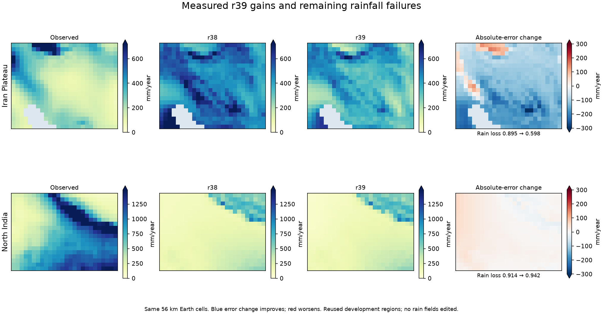

# r39: constrained parameter combinations improve regional rainfall skill

Four parameter combinations were frozen before any new candidate run. Their
weights came from a constrained linear approximation to the completed 120-run
r38 search, whose individual candidates all failed. The approximation only
proposed parameter vectors: every resulting climate was actually integrated.
Only the original ten physical settings changed; planetary forcing, geometry,
strict numerical criteria and the legacy terrain scheme stayed fixed.

All four pass the full fresh 31-region development gate. The fresh r38 reference
reproduces archived per-region errors exactly. The best actual result,
`g0.9995_a1`, passes the paired fine-grid and established-six checks and is
**adopted as r39** at `calibration/local_accuracy_20261023/r39_params.json`.

| Check | r38 | r39 | Combined S |
|---|---:|---:|---:|
| Development monthly T MAE | 1.796389 °C | 1.792823 °C | |
| Development rain loss | 0.452768 | 0.442366 | 0.987521 |
| Paired 28 km (four regions) | | | 0.994737 |
| Established six regions | | | 0.994573 |

Each protected development group improves. The six regions have been reused
in earlier milestones and are not a fresh independent holdout. At most three
finalists were allowed through fine checks; the first, also best overall,
passed, and it alone took the established-six check.

## Improvements and important remaining errors

Development rainfall loss falls 2.30%, with a small temperature improvement.
Iran's rainfall loss falls from 0.896 to 0.598 and its mean annual rain from
498 to 365 mm toward 232 mm observed. Japan and Pacific NW improve too.
**North India worsens:** rainfall loss 0.914 to 0.942, annual rain 269 to
256 mm versus 761 observed. This is a regional-balance improvement, not a fix
for the missing Himalayan rain belt. Per-region results remain visible.

For 3,667 cities, monthly rain MAE improves 33.21 to 32.84 mm and seasonality
variation improves 0.1790 to 0.1717. Annual totals within 25% slip from 46.66%
to 46.47%; annual log RMSE worsens 0.5373 to 0.5474. City statistics were
predeclared as side reports, not selection criteria. These mixed outcomes must
not be described as universal location-accuracy gains.

The static SST calculation is exactly unchanged at all 19 audit regions.
This comparison excludes wind-dependent coastal upwelling and does not
remeasure the absolute WOA18 error. No ocean, stellar, radius or greenhouse
parameter moved. The prior r38 static WOA18 MAE was 2.87 °C.

Nonzero monsoon descent now uses observed global-rain-derived forcing in the
Earth regional cases; the invented world generates that forcing from its own
rain. The Earth result is conditional regional skill. The separate world refit
and layout checks assess transfer within this simulator; they do not establish
that the full coupled planet matches an independent GCM.

## Publication

`calibration/map_world_r39/plan.json` freezes the next world refit: qualified
physics and current planetary properties fixed, mean-climate objective over
layouts 1–3, then native-resolution and additional-layout checks. The normal
`.bat` atlases remain on the last verified data until a replacement world and
all climate/economic layers pass publication checks. Their HTML pages already
contain the current directed markets and continuous sea routes.

All original case records, input protocols, saved-cell checks, city statistics
and adoption evidence are under `output/constrained_blend_20261025/`.

Native world-publication checks are implemented in `scripts/check_r39_world.py`.
They verify that finalists change only permitted world properties, reproduce the
builder's checkpoint identity, enforce target and Mediterranean protections,
and stop publication on a failed additional-layout comparison. Five focused
guard tests pass. These checks run only after the frozen world search finishes.
