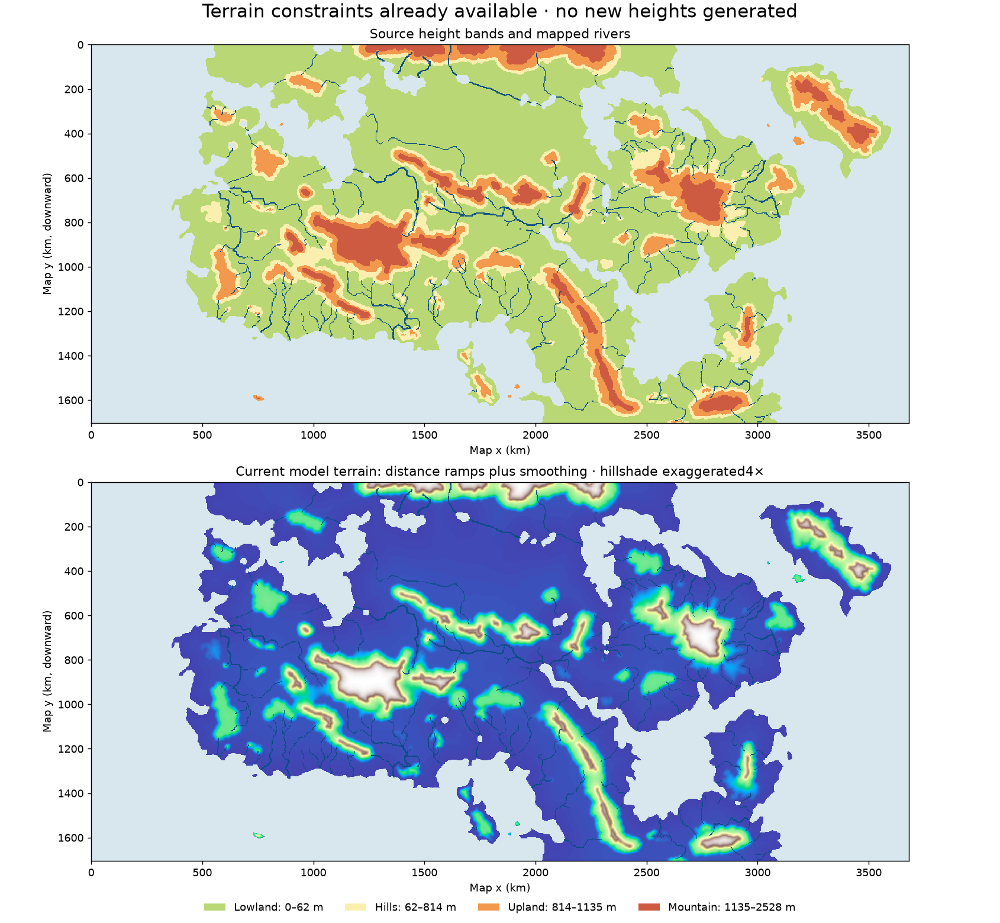

# Feasibility: terrain constrained by painted tiers and rivers

**Yes.** A more detailed, river-conditioned heightmap is feasible and could
improve regional terrain forcing and hydrology. The painted map does not
uniquely determine those heights, so the useful product is a small constrained
ensemble with uncertainty, rather than one supposedly recovered true DEM.

The current model already interpolates continuous distance-based ramps inside
the four painted tiers and Gaussian-smooths them. Drawn rivers are separate
source data and do not constrain those ramps. Existing renderer tools provide
Zhang–Suen river-centreline tracing and priority-flood/implicit stream-power
erosion. The climate model also has drainage routing. These are reusable
components; renderer erosion alone does not enforce drawn channels or tiers.

## Read-only source audit

`scripts/audit_terrain_constraints.py` produced the accompanying illustration
and `output/terrain_constraints_20261026/audit.json`. It generated **no new
heights**, changed no source data and ran no climate simulation.

The source raster is2000×926 pixels. The published Earth atlas's geometry gives
about1.840km per source pixel, and its calibrated tier tops are62/814/1135/2528m.
These are the parameters used for this baseline illustration, not new values
for the other fits. There are27,646 drawn river pixels on land and108 raster
components under8-connectivity;107 have at least20 pixels and107 come within
2pixels of water. Raster components can be distinct rivers or fragmented
strokes; proximity to sea/lake water does not establish downstream direction.
Flow directions and river/tier feasibility have not been inferred in this audit.

River pixels occupy mainly the lowest tier:24,118 lowland,2384 hill,1129 upland
and15 mountain pixels. This gives useful channel constraints but little direct
information about undrawn headwaters, ridgelines, passes or summit heights.

With those published tier heights, smoothing places5.27% of land pixels more
than0.5m outside their own nominal painted band. The present ramps therefore
do not treat each band as a hard pixel bound. A new generator must state whether
tiers are strict contour intervals or broad terrain categories.

## Recommended terrain construction

1. Preserve the land/sea mask and lake outlines. Establish candidate river
   outlets and orient the channel graph, distinguishing lake connections,
   tributaries, distributaries, ambiguous fragments and possible closed basins.
2. Fit downstream-decreasing channel profiles inside the permitted height
   intervals. Flag any infeasible tier crossing. A river descending through
   successively higher strict bands needs an explicit canyon exception or a
   source-map correction; the generator must not silently decide which.
3. Infer drainage divides and add correlated ridge/valley relief between
   constrained channels. Smooth slopes within bands, rather than merely adding
   independent noise. Priority flooding and stream-power erosion can supply
   drainage structure, but must remain subordinate to the mapped constraints.
4. Build several fixed-seed realizations. Start with conservative within-band
   relief; retain a map of inferred versus directly constrained features and
   every unresolved conflict. A normalized within-tier field lets the same
   morphology be instantiated under each fit's existing height parameters.
5. Validate unchanged coastline/lakes, tier bounds, channel monotonicity,
   unintended sinks and catchment topology. Then compare terrain statistics at
   the actual climate-grid resolution before testing any new climate fit.

Condition this construction on tiers, rivers, coast and lakes—not the painted
climate zones. Otherwise terrain can be invented specifically to manufacture
the desired climate agreement. Hold the existing physics/planet fixed for the
first sensitivity comparisons; a later world refit requires its own source and
geography controls.

## Expected climatic value and limits

The most useful additions are broad mountain barriers, pass locations,
windward/lee slopes, valley corridors and grid-scale elevation distributions.
They can change lapse cooling, upslope rain and rain shadows. Narrow detail
below the roughly15km normal fantasy climate grid mainly matters through
aggregation: mean/max height, relief, slope/aspect distributions and eventual
subgrid schemes. Attractive fine hillshade alone is not extra resolved climate
physics. The existing Earth terrain-quadrature experiments already show that
more detailed terrain statistics do not automatically improve overall skill.

River-consistent drainage and floodplain placement may benefit the settlement
and economic layers too. But a1.8km synthetic source raster cannot justify
meter-scale wetland or flood-risk precision, and the present hydrological
budgets and channel capacities would still need verification.

This side project can proceed independently while the Earth shared-wind
calibration runs: generate isolated experimental terrain files and compare
ensembles, without editing the frozen production geography implementation or
replacing existing atlas inputs. It addresses missing surface structure; it
does not by itself solve the atmosphere's large-scale circulation errors.

Reusable code: `rotclimate/geography.py`, `rotclimate/hydrology.py`,
`scripts/vector_rivers.py`, and `scripts/terrain_erosion.py` (the latter is
currently a rendering tool). The source audit records their relevant inputs
and illustration checksums.

