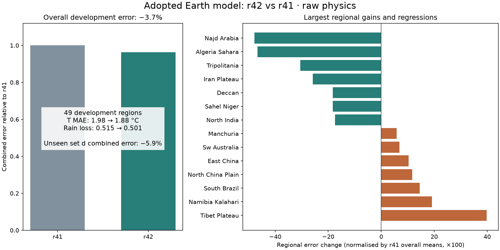
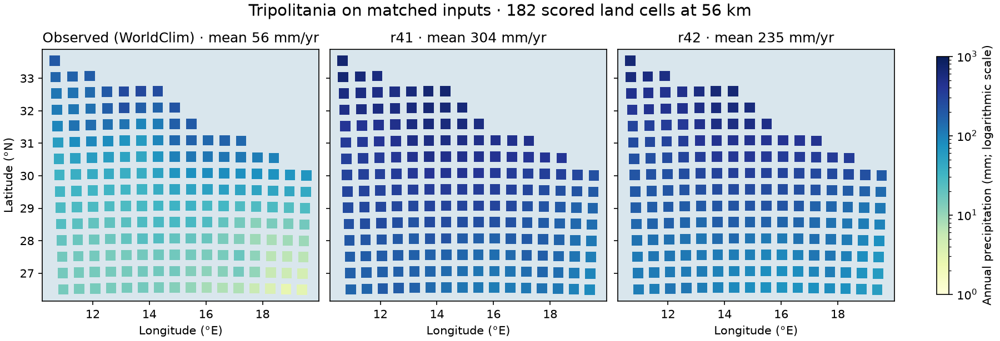

# Continuation from the newer development branch, 2 November 2026

Fetched `claude/ecstatic-wozniak-rtrwd2` (`46db7674`), rather than continuing
from the old single-branch checkout. The earlier terrain-probe commits remain
on local branch `work`, with their untracked experiment output preserved.

The adopted raw Earth model is **r42**. Its archived paired scores over the
49 development regions are:

| Metric | r41 | r42 |
|---|---:|---:|
| Monthly land temperature MAE, equal-region mean | 1.9770 C | 1.8849 C |
| Rainfall loss, equal-region mean | 0.51530 | 0.50077 |
| Combined score relative to r41 | 1 | 0.9626111 |

Under the combined metric, 29 regions improve and 20 worsen. The then-unseen
sealed set d scored 0.9406. These are reused regional development cases and
one six-region validation set, not an estimate of global climate accuracy.
Full release evidence and regional regressions: [r42 report](R42_20261101.md).

## Continuing the calibration

The previous search objective still penalised each group that worsened,
although adoption policy v3 no longer does. `scripts/gate_calibrate.py` now
supports explicit v3 plans: all 49 regions enter the equal-region objective;
groups are reported without penalties; temperature and rainfall retain their
individual 1% safeguards. Old v2 plans keep their original objective.
The new objective reproduces r42's independent release-gate score exactly.
Plans, references and source identities are frozen for v3 resumes.

`calibration/r42_multistart_20261102/campaign.json` freezes a 39-evaluation
pilot: three independent CMA starts, one centred on r42 and two at scrambled
Sobol centres, with separate random seeds. Each begins by reproducing r42
on all 49 regions. Existing r42 physical parameter bounds are reused; orbit,
planet size, solar forcing and world geometry stay fixed. Selection is by
overall development score after all three searches finish, followed by the
normal paired fine-grid and independent validation checks.

This measures sensitivity to the starting point within this parameter box.
Neither convergence nor agreement among three searches proves a global
optimum, and the exercise does not test every possible physical closure.
East Asia's spring/winter moisture and maritime seasonal phase remain
structural targets described in the prior handoff.

Fresh sealed set e was declared before any result of this pilot. Its six
scored rectangles avoid all 61 earlier region rectangles; forcing halos are
not independent. It is never evaluated by the search runner and must not be
used to choose the finalist or design mechanisms.

## Atlas and verification

The inherited r42 release was interrupted before its simulation finished;
the served Earth atlas is **r41 until promotion**. The resumed release is
repository-relative, regenerates the r42-trained corrections, corrected
animations and language layers in staging, then retains the r41 atlas as a
backup. It does not replace the atlas with a calibration candidate.

The portable packager now follows local HTML page links, so new release
reports cannot silently disappear from a bundle. It also includes current
foraging, language and political-reach methods, and removes obsolete r39/r38
claims from its README. An initial verification caught a missing r40 world
report; that failed bundle is retained separately.

Checks completed in this round:

- 69 targeted tests passed, including a complete CMA logging/checkpoint/resume
  integration test, calibration safeguards, physics switches, corrections,
  guarded search and packaging regressions.
- All three currently served atlases passed browser smoke checks: 70 / 65 /
  67 layers for Earth / free / Whittaker, with no page errors. These checks
  cover the current r41 Earth atlas, not an unfinished r42 atlas.
- Portable verification passed 543 local links and the freshly extracted
  launcher (1537 archive entries).
- A Windows-style checkout passed 986 byte-exact data assets after extending
  `.gitattributes` to nested corrected-climate metadata and packets. The first
  check exposed that the old rules protected only the top-level data folder.
- The launcher resolves all three local atlas directories and reports
  Whittaker outside-diagram shares of 0.01% / 11.47% / 1.44% respectively.

The first full control hit a recording error before its measurements were
persisted: the evaluation index and region count shared a key. This was fixed
and covered by the integration test. The failed output and exact source are
retained in `output/r42_multistart_20261102_recording_failure`; the replacement
run must reproduce r42 before proceeding. No candidate is adopted from it.

Live receipts: `output/atlas_r42/resumed_20261102.log` and
`output/r42_multistart_20261102/{status.json,chain_1.log}`. Verify processes
and receipts when resuming. Shell-detached initial launches terminated before
a complete result in this executor; their partial output is retained. The
running replacements use persistent execution sessions.

## Reference recovery before searching

The first recorded r42 control stopped on a Tripolitania mismatch. Both
scores and actual case hashes reproduce for the other 48 regions; source
file and raw observation archive hashes match everywhere. Tripolitania's
rebuilt declared box contains 182 scored land cells versus 195 in the old
archive. A missing identity in the legacy aggregate cache key is a possible
cause; it is not proved without the old cache.

Fresh paired r41/r42 tests on the six retired-c regions passed and retained
raw NPZ packets. The reconstructed S49 is **0.9628116258**, still 3.72% better
than r41. All 49 recovered r42 reference pairs match the actually completed
control. Receipts: `output/r42_reference_recovery_20261102`.

The active search is the prospectively frozen revision **20261102b**
(`calibration/r42_multistart_20261102b/campaign.json`, output directory of the
same name). Bounds, seeds, budget and selection are unchanged. The original
pilot and recording failure are retained as stopped diagnostic runs. Set e
remains unseen. The r42 atlas simulation has completed and export is running;
its browser atlas remains r41 until promotion finishes.

The revised search has completed its first full control with S49 = S31 = 1.0
and reproduced all 49 reference error pairs to 1e-10; non-control candidate
evaluations have started. There is no new adoption.

On this matched 182-cell footprint, mean annual rain is 56 mm observed,
304 mm for r41 and 235 mm for r42. The improvement leaves a large arid-region
wet bias; a better overall score does not mean the dry-belt physics is solved.
The coloured squares are scored land cells; the background is unscored.
