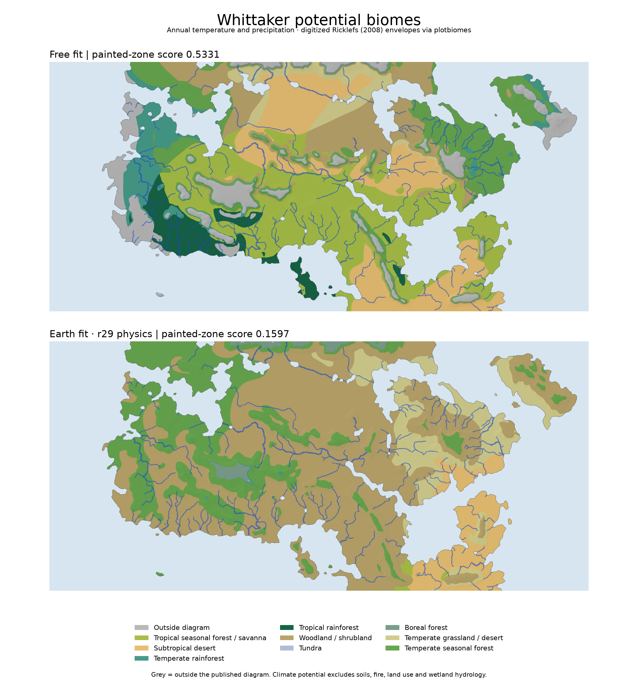

# Climate simulator and atlas campaign — 22 October 2026

This campaign fixes seasonal mountain-temperature exports, adds Whittaker potential-biome maps, completes two regional physics screens, and calibrates the invented world both freely and with Earth r29 physics held fixed. Both active repository atlases are updated. The free-fit objective improves from 0.5292 to 0.5331; the Earth-fit objective improves from 0.1532 to 0.1597 against the same r29 starting world. Exact cell agreement does not improve, and linear-solver warnings keep the scores provisional.

The user authorized autonomous simulations. The earlier handoff's user-run-only rule is superseded for this campaign. The frozen V10 transport experiments were left untouched. Historical claude.ai hosted pages were not updated; the atlas artifacts are local repository builds.

## Model and atlas changes

Seasonal elevation corrections now follow the model's circulation phase in full-resolution and high-resolution maps, monthly maps, animations, station CSVs, charts, analogue comparisons and similarity maps. Previously exports cooled sea-level temperature using an annual constant. At r29's lapse settings the discrepancy reaches about 2°C at 3,000 m. This repairs export consistency; it does not improve the underlying Earth benchmark score. Legacy atlas data without seasonal lapse arrays remain readable.

Both builds have 22 map layers, 42 layer-image files including monthly frames, five 25-frame GIFs, and monthly climate exports for 152 named places. Simulation resolution is downsample 8 (250 × 116 cells inside the map), with 25 seasonal steps; core map layers use 4,000 × 1,852 pixels, while additional layers retain source resolution. Export resolution adds detail from terrain and interpolation, not more simulated weather cells.

The new Whittaker layer uses nine digitized climate envelopes from Ricklefs (2008), figure 5.5, distributed by Valentin Stefan's MIT-licensed `plotbiomes`. Annual surface temperature and precipitation determine each potential biome, independently of painted target zones. Source precipitation is converted from cm to mm. The original vertex ordering, hashes, license and conversion method are saved with the data. Biome IDs, station names, CSVs, land-pixel shares and temperature–precipitation diagrams are exported together. The diagrams show the full climate range, with temperature and rainfall extremes marked, and keep the legend outside the data. Read [the biome method](../docs/BIOMES.md).

Climates outside the envelopes remain grey, rather than being assigned a nearby biome. They cover **10.2165%** of free-fit land and **0.0133%** of the selected Earth fit. These include cold/wet climates, not just climates beyond the diagram's maximum rainfall. Some interpolated free-fit mountain pixels exceed **20,000 mm/year**. The underlying model-grid land rainfall median is 1,035 mm, its 95th percentile 3,510 mm, and 5.08% exceeds 3,500 mm. Corresponding Earth-fit figures are 826 mm, 1,324 mm and 0%. These are model diagnostics, not observed vegetation or validated mountain rainfall estimates.

## Physics screens

The two screens completed **190 region simulations**: baseline plus five candidates in screen 1, baseline plus three in screen 2, each over 19 regions at 56 km resolution. Every regional case completed. Selection required strictly lower mean climate distance in **each** existing regional group; none passed. The r29 reference is retained. These regions have already been used in development and are not independent validation data.

| Setting | Training 8 | Former holdout 5 | Midlatitude 6 | All 19 |
|---|---:|---:|---:|---:|
| r29 baseline | 2.121918 | 2.121184 | 2.303196 | 2.178971 |
| Marine layer, 80 km | 2.127663 | 2.094246 | 2.307290 | 2.175593 |
| Marine layer, 40 km | 2.123987 | 2.101936 | 2.305769 | 2.175589 |
| Ocean transport 0.15 | 2.127110 | 2.156968 | 2.285287 | 2.184918 |
| Storm width 13° | 2.109145 | 2.155689 | 2.323923 | 2.189218 |
| Seasonal lapse 0.10 | 2.134019 | 2.122593 | 2.301596 | 2.183931 |
| Seasonal column lapse | 2.118516 | 2.113623 | 2.309458 | 2.177526 |
| Eddy heat 0.85 | 2.118227 | 2.139168 | 2.317603 | 2.186699 |
| Eddy heat 1.15 | 2.127263 | 2.106572 | 2.293613 | 2.174350 |

Lower is better. The small all-region improvement from eddy heat 1.15 does not satisfy the training-group rule. The historical run label `storm_wide` actually sets 13°, narrower than r29's approximately 14.67°; the numerical setting, rather than that label, defines the experiment. Seasonal column lapse remains an experimental option, default off.

Training: California, Iberia, southeast US, Levant, Central Asia, East China, East Australia, Mexico. Former holdout: Chile, Cape, southwest Australia, South Brazil, Japan. Midlatitude: Pacific Northwest, Western Europe, Eastern Europe, US Midwest, Manchuria, New Zealand.

## Calibrations

Both searches refine the existing reversed-spin basin. Spin is fixed, and these are bounded local searches rather than global optima or new evidence comparing rotation directions.

The broad free search used 97 CMA-ES candidates including its baseline, population 12, sigma 0.035, seed 2110, downsample 32. It found no improvement over 0.5197446. An interrupted generation was replayed, leaving 106 log rows and nine repeated evaluation numbers. Nine rows record rejected temperature-convergence failures; failures receive no successful score. A second, smaller-step search used 25 candidates, population 8, sigma 0.003, seed 2210. It improved the coarse objective to **0.5255890** and the final-grid objective to **0.5330536**.

The Earth-fit search used 49 candidates, population 8, sigma 0.045, seed 2210, downsample 32, layouts 1–3, with racing disabled. Only world parameters varied. A saved invariance audit confirms that no physics constants changed from r29. It improved the coarse objective from **0.1572594 to 0.1676642**. The final-grid candidate scores **0.1597235**, improving on **0.1532373** for the same r29 starting world at downsample 8. The candidate is selected for the active Earth-fit atlas.

| Publication-grid result | Zone-fit objective | Exact painted-zone agreement | Mediterranean dry share | Mediterranean Cs share |
|---|---:|---:|---:|---:|
| Previous free fit (archived summary) | 0.5291752 | 59.1222% | 11.6232% | 76.8871% |
| Refined free fit | **0.5330536** | 59.1054% | 11.9906% | 76.1857% |
| Previous Earth fit, r16 physics (archived summary) | 0.1792202 | 24.9033% | 12.2244% | 33.0327% |
| r29 starting world, same layouts | 0.1532373 | 19.5561% | — | — |
| Selected Earth fit, r29 physics | 0.1597235 | 18.7994% | 17.6353% | 21.9105% |

The free objective improves by 0.0038784, while its strict agreement drops by 0.0168 percentage points. Against the r29 starting world, the Earth-fit objective improves by 0.0064862 while exact agreement drops from 19.5561% to 18.7994% (0.7567 percentage points). These metrics measure different properties. The Earth r16 and r29 rows use different physics; this campaign does **not** improve on the historical r16 map-agreement score. The Earth fit still struggles with the painted cold-dry north and swamp zone. The free fit uses its established single surrounding layout; the Earth fit averages climate fields over layouts 1–3 before classification. It is not a biome-majority vote over layouts.

## Numerical limits and checks

**Both final builds emitted linear-solver iteration-limit warnings at rtol 1e-6 and 2,000 sweeps.** Temperature/wind and moisture convergence are required by the saved publication settings, but convergence of every internal linear solve is not required. Successful export and a higher score therefore do not establish full numerical convergence. The fit scores remain provisional until that issue is resolved and the fits are checked again. No tolerance was loosened to hide these warnings. Warnings also occurred in some calibration trials. The day/night layer's ocean-only cells emit an existing empty-slice warning because the learned range is undefined over sea; exported layer files pass integrity checks.

Validation completed:

- 43 focused Python tests passed, covering rendering settings, calibration, moisture, Earth cases, seasonal elevation correction, biome reference climates and boundaries, and the inert default of the experimental column option. The eight feature tests are a subset and also passed on their own.
- Five JavaScript climate-comparison tests passed.
- Both exported atlases passed binary-span, dimensions, ocean mask, biome IDs/shares, seasonal metadata, layer-image integrity, CSV-label and license checks.
- Chromium exercised Whittaker layer switching, place search, station readouts, monthly sliders, desktop and mobile layouts in both builds, with no page errors.
- All five GIFs in each atlas were decoded frame by frame; every GIF contains 25 frames.

## Artifacts and continuation

Current atlases: [free fit](../atlases/free_fit/index.html) and [Earth fit](../atlases/earth_fit/index.html). Portable bundles are [free fit](../output/autonomous_20261021/free_fit_atlas.zip) and [Earth fit](../output/autonomous_20261021/earth_fit_atlas.zip). Interactive pages require HTTP; run `.venv/bin/python -m http.server 8000` in the repository. The old active atlas files are preserved under `output/autonomous_20261021/previous_atlases/` as each branch is promoted.

Selected parameters are under `calibration/autonomous_20261021/free_polish/` and `calibration/autonomous_20261021/earth_fit/`. Evaluation-summary CSVs retain scores, failure messages and parameter hashes; detailed JSONL logs and optimizer pickles remain local. Official WorldClim source URLs and SHA256 hashes are recorded in `output/autonomous_20261021/worldclim_sources.json`.

Evidence is under `output/autonomous_20261021/`: `protocol.json`, regional manifests/cases/summaries, `earth_selection.json`, calibration/build logs, `earth_physics_invariance.json`, `final_climate_diagnostics.json`, export/browser validation JSON, screenshots and scientific plots. Each atlas carries `data/build_provenance.json` with its exact simulation settings, source hashes and map-input hashes. Simulation caches are local pickle files and should only be loaded from trusted local runs.

`finish_climate_campaign.py` implements the bounded continuation, and a promoted branch exits without relaunching. Read the branch status JSON before resuming. Build checkpoints reject mismatched model sources, settings, map inputs or layout seeds. Memory-heavy exports share a lock. The next model priority is diagnosing the linear iteration limit, then repeating final-grid comparisons under verified numerical settings; a broader fit search would be premature.
