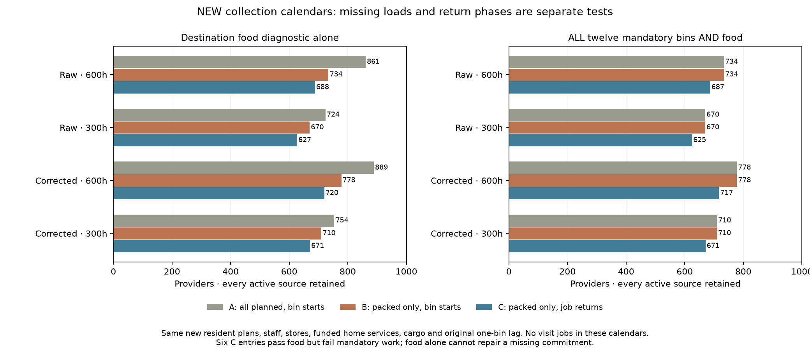
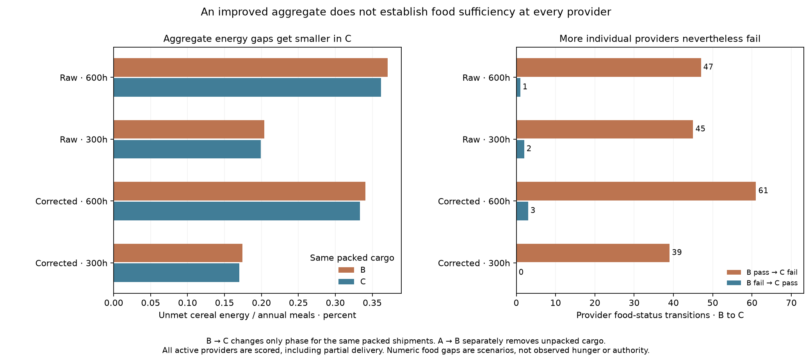

# New collector calendars and destination food: omissions versus phase

Declaration `4b42b703` preceded outputs. All four continuous-resident source
plans are retained. EVERY active provider is scored in all three food tests,
including incomplete and partially delivered sources. Inactive providers remain
explicitly unscored. Source exclusions are not absence-of-community claims.

## Actual jobs and three matched food tests

Use the unchanged collection-first worker policy with the NEW source shipments,
100 supplied institutional workers where funded,50 duty hours per person/bin
and7*365/12 calendar coordinates. Funded home-service hours come from the new
plan's secondary groups1 and2 and are equally shared/divisible,as before.
These are funded commitments,not a claim that every requested service or actual
institutional function is supplied. There are NO geographic visit jobs here.

Every whole collector trip retains its original owner,origin/month/serial and
directed journey plus handling duration. Greedy jobs are packed in descending
duration,then origin/serial order. Work and home services remain charged for
actual intervals;unpacked jobs remain explicit and consume no invented hours.

* A:all planned cargo at the original lagged destination-bin starts.
* B:ONLY packed cargo at those same bin starts. A-to-B isolates omissions.
* C:the SAME packed cargo as B,at its recorded return phase within the SAME
  already one-bin-lagged arrival bin. B-to-C isolates phase under that imposed lag.

All inventories use the same NEW resident counts including staff once,2500
kcal/day,90 days of original new-case physical storage,365-day years and5%
stored-food loss. Stocks are minimum nonnegative repeating reserves,not a free
external loan. Periodicity is distinct from meeting meals. The unchanged food
diagnostic is unmet <=1e-8*max(1,annual needed kcal),not a fitted famine threshold.

## Every declared outcome

|Climate|Farm h|Inventory|Scored providers|Mandatory twelve-bin|Food pass|Both gates|Unmet kcal|Unmet %|
|---|---|---|---|---|---|---|---|---|
|Raw|600|A|861|734|861|734|33.474|0.000000|
|Raw|600|B|861|734|734|734|1,250,420,866.387|0.370690|
|Raw|600|C|861|734|688|687|1,220,533,578.121|0.361830|
|Raw|300|A|724|670|724|670|24.907|0.000000|
|Raw|300|B|724|670|670|670|510,649,139.116|0.203691|
|Raw|300|C|724|670|627|625|498,498,854.087|0.198844|
|Corrected|600|A|889|778|889|778|34.234|0.000000|
|Corrected|600|B|889|778|778|778|1,175,466,567.569|0.340684|
|Corrected|600|C|889|778|720|717|1,149,752,299.952|0.333231|
|Corrected|300|A|754|710|754|710|25.504|0.000000|
|Corrected|300|B|754|710|710|710|447,071,778.233|0.174156|
|Corrected|300|C|754|710|671|671|436,721,673.684|0.170124|

Across four alternative scenarios,A passes food at all 3,228 active provider
entries. B passes 2,892. C passes 2,706,of which 2,700 also complete every funded
mandatory bin. Six C entries pass food while missing mandatory work. Totals refer
to entries across alternative scenarios. They remain
visible rather than being dropped or given fictitious completed commitments.

All four cases have a SMALLER aggregate energy gap in C than B,while MORE
individual providers fail the numerical food check. Improving a total therefore
does not establish food sufficiency at every source. These are scenario energy
gaps,not observed hunger,mortality,abandonment or authority.

## Cargo and source accounting

Raw cargo=min(120000,max(0,new departures-120000*serial)). Packed raw cargo plus
missing raw cargo equals the original planned departure at every origin/month.
Every missing serial and partial final load is retained. Apply0.95 retention
ONCE to packed deliveries. Clock=((origin month+1)*365/12+job end hours/7) modulo
365 days retains the original imposed one-bin lag;this does not remove the lag
or reconstruct actual historical transport dates. B/C have identical cargo.

Unshipped raw grain stays identified at source/uncollected. The exported
“missing destination potential kcal” is the COUNTERFACTUAL retained supply had
that raw cargo been transported. It is not actual transport loss on unshipped
grain. Source production,monthly availability and planned source export ledgers
remain frozen;this is not a new event-time source-stock or harvest validation.
Missing grain is never silently added to destination food or reused elsewhere.

## Independent review and complete exports

Seven new partition/lag/partial-delivery/work-charge controls ran before outputs,
alongside ten event-inventory and seven worker controls. Independent review
imports neither worker packer,cargo partition nor food-event primitive. A sorted
list replays every worker choice and interval;nonoverlap,duty caps,services and
missing trip identities are checked. Separate scalar stocks and bracketed roots
check every active provider in A/B/C,all conservation channels and all216actor
summaries. Food and twelve-bin work flags stay separate before their conjunction.

Review checked 10,820,096 packed and 31,767 missing trip identities, 3,873,600 worker-bins and 9,684 food inventories.

All12522provider/accounting records are exported,including explicit unscored
sources. Four ZIP files contain every one of the56monthly calendar,event and
field packets. Archive entry bytes and every provider CSV field are independently
checked. All63model/calendar/export/CSV/manifest outputs are fresh byte exact.
Extract the four archives beside downloaded metadata to restore relative case
paths. Actual raw missing cargo and counterfactual retained arrival deficits
are separately labelled. No previous Earth atlas packet,map or default changed.

## Remaining programme

This is COLLECTOR-ONLY necessary work and destination cereal accounting. It does
not qualify geographic visits or a new control map. Next,new point-task funding
must use these new source budgets,then baseline and joint calendars must include
actual visit jobs. A provider-year must pass BOTH twelve mandatory bins and its
OWN full-year return-phase food test. Whole calendars cannot be combined by job
success. Every old/new outcome and failure must remain explicit.

Source within-bin crop/export availability,crew-carried food and food location,
complete diets and household/draft work,actual provider roles,dated occupation
and compatible size evidence,prospective transfer and mobile/nonstate/unaffiliated
resources remain open across release1–4/S1–S5. This is exposed development,not
empirical calibration or adoption. The historical full publisher still needs
the omitted private Vidarbha cache;the reviewed direct publisher preserves all
earlier research panels and does not claim a historical full rebuild.
