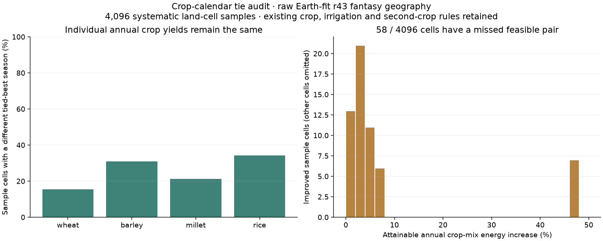

# Crop-calendar tie audit before seasonal food stocks

The production model chooses one best season per annual crop before comparing
crop pairs. Equal-yield alternatives are discarded by its strict `>` tie
rule. A calendar chosen this way is not an observed harvest date; a different
equally productive season may also permit a second crop.

The audit uses the unchanged production crop evaluator. It rolls temperature,
rain, reference evaporation and already-computed soil-water states together
through all twelve calendar origins, then maps each selected season back to
the original climate bins. Radiation, climate, irrigation, reliability factors,
individual crop yields and perennial output remain fixed. Soil water is not
spun up again, and the numerical audit preserves the production input dtypes.

On 4,096 systematic samples of the **raw r43 fantasy geography**:

| Check | Result |
|---|---:|
| Original production calorie mix reproduced | Yes |
| Maximum individual annual-crop yield drift | 0 |
| Crop mix changes under calendar relabelling | 226 cells |
| A better pair is attainable from alternative tied-best seasons | 58 cells |
| Largest local attainable energy increase | 47.12% |
| Increase in the unweighted sample's summed crop energy | 0.151% |

The right-hand histogram shows only the 58 improved cells; the remaining
4,038 are omitted. The sample consists of equally spaced row-major land-cell
indices, not a probability sample or whole-map area estimate. Summed kcal/ha
across sample cells is a diagnostic, not total food production or population.
These are not observed Earth agronomy comparisons.

The attainable alternative retains the existing different-crop rule, water
gate and half-weight second crop. It combines only individually optimal masks
selected by the original evaluator under those twelve relabellings. It is a
lower bound on what a complete scheduler could attain: it does not enumerate
all feasible seasons, sacrifice one crop's yield to improve the annual pair,
introduce two harvests of the same crop, or assign dates to perennial fruit.
No production yield, population, FORGE or atlas layer has been changed.

## Next integration contract

1. Retain feasible crop windows with sowing bin, occupied bins and maturity
   boundary, separately from annual yield. Treat these as climate-bin windows;
   they do not establish exact ancient planting or harvest days.
2. Optimize compatible crop sequences jointly, with explicit turnaround and
   crop-repetition assumptions. Compare annual calories and labels with the
   current model and validate the changed double-cropping behavior before adoption.
3. Keep perennial harvest timing separate. Seed already removed from edible
   yield must not be removed again; a seed inventory is a separate commodity.
4. Only then connect harvest schedules to the conserved food-stock prototype,
   with storage and spoilage scenarios. Monthly climatology alone cannot
   supply famine probabilities or drought frequencies.

Implementation: `harvest/calendar_audit.py`; reproducible driver:
`scripts/audit_crop_calendars.py`. Inputs, source hashes, geometry identity and
full summary: `output/crop_calendar_audit_20261103/receipt.json`, also copied
beside this plot in the browser lab. Tests cover concealed tied pairs, the
existing water gate, winter seasons crossing the year boundary, perennial and
same-crop exclusions, input preservation and production float32 arithmetic.
