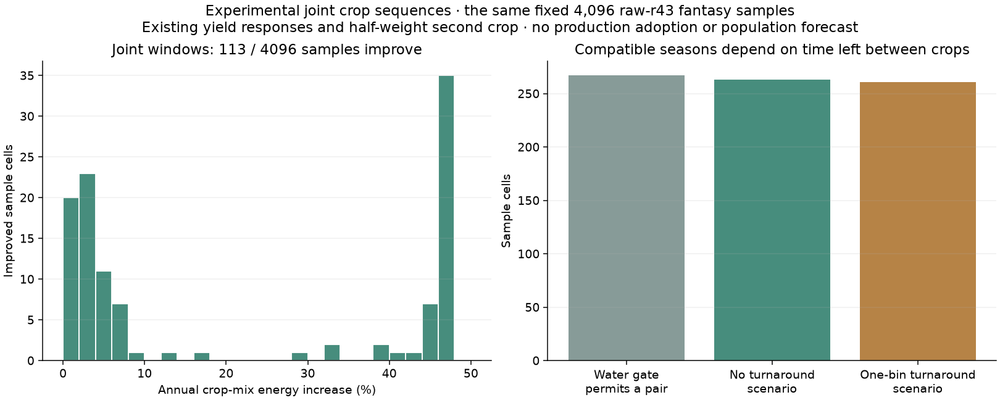

# Joint crop calendars: literature-based prototype and limits

The experimental scheduler retains every annual growing window and chooses a
compatible one- or two-crop sequence jointly. A slightly lower-yielding season
of one crop can leave room for a more productive annual combination. The
published Harvest model, population estimates and three climate atlases have
not adopted this scheduler.

## Academic basis and explicit adaptations

| Source | What supports the design | What is still our adaptation |
|---|---|---|
| [Waha et al. 2013](https://doi.org/10.1016/j.gloenvcha.2012.11.001) | Model crop sequences and sowing choices together; thermal growing requirements matter | Our lightweight search is not their LPJmL model |
| [Waha et al. 2020](https://doi.org/10.1016/j.gloenvcha.2020.102131) | Compare non-overlapping seasons; distinguish intensification potential from realized practice | No modern sequence map is transferred into 200 AD |
| [FAO irrigation scheduling, Annex II §2.1](https://www.fao.org/4/X5647E/x5647e0e.htm) | Relative yield loss responds to evapotranspiration deficit, following FAO33 | Inherited absolute yields, water access and severe-deficit cutoff are not independently established by that equation |
| [FAO56, Allen et al. 1998](https://www.fao.org/4/x0490e/x0490e00.htm) | Crop evapotranspiration and soil-water accounting | The present seasonal water approximation still needs a sequential, crop-specific soil ledger |
| [Sacks et al. 2010, observed calendars](https://doi.org/10.1111/j.1466-8238.2010.00551.x) | Separate duration/exposure diagnostic now checks a necessary timing envelope | Full spatial date/yield validation and ancient cultivar assessment remain pending |

The source and assumption register is
`research_notes/crop_sequences_20261103.json`. Literature motivates the
mechanisms; it does not make every inherited coefficient a published result.

## What the prototype computes

Each window carries its crop, sowing bin, occupied bins, maturity boundary and
net edible energy. All windows use the current temperature, heat-sum and water
response, including exactly the same float32 irrigation arithmetic. We compare
all allowed pairs on the same field. Both crops must have positive yield, obey
the existing water gate, and leave the requested turnaround after each crop,
including across the year boundary. Perennial output can win as a sole crop,
but receives no invented harvest date or annual second crop.

The comparison deliberately retains the **unvalidated inherited 0.5 second-crop
weight**, maximum two crops and different-crop restriction. Real sequential
systems can repeat the same crop; the code exposes that as a separate policy,
but the paired review holds it off to isolate calendar selection. Zero and one
climate-bin turnaround are resolution sensitivity scenarios. One bin is about
30.4 days, not an estimate of ancient farm work.

The optimizer returns an example schedule, the number of tied optima and the
union of their maturity boundaries. It does not turn a deterministic tie into
an observed harvest date or assign probabilities to equivalent calendars.

## Paired diagnostic on the previous fixed sample

The same 4,096 raw-r43 fantasy land samples and coefficients used by the earlier
calendar audit are retained. Every crop's maximum exactly reproduces the old
production evaluator. Regenerating windows after all twelve relabellings of
climate and soil on 256 fixed sample cells exactly preserves optimal energy,
optimal counts and the appropriately shifted maturity-boundary union.

| Scenario | Higher energy than current selection | Selected two-crop pairs | Cells with tied optimum schedules |
|---|---:|---:|---:|
| No reserved turnaround bin | 113 | 263 | 3,150 |
| One reserved bin after each crop | 110 | 261 | 3,094 |

The unweighted sample's energy sum rises by about 0.679% with no turnaround
constraint. This is a diagnostic of the algorithm, not total food production,
a map-wide area percentage, a population gain or an independent agronomic
accuracy score. The widespread ties reinforce the need to retain alternative
calendars when estimating storage.

## Requirements before production integration

Use an independent observed-calendar evaluation to check broad thermal and
seasonal plausibility, keeping its locations out of tuning. Review cultivar,
photoperiod and vernalization requirements, period crop availability, labour
and yield evidence. Carry soil moisture through the actual crop sequence and
limit irrigation by real water supply. Revalidate fallow and the historical
food-capacity calibration after changing crop mixtures. Assess storage across
calendar alternatives, with separate perennial timing and seed inventories.

Numerical invariance and increased calories alone cannot satisfy those checks.
Driver and full provenance: `scripts/review_crop_sequences.py` and
`output/crop_sequences_20261103/receipt.json`.
