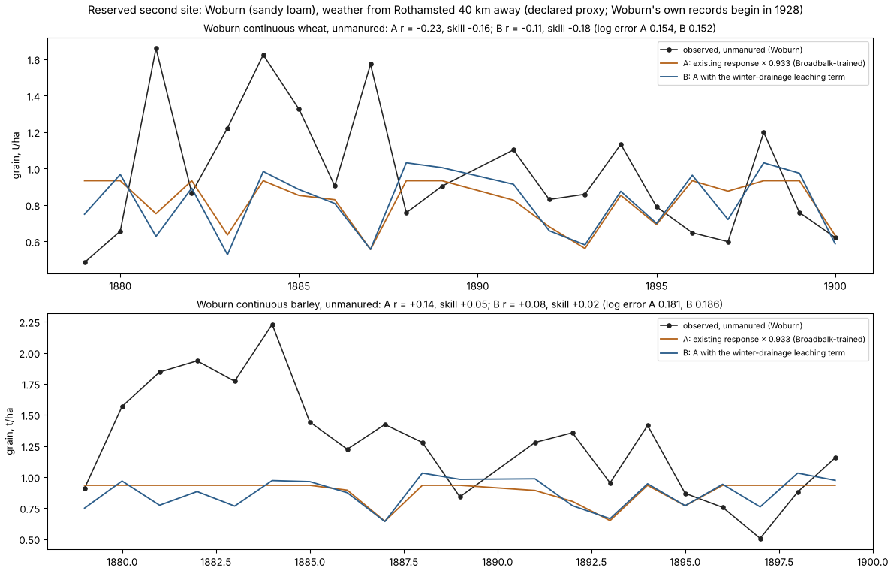

# A crop-water ledger, and the second English site: weather does not set low-input yields; soil fertility does

Part of the Earth-calibrated basis for the control map: grain feeds the shared
resident and institutional allocation that sustains reach. **No production crop,
climate, settlement or control value changes in this round.**

## 1. The dual-coefficient ledger (new, tested)

`harvest/soil_water_dual.py` implements Allen et al. (1998), *Crop
evapotranspiration*, FAO Irrigation and Drainage Paper 56: chapter 7's
evaporation layer (equations 69–79) and chapter 8's root zone (equations
81–88).

**How it works:**
- **One store.** The root zone (depletion 0 to TAW) is the only water
  account. Every millimetre leaves it exactly once: as crop transpiration,
  soil evaporation, drainage below field capacity, or runoff.
- **Evaporation is gated by the topsoil.** The 10 cm evaporation layer is a
  sub-account of the same water. It only sets how fast evaporation runs,
  through Kr and few, so the same water cannot be spent twice.
- **Stress acts on transpiration alone.**
- **Bare ground** dries only its top layer.
- **No reset.** Storage carries across seasons, with no free refill at
  sowing.

**Tests** (`tests/test_soil_water_dual.py`, six; all 16 soil-water tests
pass):
- **Closure:** water closes to 10⁻⁸ mm over two years of random weather, and
  to 10⁻¹² mm over Broadbalk's 48 years.
- **Bounds:** both depletions stay within their capacities.
- **Bare soil** gives at most TEW.
- **No double-spending:** without rain, transpiration plus evaporation never
  exceed the stored water.
- **Rain** restores stage-1 evaporation.
- **Agreement:** with evaporation shut off, it reproduces the existing
  single-store ledger (`harvest/soil_water.py`).

**Not represented:** transpiration from the exposed layer, capillary rise,
snow, frozen soil and root growth.

## 2. Broadbalk, as development data (`scripts/broadbalk_water_ledger.py`)

Declared before running in
`calibration/low_input_yields_20261105/water_ledger_development.json`.

**Settings:**
- **Weather:** Rothamsted's observed monthly record, with rain falling every
  3 days; 1 and 7 days were tried as sensitivities.
- **Soil:** FAO-56 table 19 silty clay loam, with a 1.5 m root zone (TAW
  195 mm).
- **Crop:** Kcb 0.15 / 1.10 / 0.15, between each year's observed sowing and
  harvest dates.

**Findings, 45 seasons, 1879–1925:**
- **Wheat did worse in wetter seasons,** by every wet measure, on both the
  unfertilised and the manured plots:

  | measure | unfertilised | manured |
  |---|---:|---:|
  | winter (Oct–Mar) drainage | r −0.24 | r −0.40 |
  | season soil evaporation | r −0.43 | r −0.35 |
  | transpiration / potential | r −0.19 | r −0.17 |

  The sensitivities to rain timing leave this unchanged.
- **Water shortage is not what limits this crop.** That is why the old
  water-limited response, which rewards wet years, was anti-correlated with
  the observations (r −0.38).
- **The notorious year shows it:** 1878–79, England's lost harvest, drained
  277 mm over winter, and the unfertilised plot gave 0.37 t/ha.
- **Drainage is too small.** It averages 94 mm a year, against the roughly
  half of rainfall Rothamsted's bare-soil drain gauges are known for. The
  existing Hargreaves reference evaporation is high in this humid climate:
  July 146 mm. The gauges' daily records (DR20, DR40, DR60, 1870 to now)
  need an e-RA account, and the open yearly summaries omit them, so the
  gauges were not used.
- **A one-parameter leaching term barely helps.** It fits 11 % lower
  unfertilised yield per 100 mm of winter drainage, but left one year out it
  is no better than the mean (skill 0.00). On the manured plot it gives
  +5 %.

## 3. Woburn, the reserved second site (`scripts/woburn_yields.py`)

**Woburn's own weather records start in 1928** (e-RA station WMS), two years
after the continuous wheat and barley trials (1877–1926) ended. Matched
local weather will therefore never exist, so the only possible test uses
Rothamsted's record, about 40 km away, as a declared regional proxy.

**The frozen test** (`woburn_plan.json`, before any Woburn yield was read):
- **A:** the existing response × 0.933, the scale frozen on Broadbalk's
  training years.
- **B:** A with the winter-drainage term fixed from Broadbalk, on FAO-56
  sandy loam (TAW 180 mm).
- **Qualification:** the Broadbalk protocol's rules.

**A disclosed pre-scoring amendment** (`woburn_amendment.json`): the data
code "no lime" as `L0`, and the sowing dates are day/month/year. The first
run had selected no rows and scored nothing.

**The unfertilised, unlimed plots exist from 1879 to 1900:** 21 wheat years
with complete weather, and 20 barley years.

| Woburn, unfertilised | observed mean | log error | Pearson r | RMSE skill vs constant |
|---|---:|---:|---:|---:|
| wheat, existing response | 0.98 t/ha | 0.150 | −0.23 | −0.12 |
| wheat, A (× 0.933) | | 0.154 | −0.23 | −0.16 |
| wheat, B (A + leaching) | | 0.152 | −0.11 | −0.18 |
| barley, existing response | 1.28 t/ha | 0.166 | +0.14 | +0.12 |
| barley, A | | 0.181 | +0.14 | +0.05 |
| barley, B | | 0.186 | +0.08 | +0.02 |

**Neither candidate qualifies.**
- **The Broadbalk scale does not transfer.** The existing response already
  predicts too little at Woburn (wheat 0.88 against an observed 0.98 t/ha;
  barley 0.95 against 1.28), so scaling it down made every score worse.
- **The leaching term does not rescue the year-to-year correlation.**
  Woburn's own drainage–yield correlation has the same sign as
  Broadbalk's, but it is weak (wheat r −0.20, barley −0.06).

## What the two sites do say, for the control map

- **Low-input yields run down with years of cropping, and manure stops it.**
  Woburn's continuous plots began in 1876 (five-year means, t/ha; 1879, the
  lost harvest, left out):

  | Woburn | 1880–84 | 1895–99 (wheat to 1900) | change |
  |---|---:|---:|---:|
  | barley, unfertilised | 1.87 | 0.84 | −55 % |
  | barley, manure only | 2.64 | 2.23 | −16 % |
  | wheat, unfertilised | 1.21 | 0.77 | −36 % |
  | wheat, manure only | 1.80 | 1.60 | −11 % |

  The same weather fell on both columns, so this is soil nitrogen being
  mined where nothing is returned, a state the model does not have. Weather
  explains little of the year-to-year scatter at either site.
- **Once run down, unfertilised cereals on two different English soils settle
  at 0.7–0.9 t/ha.** Broadbalk's 1901–25 evaluation mean is 0.69 (after
  over 50 years of continuous wheat), Woburn's late-1890s about 0.8. This is
  about the existing model's level (0.88–0.95 predicted), and a
  conservative floor for long-cropped land without manure.
- **Fresh or manured land yields about two to three times that floor:**
  Woburn's first unfertilised barley years 1.87, manured wheat about
  2.0 × and manured barley about 2.3 × the run-down plots, Broadbalk's
  manured wheat 3.1 ×. Around AD 200, rotation, fallow and manuring
  decided which of these held. So **land-use history and nutrient
  management, not weather, are the next component** the grain → resident
  → reach chain needs.
- **The next mechanism is a soil-fertility state.** Nitrogen supply would
  decline under continuous cropping without inputs and recover under fallow
  or manure. It would be developed on these spent Broadbalk and Woburn
  series, and evaluated on a genuinely separate record, such as the other
  Rothamsted classical experiments' early years.
- **Until then, the capacity layer stays a run-down floor,** and the control
  map's settlement support inherits it.

## Data spent

Woburn's unfertilised and manured wheat and barley strata are now spent
evaluation data (`calibration/earth_components_20261105/dataset_usage.json`).
Broadbalk was already spent. The reserved climate set f was not touched.
