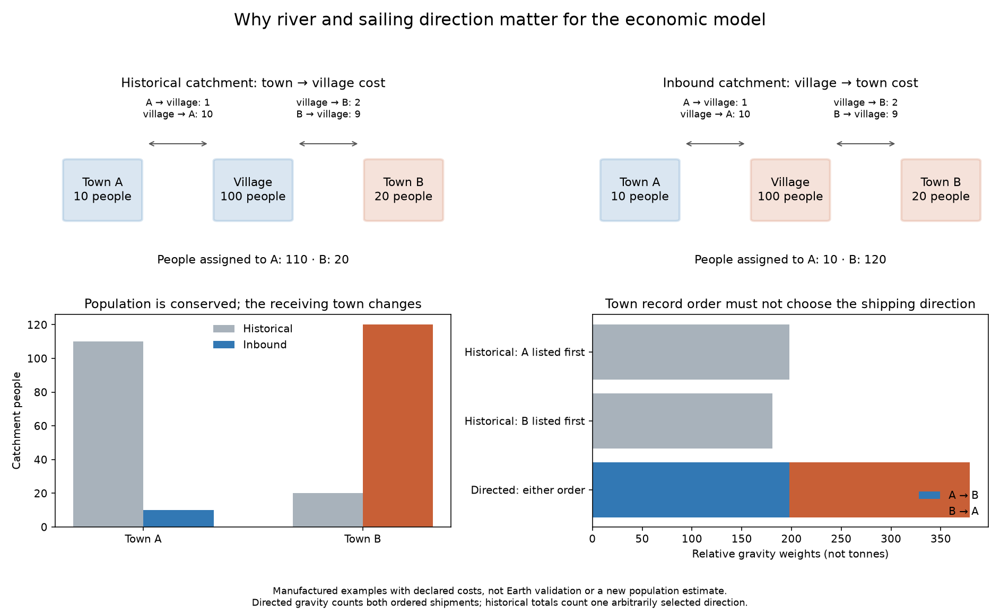

# Direction matters for hinterlands and trade

The political export audit found two reproducible directional issues in the
existing economic model. They matter because wind, river direction and slope
make the graph asymmetric.

1. `polity.trade.catchments` finds which town reaches a cell cheapest. For
   farmers bringing goods to market, the relevant direction is the cell
   reaching town. A manufactured village whose inbound costs are 10 to town A
   and 2 to town B belongs to B's market, even if A can deliver to it for 1.
2. `polity.trade.flows` counts a pair of large towns once, selecting its
   direction by town-record index. Reordering the same towns changes the cost,
   route and flow when the graph is asymmetric. This is an implementation
   dependence, not economic uncertainty.

The separate prototype `polity/directed_trade.py` uses the transposed directed
graph for inbound catchments. It routes ordered gravity shipments separately
in each direction, with values `P_i P_j exp(-cost_ij / scale)`. For the largest
300 towns approximation, it retains both directions of pairs with at least
one large endpoint, counting each ordered shipment once; smaller-to-smaller
pairs remain omitted. Population is assigned once, and unreachable population
is explicit. Auxiliary river nodes carry transport but no separate population;
seasonal aggregation rejects mismatched auxiliary-node identities.

This is not a forecast of tonnes, a grain-stock balance, a market-clearing
price model or a new fit of town population. The existing declared freight
costs and 270 road-km scale are unchanged. The earlier Roman town-size failure
remains material; this work does not validate market access as a town-size
predictor.

**Eleven manufactured tests pass**, covering inbound access, population
accounting, disconnected markets, auxiliary nodes, asymmetric routing, town
record permutation, seasonal averaging, distance cutoffs and the top-town
approximation. They also reproduce the record-order dependence of the old
algorithm. The existing implementation remains intact for completed evidence
and the political exports already in progress. The prototype is not used by
the published atlases yet.

## Next map comparison, declared before its results

Use the same climate, claimed-land population mask, road/river/sea networks,
270 road-km scale and four seasons. Compare historical and directed versions
on all three atlases. Report the share of reachable people whose assigned
town changes, the changes in town catchment ranks, and directed route weights.
Check total assigned population against reachable eligible population and
check that town permutations preserve physical edge weights. People in the
map are not created by changing their market; held/claimed population tables
must remain unchanged. Compare complete routes on a bounded town subset
before using the 300-largest approximation.

Keep this an engineering and sensitivity comparison. Historical town sizes
require a separate predeclared Earth test; the proxy-based HYDE allocations
are not independent confirmation of within-country settlement patterns.
