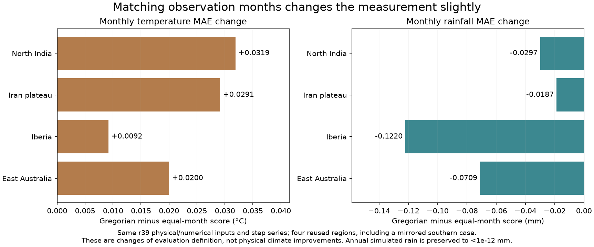
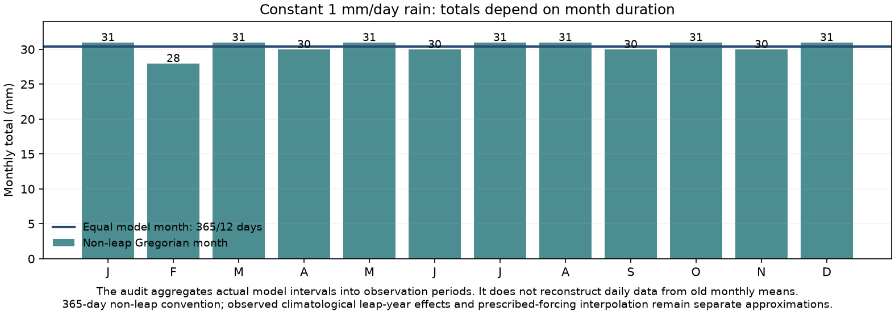

# Observation-calendar audit: an evaluation mismatch, a small effect here

The legacy benchmark aggregates model steps into twelve equal365/12-day
months, then compares monthly rain totals and temperatures with WorldClim's
calendar-month normals. Constant1mm/day rain therefore becomes30.4167mm every
model month, while a non-leap February has28mm and a31-day month31mm.

This separate audit changes **only aggregation**, not r39 climate physics or
any model default. Each of four reused regions is integrated once. The actual
step series first reproduces its archived equal-month temperature/rain and
observation arrays exactly at float32 precision, with identical geographic
inputs and passing numerical certificates. Only then is the same series
aggregated into declared365-day non-leap Gregorian observation periods.

| Region | Equal-month T MAE | Gregorian T MAE | Equal rain MAE | Gregorian rain MAE |
|---|---:|---:|---:|---:|
| North India | 3.2215°C | 3.2534°C | 50.0097mm | 49.9800mm |
| Iran plateau | 3.3072°C | 3.3363°C | 16.5228mm | 16.5041mm |
| Iberia | 1.6174°C | 1.6266°C | 19.1556mm | 19.0336mm |
| East Australia, mirrored | 1.5102°C | 1.5302°C | 36.5215mm | 36.4505mm |

Temperature MAE increases.009–.032°C; rainfall MAE decreases.019–.122mm/month.
Annual simulated rain is preserved at every scored cell, with maximum
difference below1e-12mm. Annual observed rain is untouched too. These small
changes do not explain the hundreds of millimeters of monsoon/coastal error.
They are different measurements of unchanged physical fields, not an adopted
physical accuracy gain or globally updated city statistic.

## Southern periods and known-answer tests

WorldClim observations for a southern case retain the existing July-through-
June reorder. The calendar aggregator shifts actual original Gregorian month
boundaries by half the365-day model year, including wraparound. For example,
the mirrored July interval crosses the model-year boundary; no tail is lost
and no source month is duplicated. It does not assume every shifted month
has365/12days or interpolate old monthly means into a new calendar.

The sixteen tests cover uniform daily rain across13/25/73/365 intervals in
both hemispheres, actual month durations, annual rain conservation, day-weighted
temperature conservation, the southern wrap, and rejection of irregular or
incomplete step calendars. The non-leap convention is explicit. Climatological
leap-year differences, ideal seasonal phasing and the existing interpolation
of prescribed observation-derived forcing remain separate approximations.

## Safe scope and reproduction

`scripts/earth_calendar.py` is an evaluation helper outside the production model.
`scripts/check_earth_calendar.py` and the predeclared
`calibration/earth_calendar_20261026/plan.json` freeze all code/data inputs.
`output/earth_calendar_20261026/` retains the exact controls and paired scores.
Optional NPZ archives include actual step temperature/rain and both monthly
aggregations, with SHA-256 values in the records. A new source epoch requires
a new output folder.

There is no calibration, parameter search, benchmark-default change or atlas
climate/economic replacement. Historical headline numbers remain labeled with
their equal-month method. A future calendar-aware calibration must evaluate
every reference/candidate under the same declared definition, including ocean
checks where applicable. Do not mix these partial new scores with old full31
gates or silently relabel an old fit. Four reused regions are not an independent
validation set or a remeasurement of all3,667 sampled cities.

The normal launcher's accuracy companion includes both charts and JSON scores.

