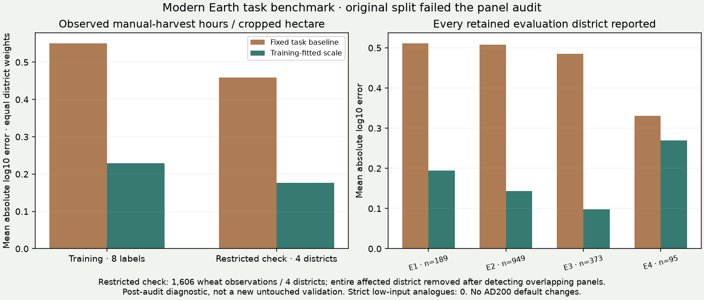

# Earth calibration programme: evidence ledger and first field-work test

The user's priority is now to calibrate every model component on Earth as well
as the evidence permits. The normal atlas hub links to **Earth calibration
evidence**, a page containing the first component ledger, searchable parameter
records, the new benchmark and its limitations. No production climate,
agricultural, population, foraging, settlement or control values change in this
milestone.

## What the inventory establishes

The first inventory covers 11 components and 551 numeric configuration records.
It separates measured inputs, definitions, published relationships, Earth fits,
historical fits, scenario choices and evidence that still needs tracing.
It covers selected JSON configurations and literal top-level Python constants,
not every number inside functions. Records can include alternative or inherited
settings; counts are not degrees of freedom or a percentage of the model
validated. Unreviewed means this inventory has not traced the evidence, not that
no earlier work exists.

The [specification](../calibration/earth_components_20261105/evidence_spec.json)
contains each assignment rule. The generated
[parameter CSV](../atlases/earth_evidence/data/parameters.csv) and
[ledger JSON](../atlases/earth_evidence/data/ledger.json) retain values, sources
and hashes. A specific fitted setting never promotes neighbouring assumptions
into fitted coefficients. Missing or ambiguous evidence references fail the
audit.

Existing climate, forager, historical population, settlement-count and crop-clock
results remain distinct. The latest r43 climate improvement was effectively tied
on its unseen combined score. The foraging adapter has successful transfer
results and known regional failures. The trained chilling-clock candidate failed
its calendar evaluation. Numerical accounting tests do not turn our new
provisioning/cohort assumptions into empirical fits.

The [dataset-exposure register](../calibration/earth_components_20261105/dataset_usage.json)
records spent evaluation pools, including the new reaping test. It does not
open or run the reserved climate set f.

## New manual-harvest experiment and the failed split audit

Source: Guvvala Venkata Anupama and Thomas Falk,
[public VDSA replication dataset](https://doi.org/10.5281/zenodo.8224522),
version 1, 2023, CC BY 4.0. The survey observations cover 2009–2014. Household
and plot records originate in the ICRISAT/partner field surveys; the
[provider documentation](https://vdsa.icrisat.org/vdsa-microdoc.aspx) describes
household, cultivation and labour schedules.

We use raw operation records and independently reported plot hectares and
household sizes. We do not use the processed tables' monetary labour values
as hours, or crop revenues as grain quantities. The source processing code
selects Kharif cost records while aggregating crop outputs across seasons;
that makes the processed economic outputs unsuitable as a direct annual
physical-work benchmark. Our importer retains full plot/subplot codes and
seasons instead of collapsing every subplot to its first character.

The [plan](../calibration/earth_components_20261105/plan.json) was committed in
`e8e09152` before target scoring. Schema, codebooks, processing code and category
vocabularies had been inspected; numerical outcomes had not been scored.
The selection, producer code and complete identities were committed in
`5ddb6d20` before held-out evaluation. Public survey files remain checksum-verified
in cache; source Stata code is never executed. Respondent names are not retained
in prepared records or published outputs.

### Task and unit matching

- Sole wheat/barley plots only; reported acres convert to hectares with
  0.40468564224 ha/acre, consistent with the source documentation.
- Exact harvesting/reaping labels only. Bundled harvesting, binding or
  threshing labels are excluded, not assigned invented fractions.
- Human family, hired and exchange hours are counted separately. Bullock hours
  are excluded. Wages cannot substitute for hours.
- Machinery-coded harvests, missing/negative hours, ambiguous event duplicates
  and mixed/ambiguous crop keys are excluded under the declared rules.
- Household size comes from the general-information schedule, independently of
  grain production. A household member is not automatically a full-time worker.
- The additional strict recorded-input subgroup requires zero recorded
  irrigation and no machinery, fertilizer, pesticide or weedicide rows. Absence
  of records does not prove historical technology.

The intended split hashes source region/state/district. It yielded 603 training
observations in eight district labels and 1,635 evaluation observations in five.
**The independent replay found the split invalid:** source spellings
`MAHARASHTRA` / `MAHARASTRA` divided Akola across folds. Five households had
seven observations in each fold. Different label strings were not independent
geographic units.

The whole affected district was removed from the evaluation, including all 29
of its evaluation records. This leaves **1,606 observations in four districts**
with no training household/village overlap. The scale was not refitted. This
restricted comparison is explicitly a **post-audit diagnostic**, not a new
untouched or fully prospective validation. The original metrics are preserved
in [the archived computation](../atlases/earth_evidence/data/evaluation_original.json),
with [the panel failure audit](../atlases/earth_evidence/data/panel_audit.json)
recording exactly what was invalidated and excluded. The current runner now
rejects cross-fold household panels before writing prepared data or scoring.
The original purposive survey is not a representative global sample.

### Fitted comparator and complete result

The baseline uses the existing Columella-derived reaping conversion: wheat
48 and barley 32 human hours/ha under the approximate 0.25 ha/iugerum and
8-hour conversion-day assumptions. The candidate fits one shared positive
multiplicative scale, bounded to [0.25, 4], using training data only.

The weighted median of log(observed/baseline) gives a global optimum of this
one-dimensional absolute-log-error objective. No local optimizer or choice of
starting point is required. This does not resolve local minima in the much
larger climate or coupled-model search.

Selected scale: **3.432**, or 164.7 hours/ha for the modern wheat comparator.
The barley conversion is not independently validated: there are only three
training barley observations and no evaluation barley.

| Check | Baseline | Training-fitted comparator |
|---|---:|---:|
| Training: equal-district mean absolute log10 error | 0.551 | 0.229 |
| Restricted diagnostic: equal-district mean absolute log10 error | 0.459 | 0.176 |
| Restricted diagnostic: equal-district fraction within factor two | 20.9% | 80.8% |

The original numerical improvement rule was satisfied, but **the independent
validation qualification is withdrawn** because its split failed the panel
audit. All four retained evaluation districts improve in the restricted
comparison; that diagnostic does not repair the original study design or
justify an ancient default. All original district results remain available.



### Why this does not change the AD200 model

**No eligible observation passes the strict recorded low-input subgroup.**
The retained evaluation cases are all wheat. Modern varieties, biomass/yield, management,
task interpretation and social organization may explain differences from
normative ancient work counts. We have not identified those causes. Multiplying
all ancient work by 3.432 would therefore be an unjustified transfer.

The restricted result supports further investigation of a modern manual-task
comparator, with the original validation claim withdrawn. It does not calibrate whole-year work availability, 40% worker
shares, household nutrition, storage, imports, urban shares or institutional
staffing. Our 200 AD model retains its explicit scenarios. The new test pool
is now spent; later candidates cannot describe it as fresh validation.

## Next calibration work, in order

1. **Fix geographic identities before another fit.** Use stable place IDs and
   explicit aliases, then reject any household or village that crosses folds.
   Corrected comparisons on this already-scored pool are development checks,
   not a replacement unseen test.
2. **Obtain matching low-input/historical work evidence and independent crop
   yield/area records.** Distinguish harvest workload per area from workload
   driven by biomass/yield. The current result does not establish that one
   global hours-per-hectare rate transfers across technology and harvest sizes.
   Do not relax the strict screen after seeing zero matches.
3. **Replace the circular rural anchor with a jointly observed household
   budget.** Household members, cultivated hectares, family/hired/exchange work,
   consumption and marketed output need compatible observations. Potential
   grain must not create its own reference population and workforce. The first
   task benchmark supplies some of these observables, not the entire budget.
4. **Separate food-production factors before fitting population.** Population
   capacity contains the product yield × arable share × farmed share × sown
   share / food need. Aggregate census matching alone cannot identify each
   factor. The existing Han normalization is not independent evidence for all
   these coefficients.
5. **Calibrate storage, imports and freight before city populations.** A locally
   supplied cereal ceiling is not a measured ancient city size. Missing food
   imports must not be compensated by inflated local yields or urban shares.
6. **Evaluate the integrated chain on Earth across different societies.** Use
   observed climate for process calibration first, then simulated climate for
   end-to-end transfer. Keep state, mobile/nonstate and uncertain-source cases
   explicit. Taxation, institutional presence and communication evidence must
   validate sustained control separately from de jure boundaries.

All utility budgets still lead back to the shared resident/source allocation.
This calibration programme replaces unsupported defaults only when compatible
Earth evidence supports the change; it does not add independent final map
families or infer institutions from ecology.

## Reproduction

The published pseudonymous task packet and original frozen selection permit
independent replay without any source-person names or a new survey download:

```sh
python -I scripts/audit_earth_components.py
python -I scripts/audit_earth_reaping_panels.py
python -I scripts/publish_earth_evidence.py
python -I scripts/check_earth_component_results.py --out output/earth_components_20261105/independent_review.json
python -I scripts/build_fit_hub.py
```

Raw files can be fetched with `scripts/fetch_vdsa_evidence.py`. The original V1
reader/runner snapshot is in commit `5ddb6d20`; it reproduces the archived
computation, including its flawed split. Current `benchmark_earth_reaping.py`
rejects that split through the added panel guard, and rejects stale identities
or uncommitted plans/selections. Do not bypass the guard to describe a rerun as
independent validation. A corrected future study needs a new declared protocol
and genuinely independent evaluation evidence. The old pool remains spent.
