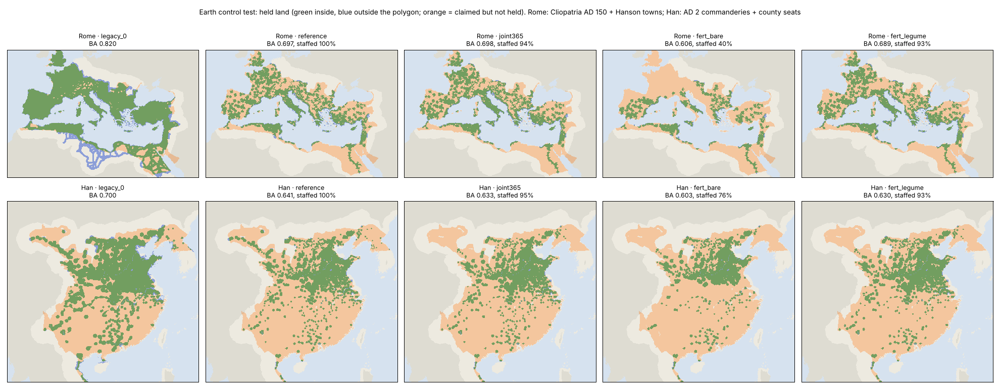

# Earth control test: which de facto control map for AD 200?

**Result: the transport-only map (legacy_0) scores best on Earth in both empires. By the frozen rule it becomes the default for Supply-supported reach. Settlements reverts to its original placement, by the same fallback.** None of the food-budget options passes. Bare fallow, the default since this morning, fails both gates.

## What was tested

**Plan and data**
- **Plan:** `calibration/earth_control_20261106/plan.json`, committed at d1935f2b before any result was computed.
- **Script:** `scripts/earth_control_test.py`.
- **Outputs:** `output/earth_control_20261106/` (`results.json`, the per-region case ledgers, `earth_control.png`).

**The chain:** the atlas's own chain, unchanged: rural cereal → collection → settlement allocation → staffed institutional sources → paired seasonal reach. It runs on the Earth windows of the polity tests at 9 km resolution, with WorldClim climate, NCEP winds, Natural Earth rivers and the Earth land/people run.

**Rome**
- **Sources:** Hanson's towns of AD 150 (1,294 source cells), with the Itiner-e roads.
- **Target:** Cliopatria's Roman empire of AD 150.

**Han**
- **Sources:** the AD 2 county seats (1,276 cells). There is no road data.
- **Target:** the AD 2 commanderies.

**Scoring:** balanced accuracy of held land over the bands used by the earlier tests. Rome's band is land within 15 walking days of the towns and roads; Han's is land within 15 year-round days of the seats.

**Data status:** a development comparison on seen data, not a blind test. Every one of these sources was used in the POLITY v2/v3 work and in A2. Nothing is fitted.

## Results

| | Rome BA (west / east) | TPR / TNR | held, M km² | real towns staffed | Han BA | TPR / TNR | held, M km² | county seats staffed |
|---|---|---|---:|---:|---:|---|---:|---:|
| **legacy_0** (transport only) | **0.820** (0.830 / 0.811) | 0.90 / 0.74 | 4.85 | — | **0.700** | 0.45 / 0.95 | 1.90 | — |
| reference (all staffed, no food limit) | 0.697 (0.747 / 0.636) | 0.46 / 0.94 | 2.25 | 100 % | 0.641 | 0.30 / 0.99 | 1.23 | 100 % |
| joint365 | 0.698 (0.748 / 0.637) | 0.45 / 0.94 | 2.23 | 94 % | 0.633 | 0.28 / 0.99 | 1.16 | 95 % |
| fert_legume | 0.689 (0.733 / 0.636) | 0.44 / 0.94 | 2.16 | 93 % | 0.630 | 0.27 / 0.99 | 1.12 | 93 % |
| fert_bare | 0.606 (0.602 / 0.611) | 0.24 / 0.97 | 1.18 | **40 %** | 0.603 | 0.21 / 0.99 | 0.88 | 76 % |

**Reproduction.** The earlier legacy scores reproduce under the current transport code:
- Rome west 0.830 and east 0.811 (0.831 and 0.811 in POLITY v3);
- Han 0.790 at its fitted 5 days (0.796).

## Decision (frozen rule)

| case | G1: staffs ≥ 75 % of real sources (Rome, Han) | G2: BA within 0.02 of legacy_0 (Rome, Han) | census error |
|---|---|---|---:|
| joint365 | ✓ (94 %, 95 %) | ✗ (−0.122, −0.067) | 0.538 |
| fert_legume | ✓ (93 %, 93 %) | ✗ (−0.131, −0.070) | 0.685 |
| fert_bare | ✗ (40 %, 76 %) | ✗ (−0.214, −0.097) | 0.459 |

**No food case passes, so the default becomes legacy_0.**
- **Supply-supported reach:** now opens on *Legacy · none*.
- **Settlements:** now opens on *Legacy · Original placement*. The plan's question names the reach map only. Applying the same fallback here keeps the two layers consistent, and it avoids opening on bare fallow, which can feed only 40 % of the real Roman towns.
- **The food-budget options:** remain as scenario options, each showing its Earth result in the legend.

## Why the supply chain loses (post hoc, after the result)

**1. Most of the loss comes from the reach rule, before any food limit.** Even with every real source staffed (the reference case), the chain holds far less land than the transport-only map: −0.12 in Rome and −0.06 in Han.
- **The every-month requirement.** The chain counts land as held only if a patrol from a staffed town can reach it in *every* month (2 days out, 2 back, within 4 days of rations). Requiring just one month instead raises the reference to 0.747 in Rome and 0.721 in Han. Requiring 6 months gives 0.733 and 0.703.
- **Roads are not sources.** The legacy map also counts land within 2 days of a road, which matters in Rome (28,775 road cells).
- **Missing interior.** The patchy green in the figure is what the rule produces: interior land between towns is left unheld.

**2. The food limit costs little, except under bare fallow.**
- Against the reference, joint365 changes BA by +0.001 in Rome and −0.008 in Han, and fert_legume by −0.008 and −0.011.
- fert_bare changes it by **−0.091 in Rome** and −0.038 in Han.

**3. Bare fallow fails because of an inconsistency in the chain, not because of the soil model.**
- **The fixed rural claim.** The chain keeps the rural food claim fixed at 0.6 × the *previous* harvest. Where the bare-fallow factor falls below about 0.6 (wet Gaul, Britain, northern Italy), the farms cannot feed even that claim:
  - 23 % of the rural need goes unmet in the Rome window (15 % in Han);
  - nothing is left to collect, so no town there can be staffed.
- **The contradiction.** The census check improves under bare fallow precisely because capacity falls in those regions (Gaul 0.10–0.22 → 0.31–0.69 of capacity). Yet the chain still feeds the rural population sized to the old capacity. Both cannot hold. The rural claim should scale with the same factor, so that one ledger supports both the people and the towns.

## What this means for the AD 200 map

**The food-budget options do not yet make de facto control more accurate.** On Earth they hold less of the land Rome and Han actually governed than the plain transport map, and bare fallow cannot feed the real town network. The fertility work stays valid as a crop model: it passed two blind Rothamsted tests and improves the census fit. But it should not drive the control map until the chain is fixed.

**Next, each its own frozen step:**
1. **Make the rural claim scale with the fertility factor**, so the rural people and the collectable surplus come from one ledger. Then rerun this test.
2. **Bring the staffed-source reach rule closer to the transport map.** Two candidate changes: count roads as reach, and use the year-round effective days instead of an every-month requirement. The difference above is the size of the prize.
3. **For a blind test, declare unseen Earth pools first.** Candidates are other polities or years in Cliopatria, with their own sources; Rome AD 150 and Han AD 2 are spent for this question.

## Deviations, all before any Rome result

1. **Date palms (1.4 % of the Rome window's food; Mesopotamia and the Nile).**
   - They are perennial and have no crop-window calendar, so the first Rome run crashed.
   - A first fix dropped them, which contradicted the plan's "dates keep F = 1". Rome was restarted with date palms keeping their food and a September harvest (season August–October).
   - Han has no date cells.
2. **Figure.** The first figure was drawn upside down and was redrawn. Cosmetic only.

## Limitations

- **The targets are claims.** The polygons are extents (Cliopatria) and administrative units, not measured presence. So the extent score cannot penalise a lenient food model, which is why it is a gate here and not the ranking.
- **Resolution and data.** The windows are 9 km. Han has no roads. Millet is kept as a fertility crop on Earth; the atlas grids carry wheat and barley only.
- **Sea and river constants** are the Earth tests' fitted values (`calibration/polity_20261025/sea.json`).
