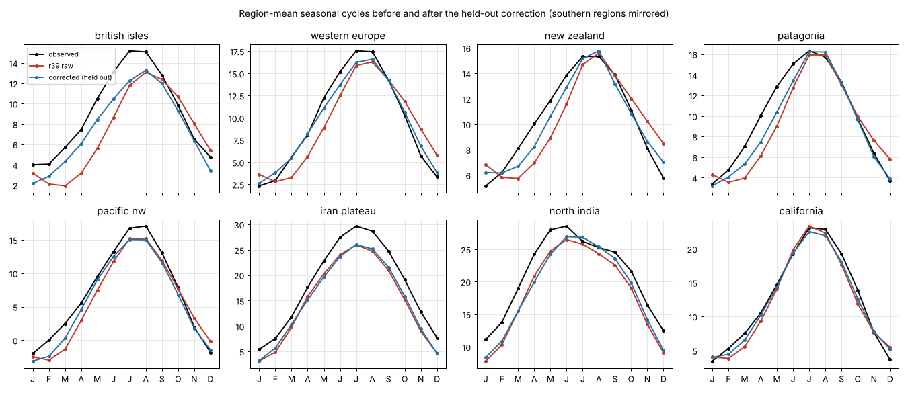
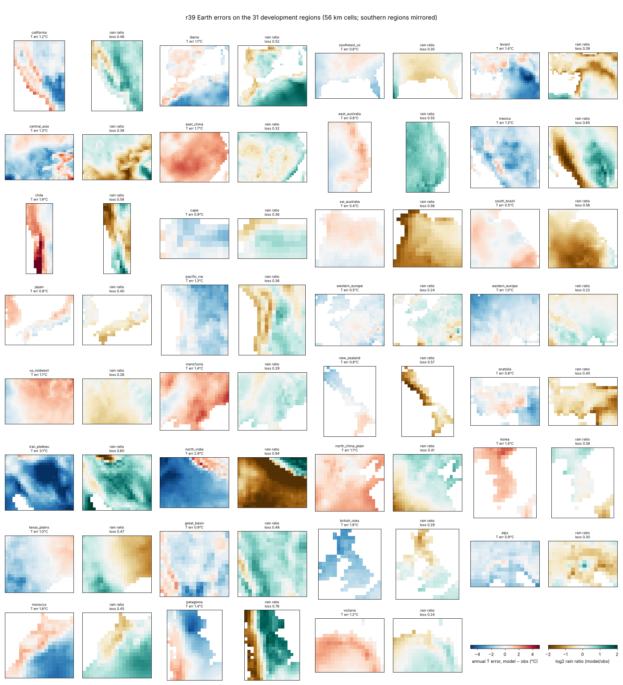
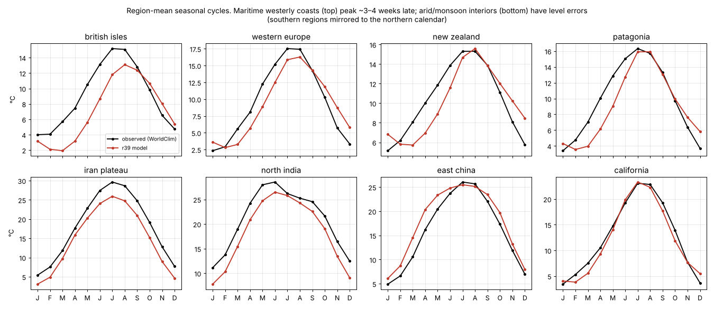
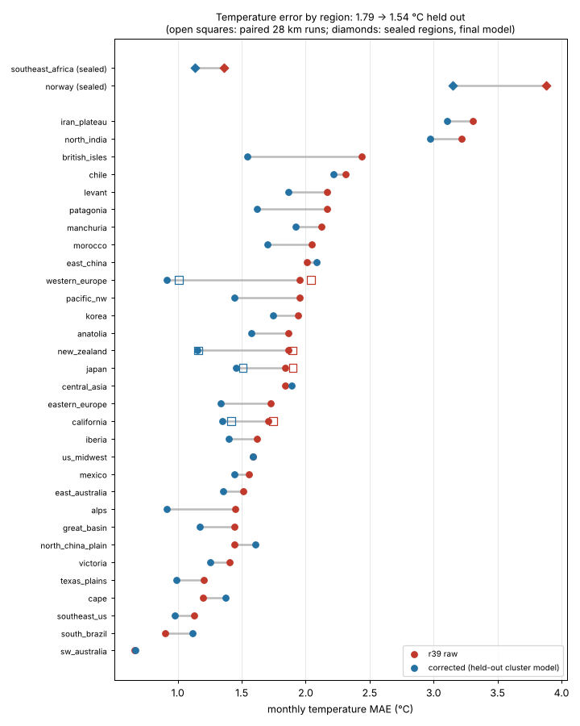
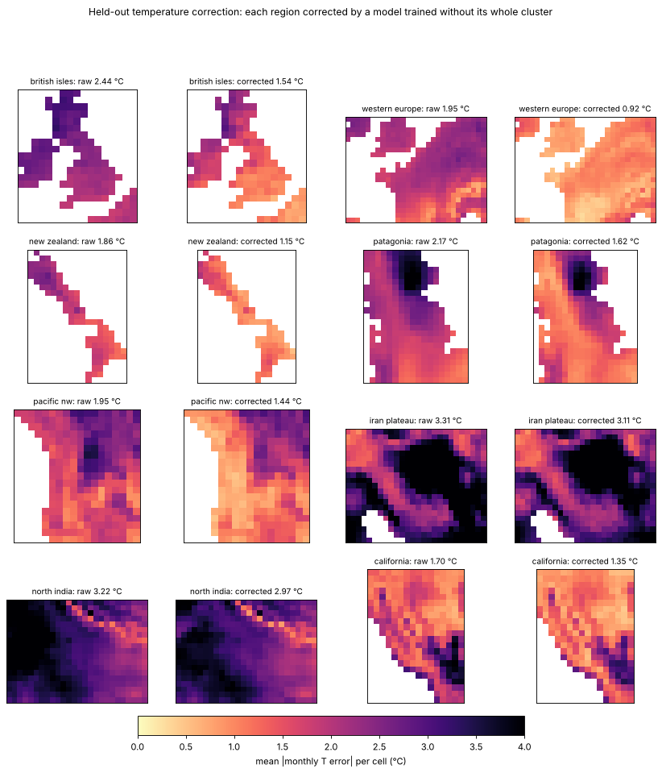
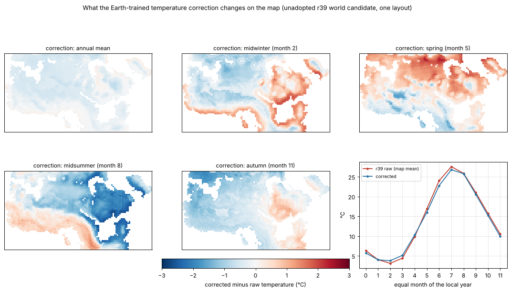
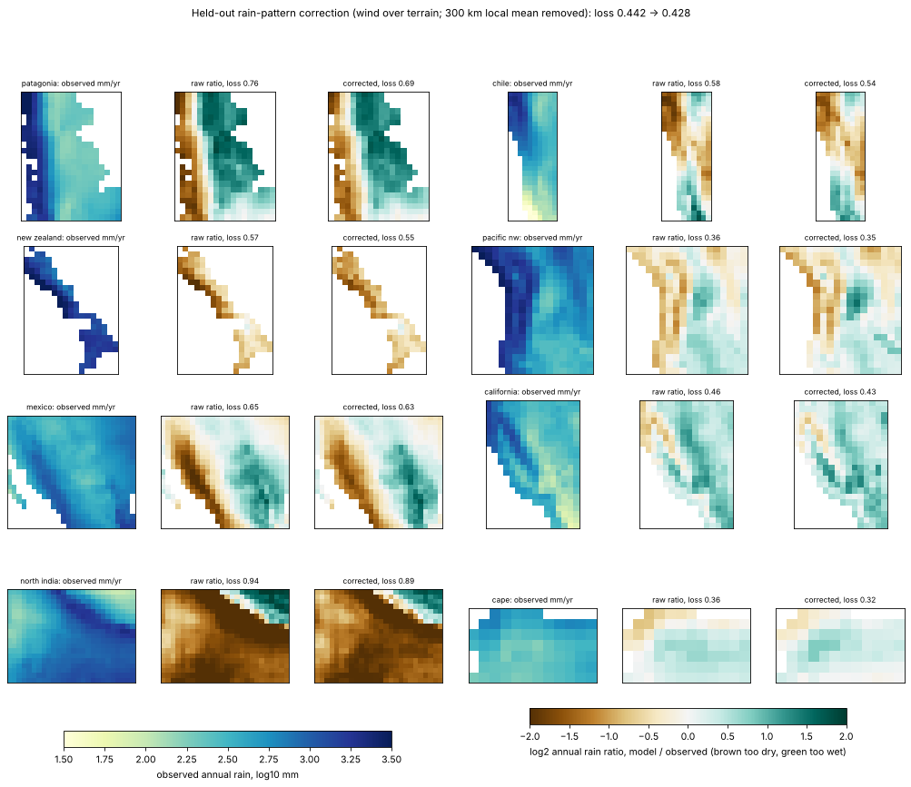
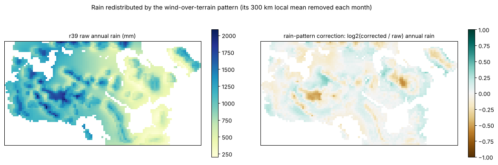

# Earth-trained corrections for r39: temperature and local rain pattern, 30 October 2026

**Result.** Two new output stages correct r39 with models learned from the 31
Earth development regions, using only inputs every map has. Scored the honest
way (each region corrected by models trained without its whole geographic
cluster):

* **Temperature:** monthly error falls **1.793 → 1.540 °C (−14.1 %)**, every
  policy group improving; paired 28 km runs 1.896 → 1.274 °C (14 km, the atlas
  scale: 1.908 → 1.288), the two sealed regions 2.621 → 2.143 °C.
* **Rain (local pattern, §8):** the model's own monthly winds over the terrain
  move rain between windward slopes and rain shadows within ~300 km, leaving
  larger-scale amounts alone. Rain loss falls **0.4424 → 0.4281 (−3.2 %)**,
  every group improving (28 km −1.8 %, 14 km −1.5 %, sealed −2.4 %).
  Correcting regional rain *amounts* failed between continents and is not done.

Köppen class agreement over the 31 regions goes 47.1 % → 47.5 %
(temperature) → 48.6 % (both). Physics r39, its outputs and the published
atlases are unchanged; neither stage is wired into the atlases yet (see *Next*).



## 1. Reproducing the baseline

A fresh container downloaded WorldClim 2.1 (5′ tavg, prec, elev, vapr) and the
monthly WOA18 profiles (`scripts/prepare_woa18.py --download`), then reran
`scripts/benchmark_local.py` with `calibration/local_accuracy_20261023/r39_params.json`
on all 31 development regions at 56 km. All 31 saved cell arrays match the
archived r39 run byte for byte (`cells_sha256`): T MAE 1.792823 °C, rain loss
0.442366. The run is kept at `output/earth_correction_20261030/r39_dev31/`.



## 2. Diagnosis

Pooling 11,487 scored cells:

* **Seasonal lag on maritime westerly coasts.** Phase of the annual harmonic,
  simulated minus observed: British Isles +32 days, New Zealand +30,
  Patagonia +24, western Europe +22, Pacific NW +11, eastern Europe +11,
  Alps +10. Subtropical and east-coast regions have none (−8 to +6). Spring
  runs 2–5 °C too cold and late autumn too warm.
* **Cause.** The model's sea-surface phase is right (within ±10 days of WOA18),
  but its seasonal swing off west coasts is about twice too large (British
  Isles 6.9 °C against 3.2; California 5.0 against 2.5) and too small off east
  coasts (Japan 5.0 against 6.7). Over British Isles land the equilibrium
  temperature the air relaxes to is the latitude's continental column (annual
  mean 2.3 °C against 7.2 °C air), so the fitted coupling leaves the air almost
  entirely sea-controlled (peak day 241; land equilibrium 204; observed 209).
* **Level errors** in arid subtropical interiors and plateaus (Iran −3.1 °C,
  North India −2.6 °C) and some east-coast/monsoon regions (East China +1.7 °C).
* **Local relief.** Cells below their 200 km surroundings are 1.2–1.5 °C too
  cold; the error grows about 1.15 K per km of local relief (about 2 K/km in
  March, 0.6 K/km in summer), so valleys and ridges need a steeper lapse than
  the fitted 4.4 K/km while broad plateaus do not. Alone, a two-scale lapse
  would improve T MAE only ~0.8 % (leave-one-region-out), so it was not built.



## 3. Physics attempt (rejected, not committed to the model)

An opt-in e53 scaled the zonal mixed layer's seasonal anomaly by the advected
upwind land share (damped under maritime air, amplified downwind of land).
Defaults reproduced r39 bit for bit. On a 15-region screen (the 7 maritime
regions plus Japan, Korea, East China, California, Iberia, Chile, Cape,
Victoria), against r39:

| setting | T MAE | rain loss | British Isles lag |
|---|---:|---:|---:|
| marine 0.5, continental 1.5 | −2.6 % | +2.9 % | +29 d |
| marine 0.6, continental 1.3 | −2.6 % | +2.3 % | +29 d |
| marine 0.4, continental 1.0 | −1.7 % | +5.2 % | +25 d |
| 0.6/1.3 + land_coupling_insolation 1.2 | −2.8 % | +2.9 % | +29 d |
| 0.6/1.3 + land_tau_days 0.9 | −3.1 % | +3.1 % | +28 d |
| 0.6/1.3 + eddy_heat 0.6 | +1.6 % | +2.9 % | +35 d |
| 0.6/1.3 + ocean_tau_days 4 | −1.5 % | +2.5 % | +29 d |

Combined S stayed at 0.999–1.023: no gain. Shifting the land equilibrium to
the sea's annual mean (existing e28 `maritime_mean` 0.6–1.0) with stronger
coupling moved the British peak only from day 241 to 232. Fixing the lag in
physics needs a restructured boundary layer and a recalibration; the e53 code
was reverted so r39's sources and run identities stay untouched. The observed
SST switch (`sst_source="observed"`) also leaves a 23-day lag.

## 4. The correction stage

`rotclimate/correction.py`, trained by `scripts/train_earth_correction.py`:

* Two gradient-boosted tree ensembles (scikit-learn for training only;
  exported to plain numpy arrays, so applying needs no new dependency):
  **shape**, the month-to-month error pattern with its annual mean removed
  (phase and amplitude), and **level**, the annual-mean error.
* Inputs available on every grid: simulated monthly T and rain, season from
  the winter solstice (so a different calendar works), |latitude|, terrain
  smoothed over 100/200/400 km and relative to its 200 km mean, land share at
  those scales and distance to the coast (all in km, not cells). No longitude,
  region name or observation enters.
* Equal weight per region; fixed hyperparameters (150 trees, learning rate
  0.1, 31 leaves, ≥200 cell-months per leaf for shape, ≥1,000 for level).
* **Leave-one-cluster-out validation.** Many regions touch or overlap
  (Texas–Mexico 1 km, Manchuria–North China Plain 2 km), so leaving out one
  region lets its neighbours teach the model its own errors. Twelve fixed
  clusters (North America west/central, Europe, Middle East, East Asia,
  SE Australia, South America west, and five singletons) are each corrected
  by models trained on the other eleven: the Earth stand-in for an unseen
  invented continent.
* **Declared selection rule**, applied by the script: among shape weights
  {1.0, 0.8, 0.6} × level weights {0, 0.3, 0.5}, the lowest held-out MAE
  with every group improved and no region worse by more than 0.25 °C.
  Selected: **shape 0.8, level 0.3**. The final model is refitted on all 31.

| weights (shape, level) | held-out T MAE | worst region | eligible |
|---|---:|---|---|
| 1.0, 0 | 1.606 | south_brazil +0.30 | no |
| 1.0, 0.3 | 1.554 | south_brazil +0.32 | no |
| 0.8, 0 | 1.591 | south_brazil +0.19 | yes |
| **0.8, 0.3** | **1.540** | south_brazil +0.22 | **yes** |
| 0.8, 0.5 | 1.531 | cape +0.41 | no |
| 0.6, 0.3 | 1.556 | cape +0.20 | yes |

## 5. Held-out results

| | monthly T MAE | annual-mean MAE | range MAE | warmest month | coldest month | Köppen exact | Köppen main |
|---|---:|---:|---:|---:|---:|---:|---:|
| all 31 | 1.793 → **1.540** | 1.241 → 1.175 | 1.977 → 2.104 | 1.721 → 1.574 | 1.530 → 1.547 | 47.1 → 47.5 % | 74.8 → 74.9 % |
| training 8 | 1.691 → 1.546 | | | | | | |
| former holdout 5 | 1.382 → 1.365 | 0.902 → 0.989 | 1.425 → 1.907 | | | | |
| mid-latitude 6 | 1.868 → 1.392 | | | | | | |
| dev12 | 1.994 → 1.683 | | | | | | |
| paired 28 km (4) | 1.896 → **1.274** | 0.819 → 0.738 | 1.604 → 1.750 | 1.457 → 1.430 | 1.458 → 1.208 | 42.3 → 45.6 % | 78.0 → 81.8 % |
| paired 14 km (4) | 1.908 → **1.288** | 0.828 → 0.747 | 1.639 → 1.775 | 1.450 → 1.447 | 1.512 → 1.252 | 41.2 → 45.0 % | 77.6 → 81.7 % |
| sealed (Norway, SE Africa) | 2.621 → **2.143** | 2.333 → 1.927 | 2.636 → 2.623 | 3.430 → 2.934 | 2.049 → 2.073 | 12.5 → 15.7 % | 40.3 → 41.1 % |

In the existing local-accuracy policy's arithmetic (rain unchanged) the
development S is 0.930, every group improves and the paired 28 km S is 0.836.
The 28 km and 14 km runs use the held-out fold models although training
used 56 km cells. The atlases use ~15 km cells: at 14 km all four regions
improve (California 1.78 → 1.46, Japan 1.93 → 1.53, New Zealand 1.89 → 1.15,
western Europe 2.04 → 1.02 °C), with the same range caveat (California and
Japan worse).

**Mixed outcomes, reported as found.** Six of 31 regions get worse (South
Brazil +0.22 °C, Cape +0.18, North China Plain +0.16, East China +0.08,
Central Asia +0.05, SW Australia +0.003). Seasonal range error worsens 6 %
overall and 34 % in the former-holdout group; coldest-month error worsens
slightly (1 %). Köppen agreement barely moves because classes depend heavily
on rain, which this stage leaves unchanged. The biggest gains are the maritime lag (western
Europe 1.95 → 0.92 °C, British Isles 2.44 → 1.54); the arid-interior cold bias
improves only a little (Iran 3.31 → 3.11), because region-level offsets do
not transfer reliably between continents.





## 6. Rain: a negative result

The same design was tried for monthly rain (log ratio with 5 or 15 mm
offsets, full features, rain-only features, shrinkage 0.5–1). Leaving one
region out looked promising (loss 0.442 → 0.408), but leaving out whole
clusters made unseen continents **worse** in every variant: 0.511 with all
features, 0.446–0.461 with rain-only features, and 0.441 at best (−0.3 %, with
mid-latitudes worse). The apparent gain was neighbours sharing their errors.
Regional rain amounts stay as simulated; §8 corrects only the local pattern.

## 7. Preview on the invented map

`scripts/preview_map_correction.py` ran the unadopted r39 world candidate
(`calibration/map_world_r39/world/best_params.json`; its shared physics equal
r39's, which the script checks) once at downsample 16 (~29 km), layout 1, and
applied the final model with the world's own calendar (winter solstice day 22).
On the 3,805 drawn land cells the correction averages −0.28 °C (mean absolute
0.82 °C, 95th percentile 1.88 °C). It warms spring in the north, cools
midsummer in the eastern interior by 2–3 °C and narrows the mean seasonal
range by 1.25 °C. The inputs carry no wind direction, so the reversed spin
needs no special handling: the stage reacts to the simulated seasonal shape.
Because the seasonal-range metric was the weak spot on Earth, summer-heat
zones (Csa/Csb, hot-dry) must be checked before any atlas adoption.

Scored against the painted zones with the calibration's own rules (a fit to
the drawn intent, not an accuracy measure), mean zone membership moves
0.300 → 0.303 and strict accuracy 0.314 → 0.314: warm-wet 0.314 → 0.340 and
Mediterranean 0.531 → 0.543 rise, cold-wet 0.686 → 0.666 falls. This world's
unknowns were fitted to the raw climate, so the meaningful test is a refit
that scores corrected temperatures.



## 8. Rain: a local wind-over-terrain pattern

**Hypothesis.** The rain-ratio maps show one pattern on several continents:
windward mountain slopes too dry and lee sides too wet (Patagonia, Chile, New
Zealand, Pacific NW, Mexico's Sierra Madre). The rain corrections of §6 had no
information about the wind relative to the terrain.

**Data.** `scripts/collect_earth_fields.py` reran every region and saved the
full-grid monthly temperature, rain and surface winds; every region's scored
cells reproduce the benchmark cells exactly (also for the 28 km, 14 km and
sealed runs).

**Predictors** (`correction.wind_terrain_features`, all lengths in km): wind
speed; upslope flow (wind along the terrain gradient smoothed over 100 and
300 km); the highest ground within 150 and 400 km upwind above the cell's own
(rain shadow) and downwind (approach to a range), on terrain smoothed over
50 km so they mean the same at any cell size; and the sea share along 300 and
1,000 km upwind. They follow the simulated winds, so reversed spin needs no
special handling.

**Exploration** (leave-one-cluster-out, rain loss, raw 0.4424):

| design | loss | groups |
|---|---:|---|
| monthly log ratio, base inputs, ×0.5 | 0.4538 | three worse |
| monthly log ratio, base + wind, ×0.5 | 0.4434 | training, dev12 worse |
| within-region pattern, base inputs, ×0.5 | 0.4366 | training 1.000 |
| within-region pattern, base + wind, ×0.5 | 0.4295 | all better |
| regional seasonal shape alone, ×0.5 | 0.4401 | 16 regions worse |
| local pattern (600 km mean removed), ×0.7 | 0.4257 | all better, 6 regions worse |
| **local pattern (300 km mean removed), ×1.0** | **0.4281** | **all better, 4 regions worse** |

Within-region patterns transfer only with the wind predictors, which supports
the hypothesis; regional amounts and seasons do not transfer. A first formal
version removed the pattern's mean over the whole domain. On the map (a
~3,700 km domain against Earth regions of 560–2,400 km) it produced a broad
east–west shift no Earth test had validated, and lowered painted-zone strict
accuracy 0.314 → 0.298. The adopted design removes the pattern's own Gaussian
mean over **300 km** instead, the scale of rain shadows and below every
training region, so it means the same on any domain. It was preferred to the
slightly better 600 km version for that robustness; both are recorded.

**Formal training** (`scripts/train_rain_pattern.py`, the same clusters and
tree settings, ≥500 cell-months per leaf; rule fixed before the formal runs:
among weights {1.0, 0.7, 0.5} the lowest held-out loss with every group
improved and no region worse by more than 0.05):

| weight | loss | training | former holdout | mid-latitude | dev12 | worst | regions worse |
|---|---:|---:|---:|---:|---:|---|---:|
| **1.0** | **0.4281** | 0.964 | 0.958 | 0.981 | 0.970 | western_europe +0.027 | 4 |
| 0.7 | 0.4297 | 0.966 | 0.965 | 0.980 | 0.975 | western_europe +0.015 | 2 |
| 0.5 | 0.4321 | 0.972 | 0.972 | 0.983 | 0.980 | western_europe +0.009 | 2 |

| held out | rain loss | annual log RMSE | monthly MAE (mm) | annual within 25 % | Köppen exact raw / +T / +T+rain | Köppen main |
|---|---:|---:|---:|---:|---:|---:|
| all 31 | 0.442 → **0.428** | 0.448 → 0.432 | 30.75 → 30.07 | 38.4 → 40.8 % | 47.1 / 47.5 / 48.6 % | 74.8 / 74.9 / 75.9 % |
| paired 28 km (4) | 0.437 → 0.429 | 0.430 → 0.421 | 48.51 → 47.86 | 42.5 → 42.5 % | 42.3 / 45.6 / 46.7 % | 78.0 / 81.8 / 80.8 % |
| paired 14 km (4) | 0.452 → 0.445 | 0.451 → 0.443 | 49.92 → 49.35 | 42.2 → 42.5 % | 41.2 / 45.0 / 45.5 % | 77.6 / 81.7 / 80.5 % |
| sealed (2, final model) | 0.580 → 0.566 | 0.592 → 0.575 | 43.63 → 42.64 | 14.4 → 15.8 % | 12.5 / 15.7 / 15.7 % | 40.3 / 41.1 / 41.1 % |

Largest gains: Patagonia −0.065, North India −0.049, Chile −0.044, Cape
−0.040, Iran −0.039, California −0.033. Worse: western Europe +0.027, Alps
+0.017, British Isles +0.003, Great Basin +0.002; at 28/14 km western Europe
again, and sealed SE Africa (0.603 → 0.609). Gains are smaller on finer grids
than at the 56 km training resolution. Köppen main-group agreement falls on
the fine grids (California 57.1 → 54.0 % at 14 km, New Zealand 89.9 → 87.5 %):
some cells cross the arid/temperate threshold the wrong way although their
rain error shrinks. The large west-coast deficits remain: they are regional
amounts, which this stage deliberately leaves to the physics.



**On the map** (the same preview run, the world's own winds, local means over
the drawn land): mean absolute change 6.8 % (log2 0.095), 2.4 % of cells
change by more than 25 %, total rain −1.4 %. Painted-zone fit (information
only): strict accuracy 0.314 raw, 0.314 with temperature, **0.325 with both**;
mean membership 0.300 / 0.303 / 0.307; tree recall 0.064 → 0.175 and warm-wet
0.342 → 0.398 rise, Mediterranean 0.620 → 0.584 falls.



## Validity and use

* Valid only for r39 physics: `correction.npz` records the parameter file
  and its SHA-256. Refit after any physics change.
* Applies to land cells; sea cells and rain are returned unchanged. The raw
  simulation must always be kept and shown alongside.
* `TemperatureCorrection.apply(Tm, Pm, grid, year_days, winter_solstice_day)`
  takes 12-month fields from `koppen.monthly_stats` on any grid.
* `RainPatternCorrection.apply(Tm, Pm, um, vm, grid, year_days, winter_solstice_day, mask)`
  also needs the monthly surface winds (see `scripts/preview_map_correction.py`);
  only cells in mask (default the drawn land) enter its local means.

## Next

1. Use the corrected temperature and rain in the r39 world refit (score the
   painted zones on corrected monthly fields), then publish an atlas with raw
   and corrected layers side by side. Check summer-heat zones (range) and the
   arid/temperate boundary (California's Köppen main group) first.
2. Physics: the maritime lag needs a boundary layer that is not almost
   entirely sea-controlled (a land surface layer or two-tile coast) plus a
   recalibration; a two-scale relief lapse is a small, cheap follow-up.

## Reproduce

```sh
python -I scripts/prepare_woa18.py --download     # plus WorldClim 5' tavg/prec/elev/vapr zips in data/cache/worldclim
python -I scripts/benchmark_local.py --fit calibration/local_accuracy_20261023/r39_params.json --regions dev31 --out output/earth_correction_20261030/r39_dev31
python -I scripts/train_earth_correction.py --run output/earth_correction_20261030/r39_dev31 --params calibration/local_accuracy_20261023/r39_params.json --out calibration/earth_correction_20261030
python -I scripts/evaluate_earth_correction.py --run output/earth_correction_20261030/r39_dev31 --correction calibration/earth_correction_20261030 --holdout --out output/earth_correction_20261030/eval_dev31_holdout.json
python -I scripts/plot_earth_correction.py --dir output/earth_correction_20261030
```

The 28 km and 14 km (`--cell-km 28` / `14`, california western_europe japan new_zealand) and
sealed (`--region-specs calibration/climate_physics_20261023/rainfall_validation_regions.json`,
norway southeast_africa) runs follow the same pattern. The rain stage:

```sh
python -I scripts/collect_earth_fields.py --run output/earth_correction_20261030/r39_dev31 --params calibration/local_accuracy_20261023/r39_params.json --out output/earth_correction_20261030/fields_dev31
python -I scripts/train_rain_pattern.py --run output/earth_correction_20261030/r39_dev31 --fields output/earth_correction_20261030/fields_dev31 --params calibration/local_accuracy_20261023/r39_params.json --out calibration/earth_rain_pattern_20261030
python -I scripts/evaluate_rain_pattern.py --run output/earth_correction_20261030/r39_dev31 --fields output/earth_correction_20261030/fields_dev31 --rain calibration/earth_rain_pattern_20261030 --temperature calibration/earth_correction_20261030 --holdout --out output/earth_correction_20261030/eval_rain_dev31_holdout.json
python -I scripts/preview_map_correction.py --params calibration/map_world_r39/world/best_params.json --correction calibration/earth_correction_20261030 --rain calibration/earth_rain_pattern_20261030 --downsample 16 --out output/earth_correction_20261030/map_preview
```

Training needs
scikit-learn (1.9.1 used); `tests/test_earth_correction.py` checks the numpy
trees against scikit-learn, the zero-mean shape term, unchanged sea and rain,
km-based fields, the solstice calendar, wind-direction handling, the local
rain mean and the recorded evidence hashes of both stages.
