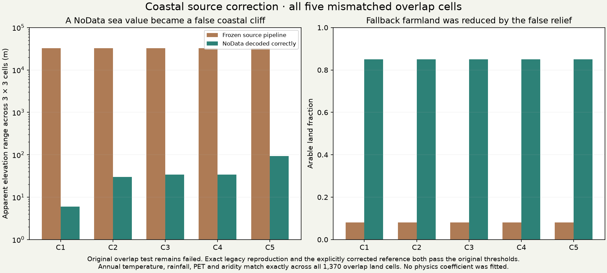
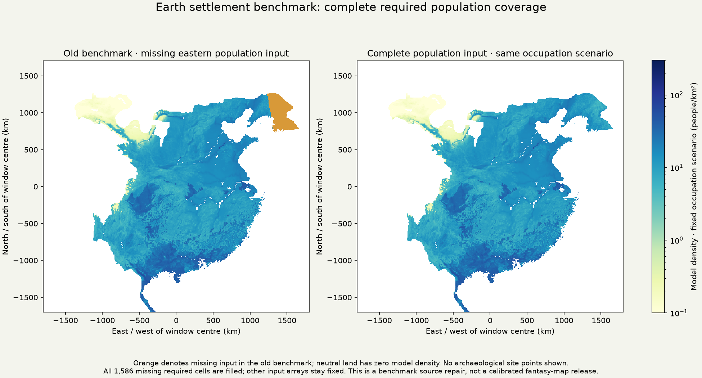

# Complete population inputs and a coastal NoData correction

The Han count benchmark now has population input across all its required land.
This round also fixes an elevation-decoding bug that created false coastal cliffs
in the food-model harness. Both are source repairs; no atmospheric coefficient,
planet setting, population multiplier or fantasy settlement default was fitted.

## What was repaired

The old global population raster stopped at 125°E, leaving 1,586 required Han cells
and thirteen source cells outside coverage. A new 5 arc-minute ecological tile
(32–48°N, 120–134°E) uses the same WorldClim version, ETOPO terrain, river classes,
slope arability, HAND irrigation, crop/pastoral/foraging rules, fallow and fixed
occupation scenario. Official temperature archives were read in RAM; only regional
rasters were cached. The complete original global archive remains unchanged.

The first overlap test **failed**, and remains recorded as failed. Annual temperature,
rainfall, PET and aridity matched exactly on all 1,370 control land cells, but five
arable fallback cells differed. Source inspection established the cause: the old
reader ignored the elevation TIFF's declared NoData value, −32,768. That sea value
produced apparent coastal relief of about 32,800 m. Where fine terrain had no land
subcells, the fallback classified low coastal ground as mountainous.

The decoder now honours declared TIFF NoData while preserving legitimate negative
elevations and zero. Tests include low coastal terrain, the sentinel, and valid
below-sea-level ground. Two separately declared comparisons distinguish provenance
from correction: recreating the legacy fallback reproduces the frozen reference;
the correctly decoded tile matches an explicitly corrected reference. Both pass
the original eight-field tolerances on all original cells. No tolerance was loosened,
and no mismatched cell was dropped from the overlap test.

The sparse global correction changes 1,274 arable/density cells and 17,903 relief
cells on the original global land mask; crop capacity changes at 1,183 cells.
Finite slope evidence stays fixed. Capacity follows its original linear arable
factor, and the settlement density is recomputed with the same food and occupation
rules. The original global archive is not overwritten. Corrected relief also means
that the core-travel field needs rebuilding before point-placement qualification.

## Complete Han input family and count replay

The new Han input fills all 1,586 missing required cells. Within its previously
covered land, 128 density cells change solely through the traceable coastal source
correction; these happen to lie outside the Han allowed-land mask. Every other
saved input array, including regional aridity, is unchanged. Old input files and
the original failed overlap remain byte-exact. The old core-history array is
retained for provenance, explicitly requiring rebuilding; counts do not consume it.

The unchanged count families were replayed on the complete Han input, with the
original Roman window as a paired control. The Roman count input has not yet
received the global coastal patch; do not describe this as a wholesale replacement
of every Earth harness. The full primary responses now retain 1,280 Han and 1,115
Roman records. All positive source-count blocks have positive expected count under
the replayed models. Source roles, multiplicity, block layout, folds, exponents and
training rules remain unchanged.

| Complete-input primary development fit | β = 0.7 | β = 0.5 |
|---|---:|---:|
| Han held-quadrant deviance / record | 2.6863 | 2.6409 |
| Roman held-quadrant deviance / record | 1.9079 | 1.8676 |
| Equal-pool mean | 2.2971 | 2.2542 |

These full-domain values must not be presented as a direct accuracy improvement
over a smaller domain. On the original supported domain, every count comparison
reproduces the previous result exactly: the coastal correction falls outside the
allowed Han mask and the population extension adds nothing to that restricted
comparison. The modest preference for exponent 0.5 persists. Large geographic
errors, source observation-process limits and urban resident-size qualification
remain unresolved; this is development, not independent validation.

## Verification and continuation

Source correction review independently reconstructs 17,903 sparse patch cells,
checks capacity from the original crop equation, verifies 21,920 overlap
field/cell comparisons, all coverage flags, all unrelated input arrays and the
lineage of 128 changed covered density cells. Count review verifies 2,780 blocks,
640 held-fold cases and 8,800 scalar metrics across all 160 comparisons. Both
source-correction and count outputs reproduce byte-for-byte in fresh runs.

The next dependency is the core-travel prior: it still clips at the old eastern
boundary and used the old relief. Rebuild it on explicitly supported geometry with
the same costs before comparing new point placements. Continue count/location
and resident-size work on the same finite population/food ledger, then rebuild the
fantasy settlements and normal atlas. Detailed institutions, all polities,
unaffiliated communities and mobile populations remain on the full roadmap.

The normal `.bat` atlas receives this research evidence; its r44 climate packet and
fantasy population, roads, staffing and control defaults remain unchanged.
