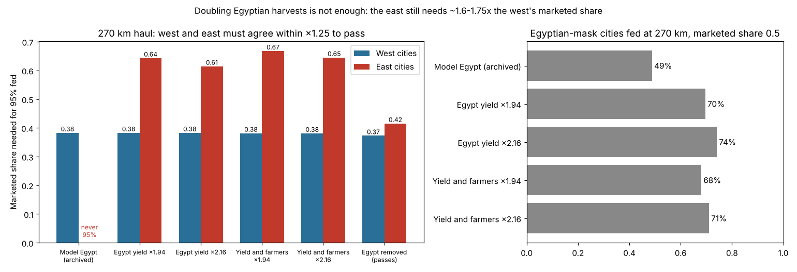

# Would fixing Egypt's harvest or people be enough? No — 14 November 2026

Plan: `calibration/egypt_sufficiency_20261114/plan.json`, committed (45f3d8de) before any output.

**Question.** The whole-empire Roman grain-supply calibration fails and passes only with Egypt removed
(SETTLEMENT_SUPPLY_CALIBRATION_20261113.md). The harvest model gives Egypt about half its historical output.
If Egyptian harvests were raised to the historical level, would the unchanged declared rules pass?

**Answer: no.** Every variant fails. Egyptian yield ×1.94 or ×2.16 (historical/model capacity), with or without
also scaling Egypt's farmers, lets eastern cities reach 95% fed, but only at a marketed share of 0.61–0.67 against
0.38 in the west. That is a factor 1.6–1.75, outside the declared ×1.25, and transfer west→east is 87–89% (<90%).
So harvest is necessary but not sufficient. The post-hoc reading below points to Egypt's farm labour: the
model has too few people there to grow the grain.

| Variant (270 km) | e95 west | e95 east | West→east transfer | Passes |
|---|---:|---:|---:|---|
| Control (= archived whole empire, exact) | 0.38 | never | 0.53 at 540 km | no |
| Yield ×1.94 | 0.38 | 0.64 | 0.88 (at 200 km) | no |
| Yield ×2.16 | 0.38 | 0.61 | 0.89 | no |
| Yield and farmers ×1.94 | 0.38 | 0.67 | 0.87 | no |
| Yield and farmers ×2.16 | 0.38 | 0.65 | 0.88 | no |
| Egypt removed (archived) | 0.37 | 0.42 | 0.92 | yes |

## Why: Egypt has too few farmers in the model (post-hoc, exploratory)

`scripts/egypt_sufficiency_diagnostic.py` (not declared) on yield and farmers ×2.16 at 270 km and share 0.5.
A first reading of the declared Egypt mask suggested surplus stuck in the delta. That was wrong: the mask
(lon ≥ 29° E, lat ≤ 32° N) includes Sinai and the southern Levant, which supplied most of its surplus. For **Egypt
proper** (the mask west of 32.6° E):

| Egypt proper, yield and farmers ×2.16, share 0.5 | Person-years |
|---|---:|
| City residents (Hanson areas × sliding density) | 1.21 M |
| Marketed surplus from Egyptian land | 0.55 M |
| Excess left in cities after own hinterland / deficit | 0.28 M / 1.00 M |
| Residents fed | 0.87 M (71%) |

The committed Roman people field holds only **0.71 M people in Egypt proper**, fewer than its own city residents
and about a seventh of the historical 4.5–5 M. Production is labour-limited (600 field hours per worker), so doubling
yield adds little grain; ×2.16 farmers still gives only 1.5 M people. The declared k was the capacity gap
(×2), but the people field lags history by about ×6.5. Alexandria–Arsinoe freight costs about 30 against the
270 km limit, so Nile transport is not the blocker. The Fayum is barely cropland in the Earth grid (4 of 56 cells
irrigated; pool density 2.6 per km²), part of the same people deficit.

Caveat: the declared mask is kept for comparability with the without-Egypt variant, which removed the same area.

## Checks

The control reproduces the archived whole-empire surface and decision exactly. The reviewer
(`scripts/review_egypt_sufficiency.py`) rebuilds every e95, the west/east ratio, the haul-limit choice and the
transfer from the stored surfaces with separate code (85 checks) and confirms Egyptian surplus rises with k. A fresh
run is byte-identical. Nothing on the fantasy map changes; the adopted share 0.3923 still rests on the
without-Egypt calibration.

## Next

Done: see the follow-up below.

## Follow-up: historical people in Egypt proper — also fails

Plan `calibration/egypt_people_sufficiency_20261114/plan.json`, declared before output. Egypt proper's people field
scaled to 4.5 M or 5.0 M (×6.3–7.1), with yield ×1 or ×2.16. Control reproduces the archive exactly; review passed
(85 checks, people arithmetic), fresh run byte-identical.

| Variant | Egypt proper surplus | Egyptian cities fed (share 0.5, 270 km) | East ever 95% at 270 km |
|---|---:|---:|---|
| Control | 0.23 M | 46% | no (93.9% at share 1.0) |
| 4.5 M people, yield ×1 | 0.00 M | 41% | no |
| 5.0 M people, yield ×1 | 0.00 M | 41% | no |
| 4.5 M people, yield ×2.16 | 0.39 M | 46% | no |
| 5.0 M people, yield ×2.16 | 0.32 M | 45% | no |

With historical numbers of farmers, the farmers eat their own land's potential: the model's land output per km²
(1 t/ha × 0.6 farmed × 0.6 sown) is the binding limit, and doubling the yield barely lifts it above their own need.
Neither more farmers nor higher yield is enough on its own. Together with the first test, this confirms the
water-to-food finding (WATER_TO_FOOD_20261114.md): Egypt needs a floodplain land rule that raises output per km²
(farmed share, annual cropping, yield) AND a people field that follows it. The model's occupation factor keeps
Egypt's people at about 0.3 of capacity, while historical Egypt was close to capacity.

## What this means for the map

The supply calibration with Egypt cannot pass through any single knob. The required fix is upstream and two-part:
a declared floodplain land rule (tested against the North China Plain, Wei and Mesopotamia constraints, see
`calibration/flood_basin_irrigation_20261113/plan.json`) and a check of how people follow capacity on such land.
The adopted marketed share 0.39 remains supported only by the without-Egypt calibration.
