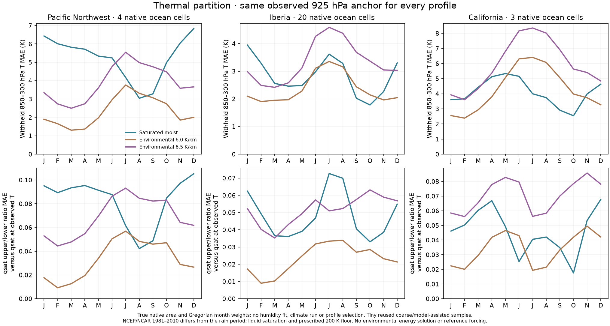

# Environmental temperature reference audit — 27 October 2026

The fixed **6.0 K/km environmental profile passes** the predeclared reference
protections on the three existing native ocean samples. The fixed **6.5 K/km
profile fails five protections**, including the mean temperature-error guard.
All outcomes remain in the review; this audit ranks no profile and authorizes
no climate or atlas adoption.

This diagnostic adds **zero Earth climate integrations**, downloads or fitted
coefficients. It compares externally anchored temperature and saturation
capacity shapes. Actual humidity, rainfall and the environmental energy
balance are separate questions. The saturated moist profile represents a
saturated ascent approximation; using it as environmental temperature is a
hypothesis that this audit tests.

## Frozen inputs and matched calculations

The plan is `calibration/environmental_reference_20261027/plan.json`, the
diagnostic is `scripts/audit_environmental_partition.py`, and the verified
results are in `output/environmental_reference_20261027_verified/`. It reuses
the exact native masks and physical areas from the independently verified
PNW and circulation archives. No new footprint is selected from the outcomes.

| Existing ocean sample | Native footprints | Covered physical area km² |
|---|---:|---:|
| Pacific Northwest | 4 | 191,165.858 |
| Iberia | 20 | 1,218,866.325 |
| California | 3 | 187,970.642 |

NOAA PSL NCEP/NCAR 1981–2010 monthly-normal temperature and humidity use the
same seven nodes: **925, 850, 700, 600, 500, 400 and 300 hPa**. Each predicted
profile receives only its own native footprint/month's observed 925 hPa
temperature. All higher observed temperatures and all humidity are withheld
from profile construction. The three declared profiles are the existing
saturated moist approximation and environmental lapses of 6.0 and 6.5 K/km.

The existing hydrostatic helper integrates temperatures with 64 RK4 steps per
pressure interval. For a prescribed environmental lapse Γ in K/m,
`dT/dln(92500/p) = −(Rd Γ/g) T`. Liquid Bolton saturation is then evaluated at
each candidate temperature and at each observed temperature. Every water and
shape comparison uses the same seven-node trapezoidal pressure quadrature;
the helper's own water integral is discarded.

Withheld thermal MAE is the pressure mean of absolute temperature error over
**850–300 hPa**, excluding the 925 hPa anchor. Saturation shape is the ratio of
the upper **700–300 hPa** pressure-mean specific saturation to its lower
**925–700 hPa** counterpart. Its error is against **saturation at observed
temperature**, not actual observed specific humidity. Ratios and errors are
formed per native footprint/month before averaging. Native physical areas and
Gregorian month lengths supply the regional weights; the final mean gives
each of the three regions equal weight rather than pooling 4/20/3 cells.

All thresholds were frozen before outcomes: mean regional thermal
MAE must improve by at least 5%; no region may worsen thermal MAE by more than
0.5 K; mean regional saturation-shape MAE must not increase; and each regional
shape MAE must stay at or below `1.10 × moist MAE + 0.005`.

## Measured outcomes and every failure

| Region | Moist thermal MAE K | Environmental 6.0 K/km | Environmental 6.5 K/km |
|---|---:|---:|---:|
| Pacific Northwest | 5.23777 | 2.33218 | 3.90154 |
| Iberia | 2.83274 | 2.37149 | 3.33441 |
| California | 4.09596 | 4.30932 | 5.96338 |
| Equal-region mean | 4.05549 | 3.00433 | 4.39978 |

| Region | Moist saturation-shape MAE | Environmental 6.0 K/km | Environmental 6.5 K/km |
|---|---:|---:|---:|
| Pacific Northwest | 0.082612 | 0.033280 | 0.068927 |
| Iberia | 0.048383 | 0.023253 | 0.051481 |
| California | 0.046148 | 0.034292 | 0.070628 |
| Equal-region mean | 0.059048 | 0.030275 | 0.063679 |

The 6.0 K/km profile reduces mean regional thermal MAE by **25.92%** and
saturation-shape MAE by **48.73%**. Its Californian thermal error increases,
but remains within the fixed additive protection. It passes all reference
guards.

The 6.5 K/km profile increases mean thermal MAE by **8.49%** and mean shape
MAE by **7.84%**. The review preserves these five failures:

1. Iberian thermal MAE is **3.334415 K**, above its **3.332741 K** limit.
2. Californian thermal MAE is **5.963377 K**, above **4.595959 K**.
3. Californian observed-temperature saturation-shape MAE is **0.070628**,
   above **0.055763**.
4. Mean thermal MAE is **4.399777 K**, exceeding the required maximum of
   **3.852717 K** for a 5% improvement over moist.
5. Mean observed-temperature saturation-shape MAE increases from **0.059048**
   to **0.063679**.

A single endpoint cannot replace the full withheld profile guard. In Iberia,
for example, 6.5 K/km gives annual 300 hPa temperature **−42.612 °C**, close to
the observed **−42.432 °C**, yet fails the full 850–300 hPa thermal protection.
In the PNW, the annual 300 hPa temperatures are observed **−44.432 °C**, moist
**−56.150 °C**, environmental 6.0 **−43.075 °C**, and environmental 6.5
**−46.836 °C**. All nine region/profile combinations retain their full native,
monthly, annual, DJF and JJA arrays. No predicted node reaches the prescribed
200 K floor in this audit.

## Actual humidity remains a separate constraint

| Region | Actual 925–300 hPa water mm | Actual upper/lower q ratio | Saturation q ratio at observed T |
|---|---:|---:|---:|
| Pacific Northwest | 11.989 | 0.29139 | 0.33940 |
| Iberia | 12.577 | 0.24263 | 0.33094 |
| California | 11.131 | 0.29976 | 0.35093 |

The distinct actual-q and observed-temperature saturation ratios demonstrate
that thermal capacity shape alone cannot prescribe humidity. No RH multiplier,
universal upper/lower humidity ratio or humidity reset is fitted or imposed.
The separate coupled environmental-partition pilot must retain its unchanged
rain, ocean, circulation, humidity and numerical protections. Reference
qualification is additional evidence, not rainfall attribution or a coupled
climate result.

## Verification, preserved failed attempt and limits

The completed reference review has identity
`6fe6c7d7d2847925e8a33ab03363046b1f8e466dbec436685ad5ce55821b7d86`.
All **61 frozen source hashes** match their current files. The immutable result
files have these SHA256 receipts:

| Artifact | SHA256 |
|---|---|
| `review.json` | `36441ad0c6651f6fe95a410f456e1694cc3481c73014da58578077802632c14c` |
| `protocol.json` | `c81c755c8d337aad6b4bde43bcc38d5039046a0900e262679c9405ef4e7935a1` |
| `native_profiles.npz` | `9a17e32b7766b838b1a0a6ccc178f706826c73c5e50b8ba6f39a3223631b32b0` |
| `environmental_profiles.png` | `5262bc86a183d8d6abcc586351f764ad6e9f14cdec21b7ac2413cd3a7c7f3188` |

The original `output/environmental_reference_20261027/failure.json` remains
preserved. That attempt failed during **archive verification**, before a
protocol identity or derived outcomes, with
`Independent archive raw reference differs: data/v10_atmosphere/uwnd.das`.
The compatibility correction recognizes that older protocols bind payloads
in `references` while newer protocols may additionally list them in `sources`;
it continues to require exact raw-reference manifest equality. The corrected
attempt uses the distinct `_verified` output directory. Both attempts record
**zero climate integrations**; the failed attempt is not a scientific profile
outcome or an additional Earth run.

These are tiny, reused coarse ocean samples without new held-out locations,
land validation or global skill. Reanalysis is model-assisted, and its
1981–2010 normals differ from WorldClim's 1970–2000 rainfall period. Monthly
means omit submonthly thermal, humidity and transport covariance. The external
925 hPa anchor excludes the marine layer below it, while the partial window
omits water above 300 hPa. Existing terrain masks cannot establish native
below-ground flags.

Liquid saturation at cold temperatures, ideal-gas hydrostatic mapping, fixed
`g`, `Rd`, `cp` and latent heat, and the 200 K floor remain approximations.
No ice, entrainment, clouds, condensate fallout, prognostic environmental
latent-energy feedback or pressure-resolved momentum is solved. An
environmental lapse and a saturated plume lapse describe different thermal
assumptions. Neither is an independently solved atmospheric energy profile.
Partial reference ratios must not be equated with the full broad model-layer
ratios. The complete review and one figure are nested inside the
environmental-partition companion study; no normal atlas climate is replaced
by this reference audit.
