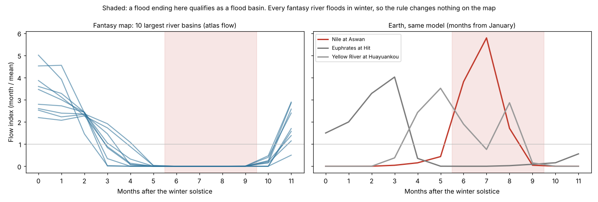

# Floodplain rule ported to the fantasy map: no river qualifies — 14 November 2026

Plan: `calibration/fantasy_floodplain_20261114/plan.json`, committed before output. Owner: "Fix the people side first,
then port to the fantasy map." The Earth rule (FLOODPLAIN_RULE_20261114) is ported unchanged as `harvest/floodplain.py`;
`harvest/export.py` is untouched.

**Result: the rule changes nothing on the fantasy map.** All 26 river basins of the atlas's own network flood in winter.
Their flow is above average from the solstice month to at most four months after it (the corrected and raw
climates agree), and 350–560 mm of rain falls on the plains during the flood. A basin flood must end 6–9 months
after the solstice and come with under 100 mm of rain. No fantasy river is fed by a distant summer rain belt the
way the Nile is: every one is a local winter-rain river, like the Tigris and Euphrates on Earth. Crop capacity,
settlement base, placement, sizes, supply and reach are therefore unchanged, and no atlas file is rewritten.

**Controls.** Rerunning `derive()` reproduces the published settlement base to within its storage rounding (≤0.002).
The recomputed settlement step reproduces it to within float32 rounding (≤3e-5). The independent review
(`scripts/review_fantasy_floodplain.py`) rebuilds the flood timing from the stored flow with separate code and
confirms that no cell qualifies and the totals are unchanged.

**What the Earth work still gives the map.** The map's calibration constants now rest on a chain that includes Egypt
in development:
- The adopted marketed share 0.39 sits inside every near-pass (0.36–0.43; 0.388 with Egypt at the Frier level).
- The cited 270 km haul limit holds.
The whole-empire test still misses, by 1.6 points of transfer (88.4% against 90%).

## Why every fantasy river floods in winter (owner question)

`scripts/fantasy_river_seasons.py` → `output/fantasy_floodplain_20261114/river_seasons.json` (corrected climate):

- **Not a detection artefact.** The 15 largest rivers, routed physically down the full-resolution simulated drainage
  (rotclimate.routing over the eroded terrain, catchments up to 5% of all land), all flood in months 11–4 after the
  solstice and carry 0–3% of their flow in months 5–8. The network proxy around the drawn rivers says the same.
- **Not missing summer rain.** About 20% of the land has its rain maximum 7–10 months after the solstice. There it
  averages 1,038 mm a year, 430 mm of it in months 5–9.
- **Summer rain never outruns summer evaporation.** Over months 5–9 that land has about 771 mm of potential
  evaporation against 430 mm of rain. The soil absorbs the rain and only about 10 mm runs off. Only 2,925 cells
  (about 1% of land) get more summer rain than evaporation; the wettest summer anywhere is 919 mm. Over the year,
  74% of all runoff falls in months 11–3 and under 1% in months 5–8.
- **The same model does make a Nile flood on Earth** (FLOOD_TIMING, peak August). There it is fed by monsoon highlands
  where summer rain far exceeds evaporation over a large area.

So the map has summer rain but no large, wet, cool summer-rain highland of the Ethiopian kind feeding a river through
a desert. In the model's terms it is a winter-rain (Mediterranean-type) continent. That comes from the climate the
atlas simulates, not from how floods are detected.
