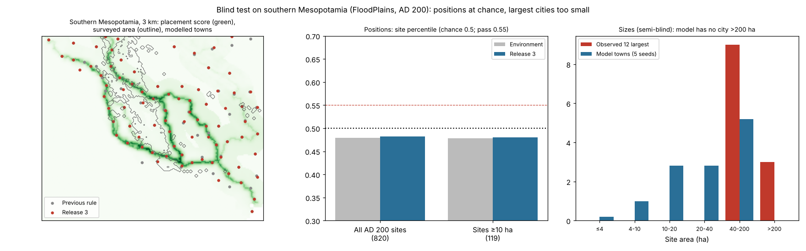

# Blind test on southern Mesopotamia (FloodPlains, AD 200): both tests fail — 15 November 2026

> Later audit, 16 November: the original top-12 comparison mixes counts/coverage
> with size shape; class 6 is right censored, without an observed 1,783 ha ceiling.
> Supplying all 119 source town locations permits the unchanged rule to generate
> 200+ ha towns. The complete size mismatch remains, and stronger fixed-request
> concentration worsens it. See [the audited diagnosis](URBAN_DIAGNOSIS_20261116.md),
> [the supplied-site control](URBAN_GIVEN_SITES_20261116.md), and
> [the concentration screen](URBAN_CONCENTRATION_20261116.md).
> Original results/interpretations below remain historical; they do not establish
> a hard size cap or isolate a missing urban-concentration mechanism.

Plan: `calibration/floodplains_blind_20261115/plan.json`, committed (ae9e2e36) after reading only the table's header and row
count. Source: the FloodPlains Web GIS survey sites published with Marchetti et al., *J. Archaeol. Res.* 33 (2025) 117–158
(CC-BY), file `docs/papers/1/data_stacked.csv` of the `bnza/archiraq` repository (owner-supplied; kept in the ignored cache).
Southern Mesopotamian site positions and areas had never been used by the model. The pool is now spent.

## Results

| Test | Measure | Result | Pass rule | Verdict |
|---|---|---|---|---|
| P: positions (3 km) | Placement-score percentile of sites ≥10 ha (119 sites) | release 3: 0.48 (environment 0.48) | ≥ 0.55 | **fail** |
| | Share within 10 km of a modelled town, sites ≥10 ha | release 3: 0.19, previous rule: 0.14 | ≥ previous − 0.05 | ok |
| | All 820 AD 200 sites | percentile 0.48; capture 0.14 / 0.14 | (reported) | chance |
| S: sizes (9 km, semi-blind) | 12 largest surveyed sites against 12 modelled towns | 9 in 40–200 ha and 3 above 200 ha observed; the model puts most towns in 40–200 ha and none above 200 ha | same band ≥ 0.5 and total in [0.67 × 964, 1.5 × 7,149] ha | **fail** (same band 0.18, model total about 490 ha) |

The previous (release-2) size model fails the same way. On the 9 km grid, positions are also at chance.

## What it says

- **Positions:** in the irrigated floodplain the environment score does not find the sites, and neither does the
  heartland weighting. The map shows a likely reason: the score follows the modern Tigris and Euphrates (Natural Earth),
  while the sites follow ancient channel networks; the rivers have shifted greatly since antiquity. The model has no
  canals and no palaeochannels. On the fantasy map the drawn rivers are the rivers of the period, so the error is less
  likely there, but the test cannot show that.
- **Sizes:** the size model, calibrated on Roman towns where size barely depends on local people, does not produce the
  very large cities of a dense irrigated plain (Seleucia and Ctesiphon class). Its ceiling is reachable only by scatter.
- **Development checks are not contradicted** (Han/Rome quadrants, Roman province folds, Vidarbha), but this is the
  first out-of-sample evidence on positions and sizes, and it is negative for a floodplain region.

## Protocol record

- **A1, before any score.** The source's Latitude/Longitude columns are swapped (ranges only).
- **A2, after the first scoring.** `SizeHa` is a size-class code 1–6, not hectares (the authors' R script maps it to
  bands). The first run's towns cohort and size test were void, and its all-sites position result stands. The first run
  is kept in `results_first_run.json`. The rescored size comparison is semi-blind, because the top codes of the largest
  sites had been seen.
- **Checks.** The independent review rebuilds the cohort from the raw table and recomputes the percentiles and captures
  with separate code (12 checks). A fresh run is byte-identical.
