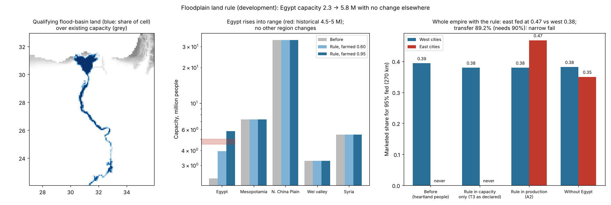

# Floodplain land rule: Egypt fixed in capacity, whole-empire supply narrowly fails — 14 November 2026

Plan: `calibration/floodplain_rule_20261114/plan.json`, committed (b5dd9b73) before any output, with two
amendments made after results (A1, A2), both disclosed below. Owner instruction: "Go ahead with the floodplain rule."
**This is development, not validation:** the farmed share comes from Egypt's own 1911 land use, Egypt's population
was known, and the thresholds were set after the groundwork diagnostics.

## The rule

On land at most 5 m above and within 30 km of a navigable river (1′ cells), when the river's flood (in the atlas's
own monthly flow) ends in July–October and less than 100 mm of rain falls on the cell during the flood months, the
land is a flood basin. It gets full water, is sown every year, grows one cool-season cereal (the better of wheat
and barley, amendment A1), and 95% of its arable share is farmed. A cell's capacity is blended by its basin share.
Implemented as an off-by-default wrapper (`scripts/floodplain_earth.py`); committed Earth inputs are unchanged
and the grid is bit-identical wherever the rule does not apply.

## Results

| Test | Result |
|---|---|
| T1: no other census region rises more than 5% | **Pass**: every other region changes by 0.00% (North China Plain, Wei, Sichuan, Hunan, Italy, Gaul, Iberia, Asia Minor, Syria, Mesopotamia) |
| T2: Egypt capacity in 3.6–6.25 M | **Pass after A1**: 2.32 → 5.83 M (3.94 M with farmed share 0.60). Original wording: **fail**, 10.12 M |
| T3: whole-empire supply calibration | **Narrow fail after A2**: 270 km kept (west/east ×1.23, limit ×1.25), but west settings feed 89.2% of the east (needs 90%); 95% of all residents fed at share 0.43 |
| T3 without Egypt | Pass, e95 0.365 (adopted 0.392) |

Qualifying basin land: 51,800 km², of which 22,500 km² is in Egypt and about 17,700 km² on the Sudanese Nile (west of 40° E),
plus about 8,900 km² on the Yellow River's Hetao loop and 2,600 km² in the Yarlung Tsangpo valley (east of 60° E).
None of those three lies in a census region, so they are untested side effects. Hetao was irrigated under the Han;
its commanderies cannot be checked because the Han shapefile is not in the cache. Mesopotamia, the North China Plain
and the Wei are excluded by flood timing or flood-season rain, as intended. The Fayum is not included (it lies beyond
30 km of the mapped Nile).

## Amendments (post-hoc, disclosed)

- **A1, after T2 failed by overshoot.** "First crop" picked the highest-energy crop at full water: dates on 46% of
  basin cells, rice on 30%, barley on 17%. Basin land is sown on the receding flood in the cool season, so the
  basin crop was fixed to wheat or barley. The original failure stays in `results.json`.
- **A2, after T3 ran.** The supply model computes production from per-crop energy with its own farmed 0.6 and sown
  0.6, which the rule did not touch, so T3 as declared tested only the people pattern. A2 applies the same basin
  rule in production. Field hours per hectare are unchanged, so basin grain needs fewer hours per kcal.

## What remains

With the rule, eastern cities reach 95% fed at a marketed share of 0.47, against 0.38 in the west. The rescaled
heartland people pattern puts 6.65 M people in Egypt proper (historical 4.5–5 M), so Egyptian farmers eat more of
their own grain than they did historically. Transfer misses the declared 90% by 0.8 points. Nothing on the fantasy
map changes yet. The adopted share 0.39 stays supported (0.365 without Egypt here).

## Checks

The off-basin grid equals the baseline exactly, and the basin capacity equation matches to 6e-8. The reviewer
(`scripts/review_floodplain_rule.py`) rebuilds qualification from the stored flow, catchments and rain with separate
run-finding code. It re-sums every region with a separate ray-casting polygon test (three cells lying exactly on
polygon edges are tolerated, none of them basin land) and rebuilds every supply e95 and the 270 km decision
(82 checks). A full fresh rebuild of the grid, fields and supply runs reproduces all five output files byte for byte.
