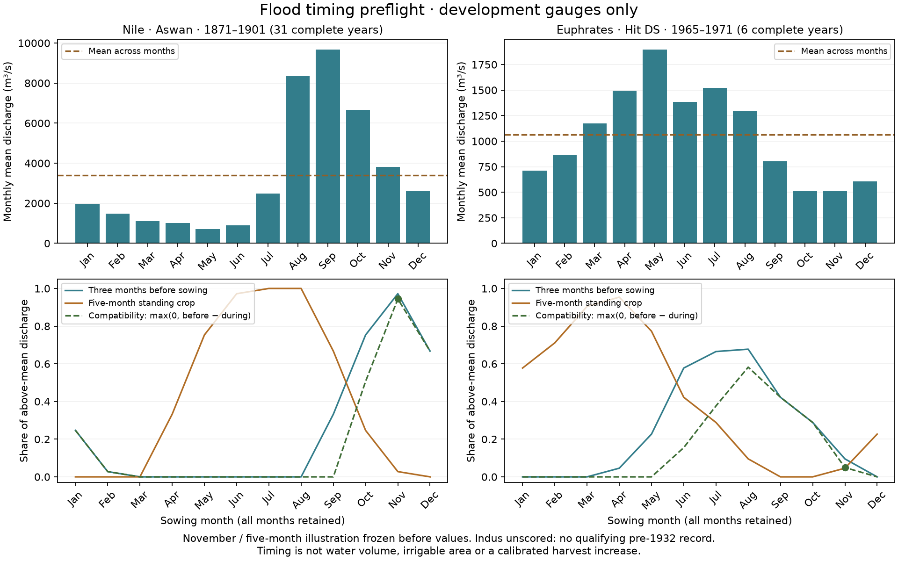

# Flood-basin irrigation: qualified timing inputs

The terrain-only candidate cannot distinguish Egypt's missing irrigation from
already overproductive Lower Mesopotamia. Monthly gauge observations provide a
promising second factor: the Nile peaks before winter sowing; the Euphrates
peaks in May. This completes the **source and timing preflight**, not an
irrigation-area fit or a harvest calibration.

[Open the evidence page](../atlases/earth_evidence/flood_basin/index.html).
The release-3 settlement atlas and owner-adopted marketed share 0.3923 remain
current. All 904 existing Earth atlas files are byte-identical to the start of
this experiment. Whole-empire supply calibration still fails because of Egypt.

## Declaration and qualified observations

Declaration commit `2aaa35f9` preceded numerical gauge inspection and phase
outputs. [Protocol](../calibration/flood_basin_seasonality_20261113/plan.json).
Both gauges are development observations, not independent validation.

| Gauge | Declared primary interval | Complete years retained | Peak month | Fixed November / five-month compatibility |
|---|---|---|---|---:|
| Nile, Aswan | 1869–1901 | 1871–1901 (31) | September | 0.944295 |
| Euphrates, Hit DS | 1932–1972 | 1965–1967, 1969–1971 (6) | May | 0.049426 |
| Indus, Kotri | 1900–1931 | Unscored: author record starts 1936 | Unscored | Unscored |

Every retained year has exactly twelve unique, finite, nonnegative monthly
means. Incomplete years are dropped without filling; every excluded year,
including years with no data, is listed in results. Means weight complete years
equally. These are m³/s means, not month-length-weighted water volumes.

Aswan precedes its first dam in 1902. Hit precedes major Tabqa/Keban impoundment;
earlier local water management is not assumed absent. Six complete years clear
the declared five-year minimum for timing only, not flood reliability. No modern
gauge is presented as a reconstruction of ancient discharge.

The Dai downstream Indus entry is Kotri, 1936–2000. Its metadata cannot support
the declared pre-Sukkur interval. Its flow values were not scored or inspected;
post-regulation data were not substituted. The extended historical variable's
station mapping was not certified for this station and was not guessed. An
independent irrigation test remains open.

## Cyclic diagnostic

For each sowing month, compute positive discharge excess above the twelve-month
mean. Divide the excess in the preceding three months by total annual excess;
separately report the share during the crop. Compatibility is
`max(0, pre_sowing_share - standing_crop_share)`. Dry and constant flow have zero
seasonal opportunity. The windows wrap correctly across January.

Every sowing month and crop duration 3–9 months is retained. The same November,
five-month illustration was fixed for both rivers before values were inspected.
It is not a fitted local crop calendar. Maximizing the diagnostic could select
very different sowing months, so a future rule must independently establish
which crop seasons are physically and historically admissible.



The Nile illustration puts 97.2% of above-mean flow before sowing and 2.8% during
the crop; Hit gives 9.5% and 4.6%. These dimensionless shares do **not** imply
94.4% or 4.9% irrigated land. Actual stored water, drainage and crop water demand
have not been calculated here.

## Provenance and checks

PANGAEA's text endpoints were unavailable; the publisher's HTML representation
of the identical DOI worked. Input SHA-256 digests pin that representation.
PANGAEA source observations and derived CSVs retain CC-BY-3.0 attribution to
Vörösmarty, Fekete and Tucker (2004) and RivDIS (1998). Dai's updated station
metadata and README use the Zenodo record and its CC-BY-4.0 license.

- Fifteen controls passed before phase outputs: cyclic wrap, scaling, rotation,
  flat/dry flow, extreme finite inputs, invalid windows and year quality.
- Independent regex raw-source parsing, Decimal means and scalar arithmetic
  checked all 1,469 source rows, 168 season combinations and 504 phase values.
- Five fresh output files reproduce byte for byte. Numeric CSVs and NPZ agree.
- Indus stays explicitly unscored; no irrigation or harvest scores are computed.
- Publication checks cover six viewport/theme combinations, keyboard focus,
  real downloads and their byte hashes, hub navigation and return links. A fresh
  Windows-style checkout verifies the release and 2,217 existing data assets.

[Source URLs, citations and hashes](../output/flood_basin_seasonality_20261113/sources.json) ·
[Review and fresh replay](../output/flood_basin_seasonality_20261113/review.json) ·
[Monthly observations](../output/flood_basin_seasonality_20261113/gauge_monthly.csv) ·
[All season combinations](../output/flood_basin_seasonality_20261113/phase.csv) ·
[Fields](../output/flood_basin_seasonality_20261113/fields.npz) ·
[Results and every excluded year](../output/flood_basin_seasonality_20261113/results.json).

## Reproduce

```sh
.venv/bin/python scripts/fetch_flood_gauges.py
.venv/bin/python scripts/flood_basin_seasonality.py
.venv/bin/python scripts/review_flood_basin_seasonality.py
.venv/bin/python scripts/publish_flood_basin_seasonality.py
.venv/bin/python scripts/build_fit_hub.py
```

Publisher page bytes may change; the fetcher refuses changed digests pending a
new source audit. The committed monthly CSV preserves the inspected observations.
Raw downloads remain in ignored `data/cache/flood_basin_seasonality_20261113/`.

## Next map dependency

Update 14 November: the [fixed-calendar storage experiment](FLOOD_BASIN_STORAGE_20261114.md)
now tests retained floodwater against crop demand and matched rain-only controls.
All 96 development scenarios are published; storage/access and independent
validation remain unqualified, so no harvest parameter or atlas default changes.

The [conserved routing primitive](../docs/FLOOD_WATER_BUDGET.md) now subtracts
upstream withdrawals and accounts for delivery losses. Its synthetic mass-balance
tests do not supply a field irrigation rule. Declare the Earth-and-fantasy-compatible
water-budget and delivery adapter, including
upstream routing, flood timing/travel, crop calendars and drainage constraints.
Fully watered seasons can tie in the current crop optimizer; choosing the best
flood window after inspecting yields would add hidden selection. Find defensible
independent test regions before scoring irrigated area or population capacity.

Earth climate/topography inputs have since been restored and independently
checked in a separate baseline; see
[restoration audit](EARTH_HARVEST_RESTORATION_20261113.md). The rebuilt Roman
field retains the previously recorded +0.354% drift, and default reference
summaries remain unchanged. Require Nile gain and
Mesopotamian non-inflation together, then rerun the whole-empire calibration.
Timing by itself is not authorization for a default production increase.
