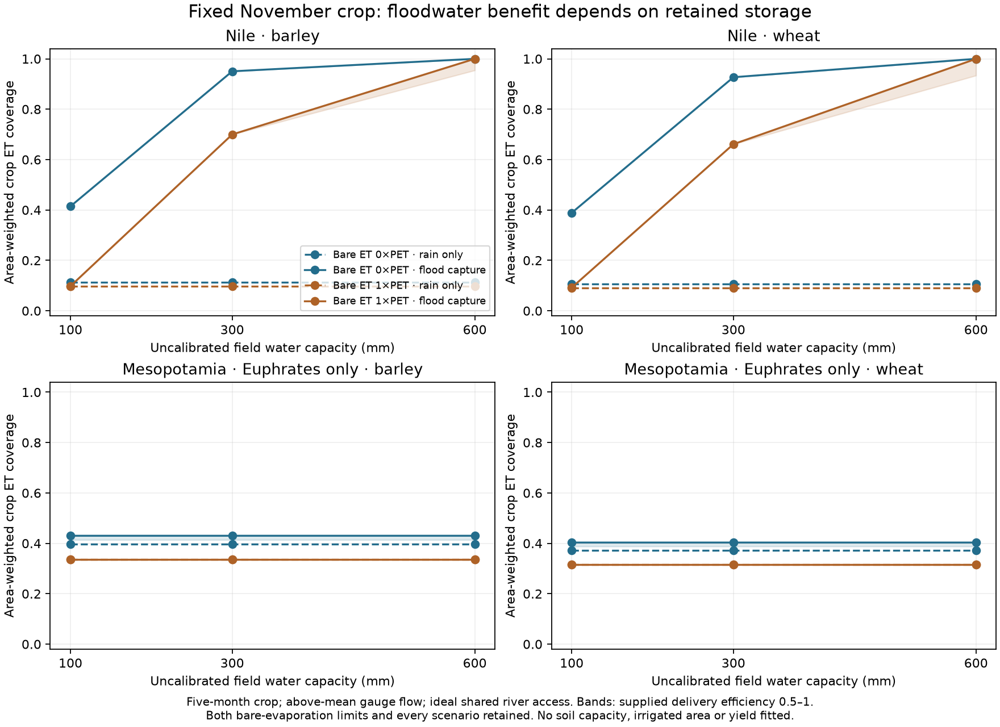
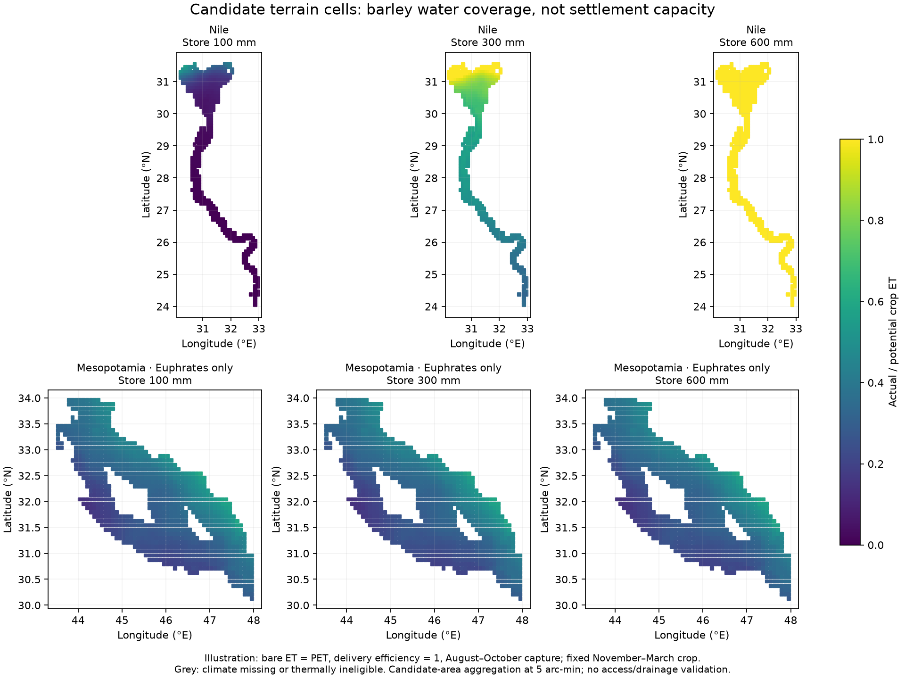

# Flood storage and winter crop water on Earth

Finite field storage is now connected to the conserved river ledger. The first
Earth field maps show why flood timing alone cannot establish irrigated harvest:
the water must remain available until the winter crop needs it.

[Open the maps, all 96 scenarios and downloads](../atlases/earth_evidence/flood_storage/index.html).
This completes a development feasibility experiment. No field capacity or
irrigated area has been calibrated, and the settlement atlas is unchanged.

## Declared experiment

Commit `29b39784` declared the rule before field-climate extraction, storage runs
or water-coverage results. Gauge timing and terrain areas were already exposed
development inputs. [Protocol](../calibration/flood_basin_storage_20261114/plan.json).

The existing terrain mask is retained: ETOPO land within 30 km of a navigable
Natural Earth river, no more than 5 m above its nearest river pixel. Negative
height differences are retained exactly as in the earlier groundwork. This
does not prove access across levees, drainage or historical canal connections.

| Region | Original arc-minute candidates | Five-minute climate fields | Actual latitude-weighted candidate area |
|---|---:|---:|---:|
| Nile valley and delta | 8,179 | 489 | 24,497 km² |
| Lower Mesopotamia, Euphrates water only | 21,925 | 1,018 | 63,986 km² |

The original constant-area method reproduces 24,553.920 and 64,003.538 km²
exactly. The small area difference above comes from using each row's latitude
for physical volumes. Terrain cells sharing an identical five-minute climate
and river node are aggregated by area; no source candidate is discarded. All
candidate fields pass the declared climate and fixed-calendar thermal checks.

Both barley and wheat use November–March, with the existing temperature,
heat, crop-coefficient and monthly PET rules. Ineligible cells would be unscored;
no alternative planting window is selected. All candidate terrain is treated as
test field area. Farmed/fallow shares are not used to infer cultivated hectares.

There are 96 combinations: two regions, two crops, three storage capacities
(100/300/600 mm), two bare-evaporation cases (0/PET), two supplied delivery
efficiencies (0.5/1), and two matched water-access cases (rain only / capture in
the three months preceding sowing). Every member is retained with equal status.

## Water accounting

The qualified development gauge means supply positive excess above their annual
monthly means, converted from m³/s to monthly volumes with 365/12 days. Annual
source excess is 39.193 km³ for Aswan and 6.239 km³ for Hit. These volumes are
availability scenarios, not measured divertible flows or timing fractions.

Each basin has one ideal shared river node. Monthly effective rain (0.8 P)
enters field storage, with excess spilling above its finite capacity. During
August–October, remaining capacity becomes a useful delivery request. Requests
are aggregated once; gross withdrawals and delivery losses are paid from the
river source, and actual useful delivery is split proportionally between
fields. Crop ET, or bare evaporation outside the crop, then uses stored water.
Only the remaining stock carries into the next month. There is no free refill.

The excluded 0.2 P, rain spill, crop ET, bare evaporation, delivery loss, river
outlet and storage change remain separate. The source and field ledgers close
monthly. Every run starts empty and reaches a repeating annual state after two
years; January's inherited stock is paid by the preceding simulated year.

## Result: retained storage is a controlling assumption

The following slice uses barley, bare evaporation equal to reference PET and
delivery efficiency 1. It illustrates the declared capacities without selecting
one for adoption. The other 84 rows remain in the evidence table and downloads.

| Region | Store mm | Rain-only mean crop ET coverage | With pre-sowing capture | Candidate area reaching ≥95% crop ET |
|---|---:|---:|---:|---:|
| Nile | 100 | 9.7% | 9.8% | 0 km² |
| Nile | 300 | 9.7% | 70.0% | 3,576 km² |
| Nile | 600 | 9.7% | 100% | 24,497 km² |
| Euphrates-only Mesopotamia | 100 | 33.7% | 33.7% | 0 km² |
| Euphrates-only Mesopotamia | 300 | 33.7% | 33.7% | 0 km² |
| Euphrates-only Mesopotamia | 600 | 33.7% | 33.7% | 0 km² |

Reducing Nile delivery efficiency to 0.5 lowers the 600 mm case to 95.4% mean
crop ET coverage. With zero bare evaporation, the 300 mm Nile barley case
reaches 95.0% mean coverage. Thus bare evaporation and paid delivery losses
matter alongside water capacity. None is fitted here.





Crop ET coverage is actual divided by potential crop evapotranspiration. It is
not the production crop model's yield response. The ≥95% area is a declared
water-adequacy diagnostic, not validated irrigated area, grain output or people.
In particular, a 600 mm abstract store does not establish that historical crop
root zones held that much plant-available water. Groundwater and capillary
recharge require explicit evidence and a separate physical representation.

## Independent review and publication

Fifty-two controls pass, including fifteen new storage controls. They cover
storage across months, shared-source rationing, paid losses, rain spill,
bare evaporation, zero-flow/no-free-water behavior, paid periodic spin-up,
explicit nonconvergence, rotation and invalid inputs.

The independent review reconstructs terrain aggregation in a dictionary, checks
the raw WorldClim samples, thermal eligibility and PET, and runs a separate
scalar field-by-field simulation from zero stock. It verifies all 96 rows,
72,336 field-years, 868,032 monthly field balances and every field CSV row,
including node-to-field delivery and river outlet/loss balances. Three fresh
numeric files reproduce byte for byte. All 904 existing Earth-fit files remain
unchanged; no default settlement or supply parameter is modified.

[Review and replay](../output/flood_basin_storage_20261114/review.json) ·
[All results and source/code hashes](../output/flood_basin_storage_20261114/results.json) ·
[Monthly fields](../output/flood_basin_storage_20261114/fields.npz) ·
[All annual field rows, gzip CSV](../output/flood_basin_storage_20261114/fields.csv.gz).

The browser checks compare every displayed numeric row with the results, test
all nine region/crop filter combinations at three widths in both themes, check
keyboard access and navigation, and verify actual downloaded bytes.
A fresh Windows-style checkout also verifies the release and all new evidence
downloads; both field NPZ copies are tracked despite the general ignore rule.

## Reproduce

```sh
# If the public climate/topography caches were reset:
.venv/bin/python scripts/restore_earth_harvest_inputs.py
# The qualified gauge phase results are committed inputs to this experiment.
.venv/bin/python scripts/flood_basin_storage.py
.venv/bin/python scripts/review_flood_basin_storage.py
.venv/bin/python scripts/publish_flood_basin_storage.py
.venv/bin/python scripts/build_fit_hub.py
python scripts/check_flood_storage_browser.py
```

The direct publisher preserves earlier evidence panels. Its normal evidence
publisher hook runs after the gauge-timing panel. Both figures can be downloaded
at full resolution; the webpage retains all 96 scenarios with filters.

## What remains before a new settlement map

Both regions are development observations. Modern WorldClim climate and the
earlier gauge records are noncontemporaneous. Shared access is optimistic and
does not implement a canal network or channel travel time. The mask does not
resolve flood access, inundation damage, drainage, salinity or return flows.

The Mesopotamian row supplies only the Euphrates; the Tigris is absent. It cannot
establish a complete regional water budget or prove non-inflation of the
already overproductive harvest model. Indus remains explicitly unscored.

Next qualify plausible storage and bare-soil/groundwater behavior, add the
missing regional flow/access evidence, and establish a shared Earth/fantasy
river-flow adapter. Freeze that field rule and independent test regions before
new area/capacity scores. Do not adopt 600 mm because it yields full water
coverage. Require Nile gain and Mesopotamian non-inflation, then rerun the
unchanged whole-empire supply calibration. Its Egypt failure remains open.

The current release-3 settlements and owner-adopted marketed share 0.3923 remain
published: 850 self-fed towns, 174 with imports, 29 short, 91% of residents fed.
